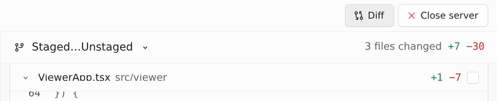

# ✅ Phase 1: Restore the Diff button on every host

The [cover](README.md) explains why desktop Productdoc pages have no way to close the source panel.

**Today**

On a desktop window outside `diffmap.dev`, a reader who clicks a reference such as [[6efed1a:src/viewer/ViewerApp.tsx#L72-L75]] gets the source panel and no way to close it.

**Proposed**

The toolbar shows **Diff** whenever the page has source changes, on every host, as it did before `8f393f0`. Pressing it closes an open panel and opens a closed one, and its pressed state follows the panel even when the panel's chevron closes it.

The change reverts `8f393f0` whole. Every line that commit added existed only to hide the button: the host check in `ViewerApp`, the `showDiffButton` prop, and the homepage demo's opt-in through `ScrollDemo` and `Landing`.

```diff [ViewerApp.tsx after the revert]
   const local = props.mode === "local";
-  const showDiffButton =
-    props.showDiffButton ??
-    (window.location.hostname === "diffmap.dev" ||
-      window.location.hostname === "www.diffmap.dev");
   // ...
-                {showDiffButton && hasSourceDiffs && (
+                {hasSourceDiffs && (
                   <DiffButton
                     pressed={showDiffPanel}
                     onClick={() => setShowDiffPanel((open) => !open)}
```

With the revert, a Productdoc host at 1280px shows a pressed **Diff** button above the open panel:



**Checks run:** browser recordings at 1280×720 and 600×900 on a local Productdoc host and on `https://diffmap.dev` (served locally). Each one opened the panel from a reference, then closed it with **Diff**, reopened it with **Diff**, and closed it with **Diff** on desktop or the chevron on narrow windows. After every step the panel's presence matched **Diff**'s `aria-pressed`. `npx tsc --noEmit` and `npm test` (97 tests) pass.

Reopening the panel on desktop briefly squeezed the table of contents; [Phase 2](02-toc-reopen-squeeze.md) fixes that.

```changes
e222772
src/viewer/ViewerApp.tsx
src/landing/ScrollDemo.tsx
src/landing/Landing.tsx
```
