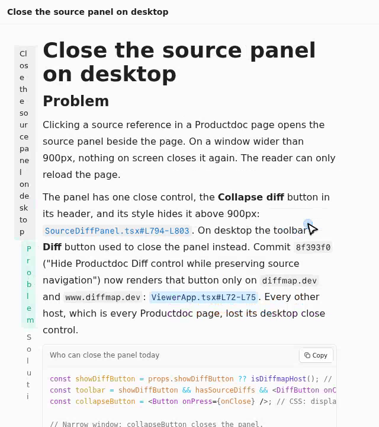
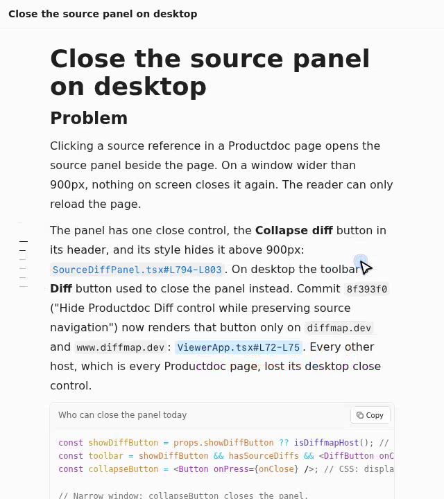

# ✅ Phase 2: Keep the table of contents steady when the panel reopens

[Phase 1](01-restore-diff-button.md) brought back the **Diff** button, which reopens the source panel on desktop.

**Today**

When the panel opens, the page's left gutter shrinks from about 250px to 48px. For one frame the table of contents still renders its docked list, the full list of headings, in the 48px gutter, so every heading wraps a letter or two per line. On the next frame it switches to the compact rail of lines.

**Proposed**

The table of contents switches to the rail in the same frame the gutter shrinks, so the squeezed list never paints.

The table of contents picks its mode from the gutter width in [[48ce9dd:src/viewer/TableOfContents.tsx#L388-L408]]. A `ResizeObserver` callback runs after layout and before paint, but React applied the `setDocked` it called in a later frame. Wrapping the callback in `flushSync` commits the new mode before that paint:

```diff [useDocked]
-    const observer = new ResizeObserver(measure);
+    const observer = new ResizeObserver(() => flushSync(measure));
```

This is the first frame after **Diff** reopens the panel, before and after the fix. Look at the left edge:

:::gallery side-by-side


:::

**Checks run:** a second `ResizeObserver` that runs after the component's, just before paint, read the gutter when **Diff** reopened the panel. Without the fix it found a 48px gutter still docked with a 48px list; with the fix it found the rail. In 60fps desktop recordings on Productdoc and `diffmap.dev`, the unfixed build has one squeezed frame at each reopen, and the fixed build has none. `npm test` passes, and React logs no warnings.

```changes
48ce9dd
src/viewer/TableOfContents.tsx
```
