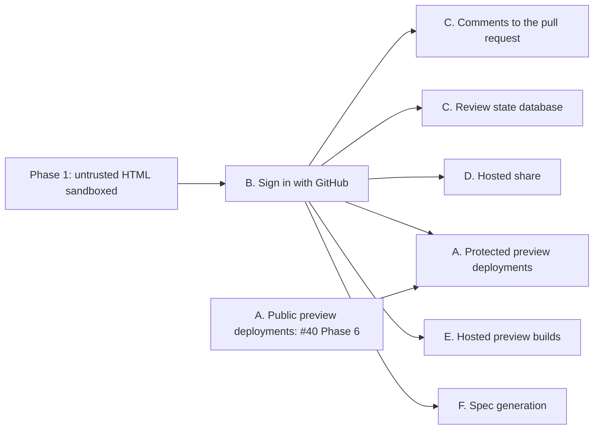

# What cloud could mean

The [cover](README.md) lists six meanings of "diffmap cloud". This page says what each gives the reader and what it needs. It is not a phase: the phases after it build the recommended first version.

Costs are rough orders of magnitude at small scale, a few hundred readers a month.

## A. Live previews and flows on diffmap.dev

**What the reader gets.** On a pull request's spec at diffmap.dev, the preview and flow blocks from [pull request #40](https://github.com/tanishqkancharla/diffmap/pull/40) show the app's real UI instead of an empty frame.

**What it needs.** Phase 6 of #40 already plans this: `previews.preview` in `.diffmap/config.json` is a URL template such as `https://myapp-git-{branch}.vercel.app/__diffmap`, and the hosted viewer fills it from the pull request. The app's own CI builds the preview page, as it already does for its preview deployments, so diffmap runs nothing.

- **Infrastructure:** none for diffmap.
- **Sign-in and storage:** none while the preview deployment is public.
- **Security:** the preview page must allow diffmap.dev to frame it (`Content-Security-Policy: frame-ancestors https://diffmap.dev`), and must accept messages only from diffmap.dev, which #40's `src/preview/protocol.ts` already checks.
- **Where it stops working:** most teams protect preview deployments. Vercel Deployment Protection, Netlify password protection, and Cloudflare Access all send a sign-in page, which cannot load in a cross-site iframe because its cookie is blocked as third-party. Getting past that needs a bypass secret per repo, which diffmap would have to store, so it needs B and a small store. See [Phase 5](06-previews-on-pull-requests.md).

## B. Sign in with GitHub

**What the reader gets.** Private repos open on diffmap.dev at today's URLs, and the 60-requests-an-hour limit goes away.

- **Infrastructure:** a GitHub App registered for diffmap, and three to five Vercel Functions in an `api/` directory beside the static site: sign-in, the OAuth callback, sign-out, and a proxy to GitHub.
- **Sign-in:** GitHub App user access tokens. An org installs the app on the repos it chooses, and a reader can only use the app on repos they can already read. Tokens expire after eight hours and refresh for six months.
- **Storage:** none. The tokens live in an encrypted, `HttpOnly` cookie, so there is no session table.
- **Cost:** near zero. A spec load is a few function calls, inside Vercel's included usage.
- **Security:** the reader's token can read their private code, so diffmap.dev must stop running spec HTML on its own origin first ([Phase 1](02-untrusted-html.md)). The proxy only forwards the GitHub API paths the viewer uses, with read methods only.
- **CLI and viewer:** the viewer gets a sign-in button and sends GitHub requests through the proxy when signed in. The CLI does not change.

## C. Shared review state across reviewers

**What the reader gets.** Comments and Reviewed checkboxes follow the reviewer across browsers, and reviewers see each other's comments.

There are two ways to store it:

- **GitHub as the store (recommended first).** A signed-in reviewer posts their comments as a pull request review. Line comments on a diff map onto GitHub's line comments; comments on prose or diagrams go into the review body, quoting what they highlight. Nothing new is stored, and the pull request's author reads them where they already work. Reviewed checkboxes stay local. See [Phase 4](05-send-comments-to-pull-request.md).
- **A diffmap database.** Comments and Reviewed state are rows keyed by repo, pull request, spec page, and anchor, and the viewer shows everyone's comments in place. This needs Postgres (such as Neon through the Vercel Marketplace, with a free tier, then about $20 a month), an API that checks the reader can read the repo on every request, and anchors that survive new commits, which today's `TextAnchor` and `LinesAnchor` in [[src/viewer/comments.ts]] already half-solve with quotes and surrounding text. It also makes diffmap responsible for storing people's review text and deleting it on request.

## D. Hosted share, with media and live updates

**What the reader gets.** `diffmap share` works without `gh`, keeps screenshots and recordings, and the shared link can update while the agent keeps editing, as `serve` does locally.

- **Infrastructure:** object storage for uploaded specs and media, such as Cloudflare R2 (no charge for bandwidth) or Vercel Blob, and an upload API.
- **Sign-in:** the CLI needs a token. A device-code sign-in (`diffmap login`) keeps it simple; GitHub's device flow works with the same GitHub App as B.
- **Storage and cost:** cents a month for text; media dominates, at a few megabytes a spec. Uploads need a size limit and an expiry.
- **Security:** an upload service is a free file host for anyone who signs in. It needs size limits, a rate limit per account, and a way to take content down.
- **CLI and viewer:** `share` gains a target besides gists, and a live mode that pushes each saved page. The viewer reads the uploaded spec like a gist, from [[src/gist/fetchGist.ts]].

## E. Hosted preview builds

**What the reader gets.** Live previews on diffmap.dev for apps with no preview deployments of their own, or protected ones.

- **Infrastructure:** a GitHub Action that builds the app's preview page as static files and uploads them, and a separate domain that serves each build, such as `<build-id>.diffmap-previews.dev`.
- **Sign-in:** the Action uploads with GitHub's OIDC token, so the repo needs no secret.
- **Storage and cost:** each build is a few megabytes; cost grows with pull requests and is mostly storage and bandwidth.
- **Security:** this is hosting other people's JavaScript. It must live on its own registrable domain, so it shares no cookies with diffmap.dev, and needs per-repo quotas and abuse handling. Apps that call real backends from their stories would leak those calls to the public.
- **CLI and viewer:** a published Action, and `previews.preview` resolves to the hosted build. Mostly duplicates what Vercel and Netlify already do for the app.

## F. Spec generation from a pull request

**What the reader gets.** Open a pull request, and a diffmap spec appears on it without running an agent locally.

- **Infrastructure:** a queue, sandboxes that check out the repo and run a coding agent with the diffmap guide, and a GitHub App with write access to push the spec or post it as a gist.
- **Cost:** model usage on every pull request, from cents for a small change to dollars for a large one, plus sandbox time. This is the only option whose cost grows with every pull request, and it would need billing or a usage cap.
- **Security:** the sandbox runs untrusted code from the pull request with a write token nearby, so it needs network limits and a token that can only write to `.diffmap/`.
- **Alternative without diffmap infrastructure:** a GitHub Action that runs the team's own agent with the team's own key and the existing `generate-diffmap` skill. That gets most of the value, and the team pays its own model costs.

## How they depend on each other

