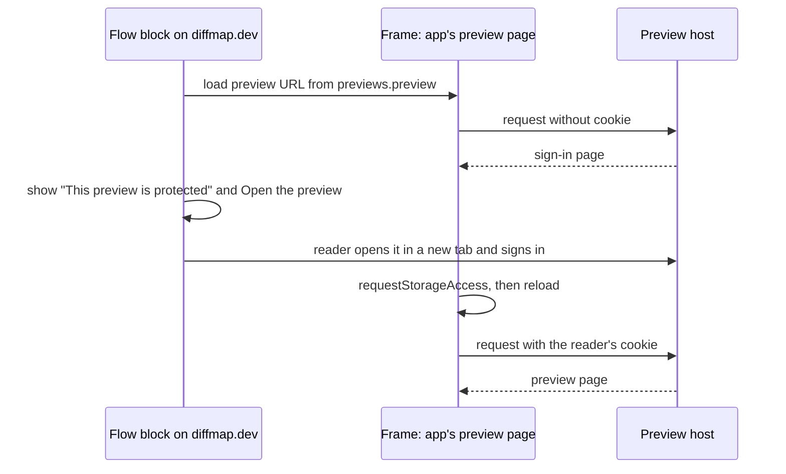

# Phase 5: Previews on pull requests

[Pull request #40](https://github.com/tanishqkancharla/diffmap/pull/40) adds preview and flow blocks, which load the app's preview page in an iframe. Its Phase 6 loads that page from the app's preview deployment on diffmap.dev, using `previews.preview` in `.diffmap/config.json`. This page covers only what changes once [Phase 2](03-sign-in-with-github.md) signs readers in. It depends on #40 landing first.

**Today**

On diffmap.dev, preview and flow blocks have no preview page to load, so they show a placeholder. After #40's Phase 6, they load public preview deployments. A protected deployment, which is the default for Vercel team projects, answers with a sign-in page that cannot load in a cross-site iframe, because the browser blocks its cookie.

**Proposed**

Public preview deployments need nothing from this spec. For protected ones, there are two ways in, and this phase picks the first.

1. **The reader signs in to the preview host themselves.** When the frame fails to load, the block says the preview is protected and offers **Open the preview** in a new tab. The reader signs in there, and the host sets its cookie as a first-party cookie. The block then asks for storage access in the frame (`document.requestStorageAccess()`, run by the app's preview page from #40) so the frame can use that cookie. No secret reaches diffmap. Browser support for storage access in frames varies, so the new-tab link stays as the fallback.
2. **diffmap holds a bypass secret per repo.** Vercel's "Protection Bypass for Automation" gives a secret that opens any deployment of a project when sent as `x-vercel-protection-bypass`. A repo admin would paste it into diffmap, and the proxy would hand it only to readers who can read the repo. This works in every browser, but makes diffmap store a secret that opens the team's deployments, and needs a database. It waits until the first way proves too awkward.



The host must also allow diffmap.dev to frame the preview page (`frame-ancestors https://diffmap.dev`), and [Phase 1](02-untrusted-html.md)'s `frame-src` on diffmap.dev must allow the preview's origin.

Building and hosting the app's preview page in diffmap's own infrastructure, for apps with no preview deployments, is option E in [What cloud could mean](01-what-cloud-could-mean.md#e-hosted-preview-builds), and is not part of this spec.

```changes

```
