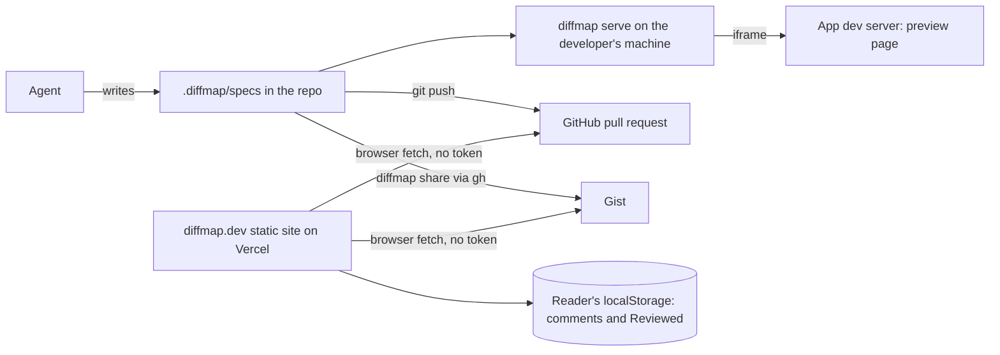

# diffmap cloud: what it could mean, and what it needs

"diffmap cloud" could mean several things. This spec lays out each one, what it needs, and a recommended first version. It contains no code yet: the first question for the reader is which meaning to build.

## Problem

Everything diffmap does after the agent writes a spec happens either on one machine or in one browser.

- **diffmap.dev is a static site with no server.** Vercel serves one `index.html` for every route in `vercel.json`, and the reader's browser calls GitHub itself. [[src/github/fetchRepo.ts#githubFetch]] sends no token, so it only reads public repos, and GitHub allows each network 60 API requests an hour. [[src/host/githubFailure.ts#responseFailure]] already explains the 404, 403, and rate-limit errors this causes.
- **Review state stays in one browser.** Comments ([[src/viewer/comments.ts#useCommentStore]]) and Reviewed checkboxes ([[src/viewer/reviewed.ts#useReviewedFiles]]) live in `localStorage`. Two reviewers of one pull request never see each other's notes, and the only way out is **Copy comments**, which the reader pastes somewhere by hand.
- **`share` publishes through the user's own GitHub account.** [[src/share.ts#shareMarkdownFile]] writes a gist with `gh`, so it needs `gh` signed in, and it refuses specs with local screenshots because a gist holds only text.
- **Live UI only works locally.** The preview and flow blocks on [pull request #40](https://github.com/tanishqkancharla/diffmap/pull/40) load the app's preview page in an iframe. That page runs on the developer's dev server, so diffmap.dev shows nothing in its place. The pull request's Phase 6 plans to load the app's own preview deployment instead.

## What "cloud" could mean

[What cloud could mean](01-what-cloud-could-mean.md) covers each option's infrastructure, sign-in, storage, cost, security, and changes to the CLI and viewer. In short:

| Meaning | Needs a server | Needs a database | Main cost |
| --- | --- | --- | --- |
| A. Live previews and flows on diffmap.dev | No, if the app has its own preview deployments | No | None for diffmap |
| B. Sign in with GitHub: private repos, no rate limit | Yes: a few Vercel Functions | No | Near zero |
| C. Shared review state across reviewers | Yes | Yes, or GitHub as the store | Small database |
| D. Hosted `share` with media and live updates | Yes | Object storage | Storage and bandwidth |
| E. Hosted preview builds of the app | Yes, plus CI | Object storage | Hosting other people's code |
| F. Spec generation from a pull request | Yes, plus agent sandboxes | Yes | Model usage on every spec |

They build on each other. B is needed by C, D, E, and F for anything beyond public repos, because each needs to know who the reader is and what they can read. A needs no diffmap server for public preview deployments, and needs B once a deployment is private.

## Recommendation

Build **B first, with the cheapest form of C: send comments to the pull request**. diffmap.dev gains "Sign in with GitHub" through a GitHub App, private repos open on the existing pull request and commit routes, and a signed-in reviewer posts their diffmap comments as a GitHub review. GitHub stores the data, so diffmap runs a handful of functions and no database.

This version is useful on its own: it opens diffmap to teams whose code is private, which is most teams, and it gets review notes to the place the pull request's author already reads them. Everything else in the table reuses its sign-in and its GitHub proxy.

If "cloud" mostly means live previews on pull requests (A), that work belongs in Phase 6 of [pull request #40](https://github.com/tanishqkancharla/diffmap/pull/40) and needs no server at all; [Phase 5](06-previews-on-pull-requests.md) here only covers what changes once sign-in exists.

Phases:

1. [Untrusted HTML cannot act as the reader](02-untrusted-html.md): a prerequisite for any sign-in.
2. [Sign in with GitHub](03-sign-in-with-github.md).
3. [Private repos and no rate limit](04-private-repos.md).
4. [Send comments to the pull request](05-send-comments-to-pull-request.md).
5. [Previews on pull requests](06-previews-on-pull-requests.md): only the parts that depend on sign-in.

## Goals

- A signed-in reader opens any spec they can read on GitHub, public or private, at the same diffmap.dev URLs as today.
- A reviewer's comments reach the pull request without copy and paste.
- diffmap stores no user code and runs no database in the first version.
- The local `serve` and `share` keep working with no account.

## Non-goals

- Accounts, billing, or teams separate from GitHub. GitHub's permissions decide who reads what.
- GitLab or Bitbucket.
- Running agents or building other people's apps (options E and F) in the first version.
- Live collaboration, such as seeing another reviewer's cursor.

## Questions for the reader

1. Which meaning of "cloud" do you want? The recommendation is B plus comments to the pull request.
2. Is a GitHub App acceptable, which each org installs, or do you want a plain OAuth app, which needs no install but asks for broad `repo` access?
3. Should diffmap.dev stay on Vercel? The phases assume Vercel Functions, since the site already deploys there.

## References

- [Pull request #40: live UI in diffmap specs](https://github.com/tanishqkancharla/diffmap/pull/40), whose Phase 6 loads preview deployments on diffmap.dev.
- [GitHub Apps: user access tokens](https://docs.github.com/en/apps/creating-github-apps/authenticating-with-a-github-app/generating-a-user-access-token-for-a-github-app)
- [GitHub REST: create a review for a pull request](https://docs.github.com/en/rest/pulls/reviews#create-a-review-for-a-pull-request)
- [Vercel Deployment Protection](https://vercel.com/docs/deployment-protection)
