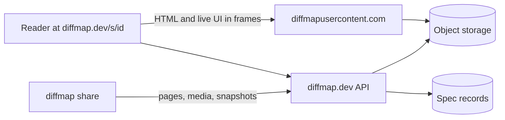

# diffmap cloud: publish a spec and share its link

An agent writes a spec, and the person who asked for it wants to show it to someone. Today that means a local server only they can open, or a gist that drops half of what the spec shows. This spec makes `diffmap share` upload the whole spec to diffmap.dev and print a public link that looks and works like `diffmap serve`. Teams, with private specs shared inside a company, come later, and the first version leaves room for them.

## Problem

**What the person sharing sees today.** `diffmap share` ([[src/share.ts#shareMarkdownFile]]) turns a spec into a gist through the GitHub CLI and prints `https://diffmap.dev/g/<id>`. It needs `gh` installed and signed in. It refuses any spec with a local screenshot or recording, because a gist holds only text. Every share makes a new gist and a new link, so fixing a typo means sending a new URL.

**What the reader sees today.** The gist viewer ([[src/gist/GistApp.tsx#GistApp]]) reads the gist from GitHub's API in the reader's browser, without a token, so each network gets 60 loads an hour. Compared with the local viewer, it is missing:

| What the reader loses on a shared gist | Why | Fixed in |
| --- | --- | --- |
| Screenshots and recordings | A gist holds only text, so `share` refuses local media | [Phase 1](02-publish-a-spec.md) |
| Loading at all, past 60 loads an hour per network | The browser calls GitHub's API without a token | [Phase 1](02-publish-a-spec.md) |
| Large specs | The diffs are one JSON file in the gist, and GitHub serves a gist file over 10 MB only by cloning the gist | [Phase 1](02-publish-a-spec.md) |
| One link that stays current | Each share is a new gist | [Phase 2](03-update-and-delete.md) |
| Edits appearing while the agent works | No server pushes changes | [Phase 3](04-live-updates.md) |
| HTML the spec includes | Hosted viewers show a placeholder, so a stranger's script never runs on diffmap.dev | [Phase 4](05-html-and-live-ui.md) |
| Live UI from preview and flow blocks ([#40](https://github.com/tanishqkancharla/diffmap/pull/40)) | They load the app's preview page from the developer's dev server | [Phase 4](05-html-and-live-ui.md) |
| Cmd-click to a definition, and choosing a commit range in the Diff panel | Both ask the local server, which runs TypeScript and git | [Phase 5](06-definitions-and-ranges.md) |

Some things already match. Diffs and file excerpts come from snapshots `share` saves, and comments and Reviewed checkboxes stay in the reader's browser, as they do locally.

## Solution

`diffmap share` uploads the spec and everything it shows to diffmap's own storage and prints `https://diffmap.dev/s/<id>`. Sharing again from the same spec updates the same link. `diffmap share --watch` keeps the link current while the agent edits, as `serve` keeps the local page current. The person signs in once with `diffmap login`, through GitHub, so diffmap knows who owns each spec and can enforce limits and take content down.

diffmap.dev moves to Cloudflare: one Worker serves the viewer, the API, and published specs, with R2 for files, D1 for records, and a Durable Object per spec for live updates. [Where it runs](01-where-it-runs.md) says why, and covers the storage layout, limits, cost, and security.

Phases:

1. [Publish a spec](02-publish-a-spec.md): `diffmap login`, and `diffmap share` uploading pages, media, and snapshots.
2. [Update and delete](03-update-and-delete.md): one stable link, versions, and `share --delete`.
3. [Live updates](04-live-updates.md): `share --watch`.
4. [HTML and live UI](05-html-and-live-ui.md): HTML fences and #40's preview and flow blocks, run on a separate domain.
5. [Definitions and commit ranges](06-definitions-and-ranges.md): worked out when the spec is shared.
6. [Later: teams](07-later-teams.md): accounts, private team specs, and specs published from CI.

## Goals

- A shared spec at diffmap.dev shows everything `diffmap serve` shows, apart from what [Phase 5](06-definitions-and-ranges.md) lists.
- Sharing is one command, after a one-time sign-in, with no `gh`.
- A link stays the same across updates, and its owner can delete it.
- Nothing in the first version blocks private team specs later: every read goes through the Worker, every spec has an owner and a visibility, and code from specs runs on its own domain.

## Non-goals

- Private specs, teams, and shared comments. These are [later](07-later-teams.md).
- Opening specs from private GitHub repos. Pull request and commit links keep working for public repos as they do today.
- Generating specs on diffmap's servers.

## Not now

The first version of this spec weighed other meanings of "diffmap cloud". They wait, and some come back as part of teams:

- **Signing in to read private repos on pull request links.** Teams cover private specs by publishing them instead.
- **Review state shared between reviewers,** such as comments that sync. This comes back with teams.
- **Live previews on pull request links** from the app's own preview deployment. This stays in Phase 6 of [#40](https://github.com/tanishqkancharla/diffmap/pull/40), and shared specs get it from [Phase 4](05-html-and-live-ui.md).
- **Generating specs from a pull request on diffmap's servers.** It costs model usage on every pull request; a GitHub Action running the team's own agent gets most of the value.

## Decisions to confirm

Each of these changes the design. Each has a recommendation.

1. **Require sign-in to share?** Recommended: yes, with GitHub. Anonymous uploads make diffmap.dev a free file host with no one to contact about abuse, and the owner record is what teams build on. Without sign-in, `share` would keep a secret owner token on the machine, and a lost token would mean a spec nobody can delete.
2. **Replace gists in `share`, or add a new `publish` command?** Recommended: `share` uploads to diffmap.dev, and `share --gist` keeps today's behavior for a while. The guide and skill already tell agents to use `share`, and old `/g/` links keep working.
3. **Teams as GitHub orgs, or diffmap's own teams?** Recommended: GitHub orgs first, so a team is everyone in the org, with no invites to manage. This decides whether sign-in uses a GitHub App, which can read org membership once an org installs it, or a plain OAuth app. The recommendation is a GitHub App with no repository access.
4. **What gets uploaded besides what the spec shows?** Recommended: only the files the spec shows, plus the definitions [Phase 5](06-definitions-and-ranges.md) finds in them. Uploading the whole repo would make every Cmd-click work, but would publish code the person never meant to share.

## References

- [Cloudflare R2 pricing](https://developers.cloudflare.com/r2/pricing/) and [Workers pricing](https://developers.cloudflare.com/workers/platform/pricing/)
- [GitHub device flow](https://docs.github.com/en/apps/creating-github-apps/authenticating-with-a-github-app/generating-a-user-access-token-for-a-github-app#using-the-device-flow-to-generate-a-user-access-token)
- [Public Suffix List](https://publicsuffix.org), which keeps one user-content subdomain from setting cookies for the others
- [Pull request #40: live UI in diffmap specs](https://github.com/tanishqkancharla/diffmap/pull/40)
