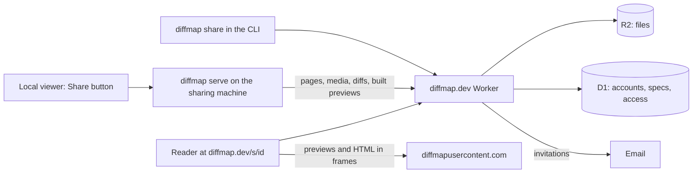

# diffmap cloud: share a spec from its header

An agent writes a spec, and the person reading it locally wants to show it to someone else. This spec adds a **Share** button to the header of the local viewer. It opens a share dialog modeled on [Halo's](https://github.com/cashew-labs/halo/blob/main/packages/web/src/panes/ShareAppForm.tsx): choose **Public** or **Restricted** to people you add by email, copy the link, and share. The spec uploads to diffmap.dev, so the link keeps working after the machine that served it shuts down, and it looks and works like `diffmap serve`.

## The share dialog

The person clicks **Share** in the viewer's header, beside the Diff button. The dialog shows:

- A small browser frame with the spec's cover as it will look at its link.
- **Access**: **Restricted**, "Only people you've added get access", or **Public**, "Anyone with the link has access".
- For Restricted, **Add people by email**, and the list of people with access, each with a remove button.
- **Keep this link updated**, on by default, so the link follows the spec while this viewer runs.
- **Copy link**, and one main button that applies the changes: **Share**, **Share with 2 people**, **Update access**, or **Done**. While uploading it reads **Sharing…**, and on failure **Retry**, with the reason.
- **Share with team**, greyed out, marked "Coming soon".

The first time, sharing asks the person to sign in to diffmap.dev with Google or GitHub, in a popup. People added by email get an invitation; those without a diffmap account sign in with that address to open the spec. Agents share the same way from the CLI with `diffmap share`.

## Problem

**Sharing today.** The local viewer has no Share button. `diffmap share` ([[src/share.ts#shareMarkdownFile]]) turns a spec into a gist through the GitHub CLI and prints `https://diffmap.dev/g/<id>`. It needs `gh` signed in, refuses any spec with a local screenshot or recording, makes a new link every time, and cannot limit who reads it.

**Reading a shared gist.** The gist viewer ([[src/gist/GistApp.tsx#GistApp]]) reads the gist from GitHub's API in the reader's browser, without a token. Compared with the local viewer, it is missing:

| What the reader loses on a shared gist | Why | Fixed in |
| --- | --- | --- |
| Screenshots and recordings | A gist holds only text, so `share` refuses local media | [Phase 1](02-share-dialog.md) |
| Loading past 60 loads an hour per network | The browser calls GitHub's API without a token | [Phase 1](02-share-dialog.md) |
| Large specs | The diffs are one JSON file, and GitHub serves a gist file over 10 MB only by cloning the gist | [Phase 1](02-share-dialog.md) |
| Limiting who can read it | A gist is readable by anyone with its link | [Phase 2](03-restricted-and-invites.md) |
| One link that follows the spec as it changes | Each share is a new gist | [Phase 3](04-live-link.md) |
| Live UI from preview and flow blocks ([#40](https://github.com/tanishqkancharla/diffmap/pull/40)) | They load the app's preview page from a dev server on the sharing machine | [Phase 4](05-previews-and-html.md) |
| HTML the spec includes | Hosted viewers show a placeholder, so a stranger's script never runs on diffmap.dev | [Phase 4](05-previews-and-html.md) |
| Cmd-click to a definition, and choosing a commit range | Both ask the local server, which runs TypeScript and git | [Phase 5](06-definitions-and-ranges.md) |

## Solution

Sharing uploads a snapshot of everything the spec shows, so nothing on diffmap.dev depends on the sharing machine. While the local viewer keeps running, it uploads each edit as a new version, and when it stops, the link keeps showing the last one.

diffmap.dev moves to Cloudflare: one Worker serves the viewer, the API, sign-in, and shared specs, with R2 for files, D1 for records, Durable Objects for live updates, and Cloudflare Email Sending for invitations. Sign-in uses [Better Auth](https://www.better-auth.com) with Google and GitHub, linking both to one account. [Where it runs](01-where-it-runs.md) says why, and covers storage, limits, cost, and security.

Phases:

1. [The share dialog](02-share-dialog.md): the Share button, signing in, and sharing publicly, from the viewer or the CLI.
2. [Restricted access and invitations](03-restricted-and-invites.md): sharing with people by email.
3. [A link that stays current](04-live-link.md): live updates, versions, and stopping sharing.
4. [Previews and HTML](05-previews-and-html.md): #40's live UI and HTML blocks, built and uploaded when sharing.
5. [Definitions and commit ranges](06-definitions-and-ranges.md): worked out when sharing.
6. [Later: teams](07-later-teams.md).

## Goals

- Sharing is one dialog in the viewer, or one command for agents, after a one-time sign-in.
- A shared spec shows everything `diffmap serve` shows, apart from what [Phase 5](06-definitions-and-ranges.md) lists, with the sharing machine turned off.
- The owner decides who reads it: anyone with the link, or the people they add.
- Nothing blocks teams later.

## Non-goals

- Teams. The dialog shows "Share with team" as coming soon.
- Document kinds other than diffmap specs. The storage and access model do not depend on the kind of document, so another kind can share the same way later.
- Opening specs from private GitHub repos at pull request links.
- Comments shared between readers.

## Not now

Earlier drafts of this spec weighed other meanings of "diffmap cloud": signing in to read private repos at pull request links, comments synced between reviewers, live previews at pull request links from the app's own preview deployment (still Phase 6 of #40), and generating specs on diffmap's servers. None is part of this plan.

## Decided

- Share from the viewer's header and from the CLI.
- Public, or Restricted to people added by email, who get an invitation.
- Previews are built and uploaded when sharing, with screenshots when the repo has no preview build.
- The link follows the spec while the local viewer runs.
- Better Auth, with Google and GitHub sign-in and account linking.
- diffmap.dev runs on its own, on Cloudflare.
- Teams wait.

## References

- [Halo's share dialog](https://github.com/cashew-labs/halo/blob/main/packages/web/src/panes/ShareAppForm.tsx) and its access model, `AppAccess` in [`extensionSharing.ts`](https://github.com/cashew-labs/halo/blob/main/packages/shared/src/extensionSharing.ts)
- [Better Auth device authorization](https://www.better-auth.com/docs/plugins/device-authorization) and [account linking](https://www.better-auth.com/docs/concepts/users-accounts#account-linking)
- [Cloudflare R2 pricing](https://developers.cloudflare.com/r2/pricing/), [Workers pricing](https://developers.cloudflare.com/workers/platform/pricing/), and [Email Service](https://developers.cloudflare.com/email-service/)
- [Pull request #40: live UI in diffmap specs](https://github.com/tanishqkancharla/diffmap/pull/40)
