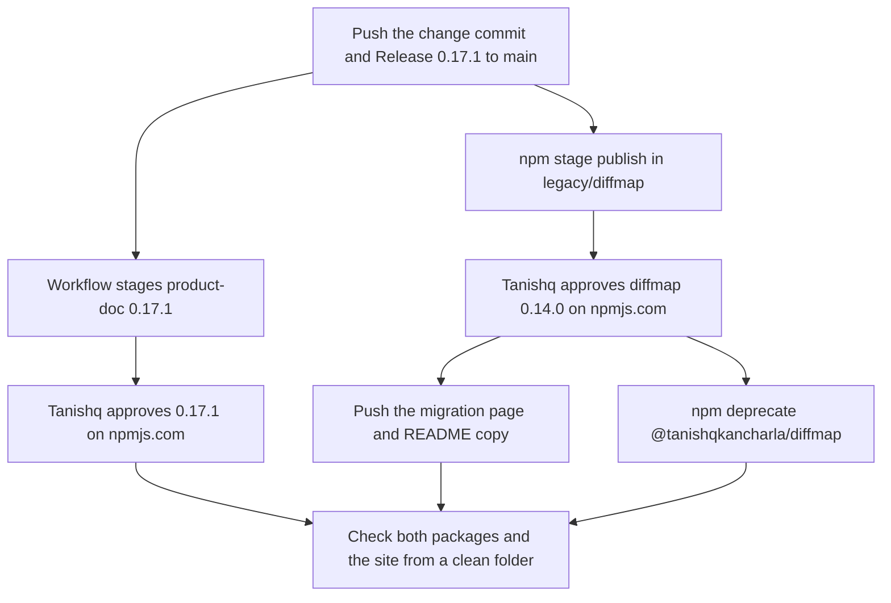

# Phase 3: npm deprecation

npm can mark a package deprecated. npm then prints the message whenever someone installs it, including the first time npx fetches it, and shows a banner on the package page. It does not stop anything from running. It reaches people the 0.14.0 notice cannot, such as anyone who installs an older diffmap by version.

```sh [Run once 0.14.0 is live (needs npm sign-in and 2FA)]
npm deprecate @tanishqkancharla/diffmap "diffmap is deprecated. Use product-doc instead: npx product-doc@latest guide"
```

Leaving out a version marks every version, including 0.14.0. That is intended: the warning and the notice say the same thing. Run it after 0.14.0 is approved, so the package is never deprecated while `latest` still points at the old guide.

I checked this in the same local registry as Phase 2. `npm deprecate` marked all 20 versions, and a new user's `npx @tanishqkancharla/diffmap guide` printed `npm warn deprecated @tanishqkancharla/diffmap@0.14.0: diffmap is deprecated. Use product-doc instead: npx product-doc@latest guide` above the notice.

One side effect helps: once every version is deprecated, npm skips the `latest` tag and installs the highest version. In the local registry, a fresh install got 0.14.0 even with `latest` pointed back at 0.13.0.

## Release order

R0002 covers product-doc: a `Release 0.17.1` commit on `main`, which the workflow stages and you approve. The workflow refuses any other package name, so diffmap 0.14.0 is a one-time manual stage. It still goes through npm staging and your approval on npmjs.com.



Steps D and F need an npm sign-in for `tanishqkancharla`. I can run them from this orb's terminal while you enter your password and 2FA code, or you can run them yourself. After the website push I fetch productdoc.dev/docs/migration to confirm it no longer says Diffmap is not being retired. After each npm step I check the registry: `latest` is 0.14.0, `npm view` shows the deprecation, and a clean `npx @tanishqkancharla/diffmap guide` prints the notice.

## Phase goals

- Anyone who installs any diffmap version sees npm's warning pointing to product-doc.
- The diffmap page on npmjs.com shows the deprecation banner.
