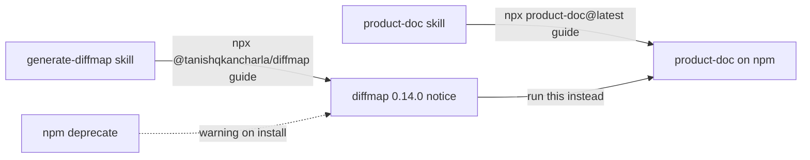

# Deprecate diffmap

Most people still run the old `@tanishqkancharla/diffmap` package (latest is 0.13.0). They get there through the `generate-diffmap` skill, which runs `npx @tanishqkancharla/diffmap guide`. This plan publishes one last diffmap release that tells them to use product-doc instead, and makes the product-doc skill always run the newest product-doc.

**State:** built and committed locally, not pushed or released. Each phase page ends with its commit. The proof ran against a local npm registry, so nothing reached npmjs.org.

## What an old user sees

Today an agent with the old skill gets the old guide and keeps using diffmap. After this plan, the same command prints a short notice and the exact command to run instead:

```text [Before: npx @tanishqkancharla/diffmap guide]
# Living specs
...the diffmap 0.13.0 guide...
```

```text [After: npx @tanishqkancharla/diffmap guide (proposed)]
npm warn deprecated @tanishqkancharla/diffmap@0.14.0: diffmap is deprecated. Use product-doc instead: npx product-doc@latest guide

diffmap is deprecated. Use product-doc instead.

Tell the user diffmap is deprecated. Offer to switch them to
product-doc, and with their OK run:
  npx skills remove generate-diffmap
  npx skills add tanishqkancharla/diffmap --skill generate-product-doc
Their .diffmap/specs/ documents keep working with product-doc.

To keep going now, run:
  npx product-doc@latest guide

https://productdoc.dev
```

The first line is npm's own deprecation warning. The rest comes from the new diffmap release. The agent tells the user, offers to do the migration, and runs the two skill commands once they agree. Then it runs the product-doc command and carries on with the same documents.

## Why this reaches people

People who run diffmap through `npx` get the new release on their next run. When the command names only the package, npx checks the registry for a newer version even if an older one is in its cache. That check has been in npm since 10.0, which ships with Node 22, the oldest Node that diffmap supports.

```callstack [npx @tanishqkancharla/diffmap guide, with 0.13.0 in the npx cache]
 run = npx("@tanishqkancharla/diffmap guide")
 ├── npxByNameOnly = true # the command names only the package
 ├── manifest = getManifest(spec, { preferOnline: true }) # asks the registry for latest
-├── latest = 0.13.0 → cached copy matches, run it
+├── latest = 0.14.0 → cached copy is older, install 0.14.0
+└── 0.14.0 prints the notice
```

People who installed diffmap globally keep 0.13.0 until they run `diffmap update`, which installs the 0.14.0 notice. Nothing can reach them sooner.

## Implementation



- [Phase 1: Always the latest product-doc](01-product-doc-latest.md) adds `@latest` to the product-doc skill and guide, released as product-doc 0.17.1. It also rewrites the README and website migration copy, which still say Diffmap is not being retired.
- [Phase 2: Diffmap 0.14.0 notice](02-diffmap-notice.md) publishes a tiny diffmap release that prints the notice, and points the old skill at product-doc.
- [Phase 3: npm deprecation](03-npm-deprecation.md) marks every diffmap version deprecated on npm, and orders the release steps.

## Decisions for Tanishq

1. **Stop, don't forward.** The 0.14.0 notice exits with an error and prints the product-doc command, instead of quietly running product-doc for the user. Forwarding would hide the switch, so people would never move. It also matches the README's promise of no legacy alias. Say if you would rather forward.
2. **Point the old skill forward.** `generate-diffmap` becomes a three-line pointer to product-doc, so `npx skills update` moves people too.
3. **`@latest` in the guide, not only the skill.** The guide tells agents to run `npx product-doc serve` and others. Without `@latest`, a machine with an older global product-doc would read the new guide but serve with the old viewer. This needs a product-doc 0.17.1 release.
