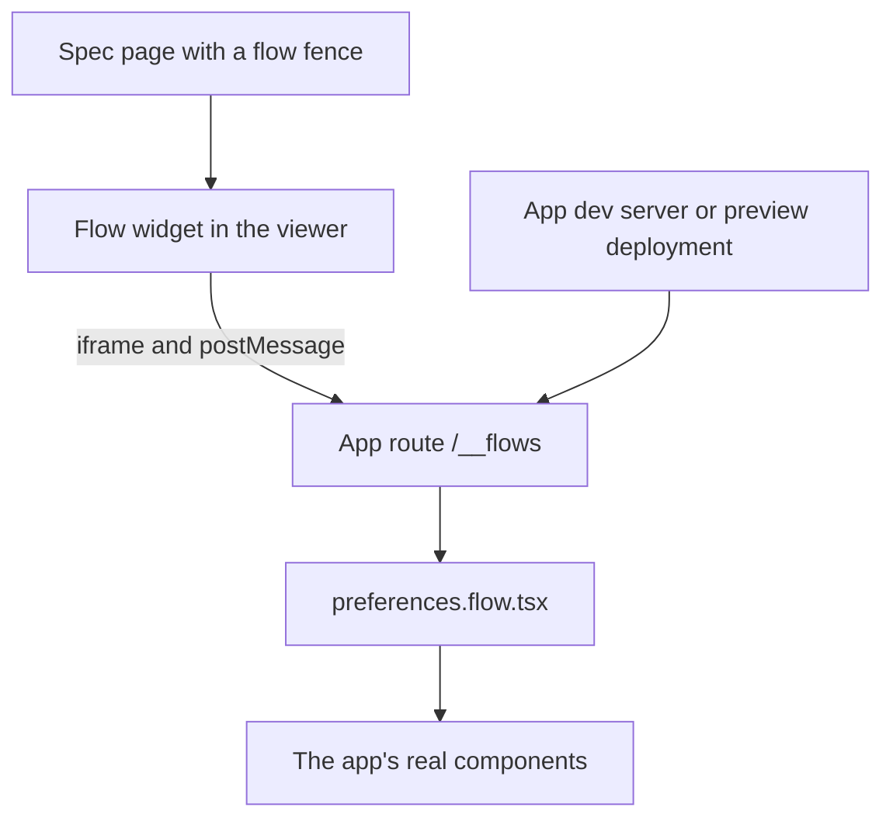

# Flow widget: live UI journeys in a diffmap spec

[flow-preview](https://github.com/tanishqkancharla/flow-preview) is an agent skill that turns a user journey into an interactive canvas of real UI states. This spec brings the idea into diffmap as an interactive widget, a `flow` fence, so a spec can show the journey a change affects right beside the text that explains it, running the app's real components with their real styles and animations.

The people using this build web apps. They already have a design system, a bundler, a dev server, and usually a preview deployment for each pull request. So diffmap does not build their components. It embeds their own app, on a small dev-only route, and draws the flow's controls around it.

## Problem

**How flow-preview renders components today.** The skill's generator ([`scripts/generate.mjs`](https://github.com/tanishqkancharla/flow-preview/blob/e9894aa/scripts/generate.mjs)) writes a second app to `tmp/<name>/`, with its own `package.json`, its own React, Maui, and Vite, and its own `npm install`. The agent's `scenario.tsx` imports the project's components by relative path, and that second Vite build compiles them, using a helper ([`assets/previewConfig.mjs`](https://github.com/tanishqkancharla/flow-preview/blob/e9894aa/assets/previewConfig.mjs)) that dedupes React and limits which folders the dev server may read.

That second build knows nothing about the project's own build. Path aliases, Tailwind or PostCSS, CSS modules, SVG loaders, environment variables, global stylesheets, fonts, theme classes, and app-wide providers all have to be recreated by hand. flow-preview's [`SKILL.md`](https://github.com/tanishqkancharla/flow-preview/blob/e9894aa/SKILL.md) spends a whole section telling the agent to load the app's global styles and fonts and to compare each state against the running app, because the copy drifts. The canvas, about 1,500 lines in [`assets/FlowCanvas.tsx`](https://github.com/tanishqkancharla/flow-preview/blob/e9894aa/assets/FlowCanvas.tsx), is built to fill a browser window, and the preview lives only in `tmp/` on the agent's machine, so a reviewer of the pull request never sees it.

**What a diffmap spec shows today.** For a UI change, [[guide.md]] asks for one screenshot per state, with Today beside Proposed in a gallery. Screenshots are not interactive, show no animation, and leave the reader to piece together from prose how the states connect.

## Solution

The app gets one dev-only route, `/__flows`, that renders any state of any flow inside the app's real layout, providers, styles, and fonts. diffmap's viewer embeds that route in an iframe and draws everything else itself.



The agent writes the flow next to the app's code, in the app's own language and build:

```tsx [src/flows/preferences.flow.tsx]
import { defineFlow } from "@tanishqkancharla/diffmap/flow";
import { Preferences } from "../settings/Preferences";

export default defineFlow({
  id: "preferences",
  title: "Saving preferences",
  initialState: "editing",
  states: [
    {
      id: "editing",
      title: "Editing",
      note: "The form opens with the saved digest name.",
      render: ({ go }) => <Preferences onSave={() => go("saved")} />,
    },
    {
      id: "saved",
      title: "Saved",
      parent: "editing",
      action: "Save preferences",
      note: "The new name is saved, and a confirmation shows.",
      render: () => <Preferences saved />,
      enter: async (ui) => ui.click("Save preferences"),
    },
  ],
});
```

The spec only names the flow:

````text
```flow [Saving preferences]
preferences
```
````

The `userFlows` key in the repo's `.diffmap/config.json` tells the viewer where the route lives, locally and on each pull request. It is diffmap's single config file, so later settings become sibling keys rather than more files:

```json
{
  "userFlows": {
    "local": "http://localhost:5173/__flows",
    "preview": "https://myapp-git-{branch}.vercel.app/__flows"
  }
}
```

In the page, the widget fits the text column. The selected state is the live iframe; everything around it is the viewer's own UI:

```text [Inline, in the spec column]
+- Saving preferences -------------------------- [expand] -+
| Editing  >  Saving  >  Saved              (breadcrumbs)  |
| +------------------------------------------------------+ |
| |   iframe: the app's /__flows route, selected state   | |
| +------------------------------------------------------+ |
| < Previous state                    Save preferences >   |
| Note: what just happened, and what the user can do next  |
| +--------+  +--------+  +--------+  +--------+           |
| | [x]    |  | [ ]    |  | [ ]    |  | [ ]    |   >       |
| +--------+  +--------+  +--------+  +--------+           |
|  Editing     Saving      Saved       Error               |
+----------------------------------------------------------+
```

The expand button opens the full canvas over the page, with the outline, a zoomable map of every state, and the same live preview, as flow-preview lays it out today:

```text [Expanded, over the page]
+- Saving preferences ------------------------------------- [close] -+
| Outline     | Map: pan and zoom              | Live preview        |
| Editing [x] |                                | breadcrumbs         |
|  Saving     | [Editing] --> [Saving]         | iframe              |
|   Saved     |                  |             | < Prev  Next >      |
|   Error     |       [Error] <--+--> [Saved]  |                     |
+--------------------------------------------------------------------+
```

**What this removes, compared with flow-preview**

- The second app in `tmp/`, its install step, and keeping its React and design-system versions in line with the project.
- Copying global styles, fonts, and providers into a preview.
- The dev-server folder allowlist, which existed only to fence in that second build.
- Any new runtime dependency in diffmap's CLI: no Vite, React, or browser automation at `serve` time.

**What it costs**

- A one-time setup in the app: the dev-only route, added by the agent the first time it writes a flow.
- A running dev server to see a flow locally, and a preview deployment to see it on a pull request.
- `@tanishqkancharla/diffmap` as a dev dependency of the app, for `defineFlow` and the route's runtime.

## Goals

- A spec page shows a journey as a live widget that fits the text column and expands to the full canvas.
- Each state renders through the app's own build, so it looks and moves exactly as it does in the app.
- Moving to the next state plays the app's own transitions.
- A reviewer on diffmap.dev sees the same live widget, through the pull request's preview deployment.
- No code from the repo runs in the viewer's own page, on diffmap.dev or locally.

## Non-goals

- Building or bundling the app's code in diffmap.
- Comparing two revisions of a journey side by side, as flow-preview's `comparison` does. Showing Today needs a second dev server or the base branch's deployment; that is a later spec.
- Shipping `/__flows` to production. The route exists in development and preview builds only.

## References

- flow-preview at [`e9894aa`](https://github.com/tanishqkancharla/flow-preview/tree/e9894aa): [`SKILL.md`](https://github.com/tanishqkancharla/flow-preview/blob/e9894aa/SKILL.md), [`scripts/generate.mjs`](https://github.com/tanishqkancharla/flow-preview/blob/e9894aa/scripts/generate.mjs), [`assets/FlowCanvas.tsx`](https://github.com/tanishqkancharla/flow-preview/blob/e9894aa/assets/FlowCanvas.tsx), [`assets/previewConfig.mjs`](https://github.com/tanishqkancharla/flow-preview/blob/e9894aa/assets/previewConfig.mjs), [`NOTICE`](https://github.com/tanishqkancharla/flow-preview/blob/e9894aa/NOTICE). flow-preview is Apache-2.0 and diffmap is MIT, so code that moves keeps its license and NOTICE.
- diffmap: [[src/viewer/Fence.tsx#Fence]], [[src/parseFence.ts#parseFence]], [[src/viewer/MermaidBlock.tsx#MermaidBlock]], [[src/viewer/reviewed.ts#useReviewedFiles]], [[src/serve.ts#contentSecurityPolicy]], [[src/github/fetchRepo.ts]].
