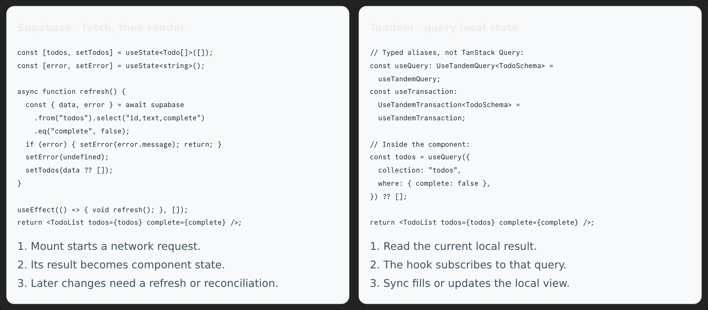
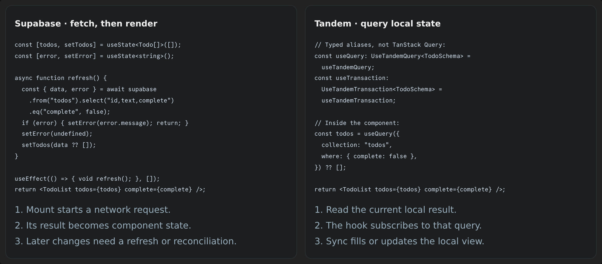
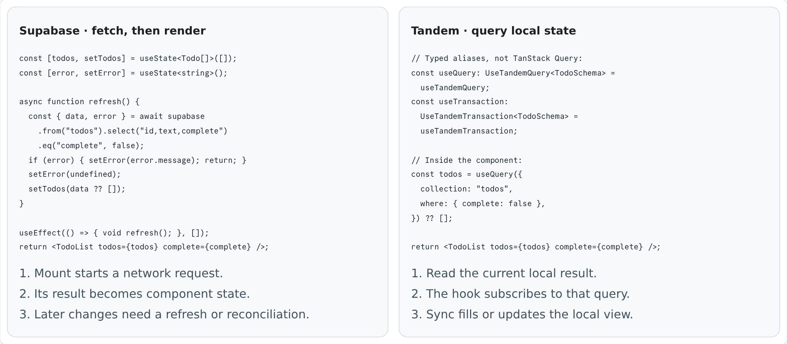

# HTML in dark mode

`html` fences render the trusted markup an agent wrote, and agents nearly always hard-code a light palette in it. In the dark theme those blocks stay light, and worse, any text the block leaves uncolored picks up the viewer's near-white text and disappears on the light card. Below is a real block from the round 12 Tandem eval (`01-read-todos.md`), which sets `color:#17222d`, `background:#f7f9fa`, `border:1px solid #d6e0e5`, and `color:#405360`.

In the dark theme today, the cards stay light and the two headings vanish:

:::gallery side-by-side


:::

The light theme does not change; the two captures are pixel-identical:

:::gallery side-by-side


:::

The proposed captures come from the implementation, merged to `main` in 5acca67 and not yet released.

## Proposal

**Merged, not yet released:** when the viewer is dark, rewrite every color the block's CSS names into its dark counterpart before rendering it. Each color keeps its hue and saturation and gets mirrored lightness, so dark text turns light, light cards turn dark, and a mid-tone accent stays recognizable. Existing documents adapt without edits, and authors keep writing ordinary light CSS.

```ts [HtmlBlock]
function HtmlBlock({ source }: { source: string }) {
  const { resolvedTheme } = useTheme();
  const html = resolvedTheme === "dark" ? darkHtml(source) : source;
  return <div data-diffmap-kind="html" dangerouslySetInnerHTML={{ __html: html }} />;
}

function darkHtml(source: string) {
  // Authors who handle dark mode themselves keep full control.
  if (/light-dark\(|prefers-color-scheme|data-theme/.test(source)) return source;
  // Only CSS values: <style> declarations, style="…", and fill/stroke/color attributes.
  return rewriteColorValues(source, (color, property) => {
    const { L, a, b } = toOklab(color); // hue and chroma live in a and b
    if (isBackground(property) && L <= 0.5) return color; // already a dark or accent fill
    if (property === "color" && L >= 0.5) return color; // already light text
    return oklab(clamp(1.13 - 0.9125 * L, 0, 1), a, b);
  });
}
// [!note L10-L11] Selectors such as `#fade` and `url(#grad)` references are left alone.
// [!note L13-L14] Light text on a dark code panel or a red badge keeps both colors, so the pair stays readable.
// [!note L15] White lands on the dark element surface (gray 3) and the light theme's text on the dark theme's text.
```

What it covers:

1. Hex, `rgb()`, `hsl()`, `white`, and `black` in `<style>` blocks, `style` attributes, and SVG `fill`, `stroke`, and `stop-color` attributes. Gradients adapt color by color.
2. Images, video, and canvas stay untouched, because nothing is filtered.
3. Switching themes re-renders the block, so no reload is needed.
4. Raw HTML written directly in Markdown, outside a fence, gets the same treatment, so the two kinds of trusted HTML stay consistent.

What it does not cover: colors set by a script at run time (scripts in `html` blocks do not run anyway), named colors other than `white` and `black` (mid-tones such as `red` read fine on dark), and dark borders or SVG fills, which always mirror, so a deliberately dark SVG turns light.

## Options considered

| Option                                                             | Existing docs in dark                                  | Cost                                                  |
| ------------------------------------------------------------------ | ------------------------------------------------------ | ----------------------------------------------------- |
| **Rewrite hard-coded colors (built)**                              | Adapt automatically, images untouched                  | One small viewer module                               |
| Theme variables such as `--pd-text`, plus a guide rule to use them | Stay broken until rewritten                            | Guide change in the eval thread; agents must remember |
| `filter: invert(1) hue-rotate(180deg)` in dark                     | Adapt, but images, photos, and brand colors invert too | One CSS rule, worse output                            |

The page's root already sets `color-scheme` and the theme's text color, so HTML that hard-codes no colors already follows dark mode. Theme variables could still come later as an option for authors; they are not needed for this change, and no guide change is part of it.

Source: [[5acca67:src/viewer/HtmlBlock.tsx#L5-L14]] renders `html` fences from [[src/viewer/Fence.tsx#L39-L42]]; raw HTML renders in [[5acca67:src/viewer/ComarkView.tsx#L47-L64]].

[The live block](01-live-block.md) renders the same eval HTML, so you can toggle the theme yourself.

```changes
5acca67
src/viewer/htmlTheme.ts
src/viewer/HtmlBlock.tsx
src/viewer/ComarkView.tsx
```
