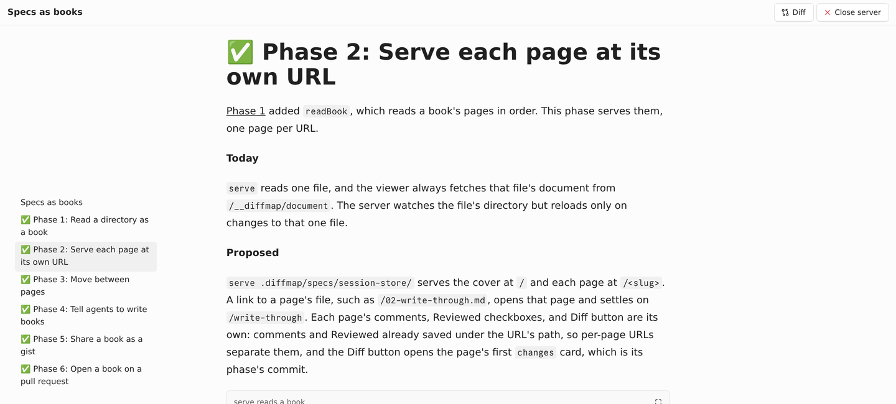
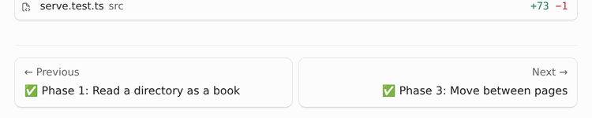
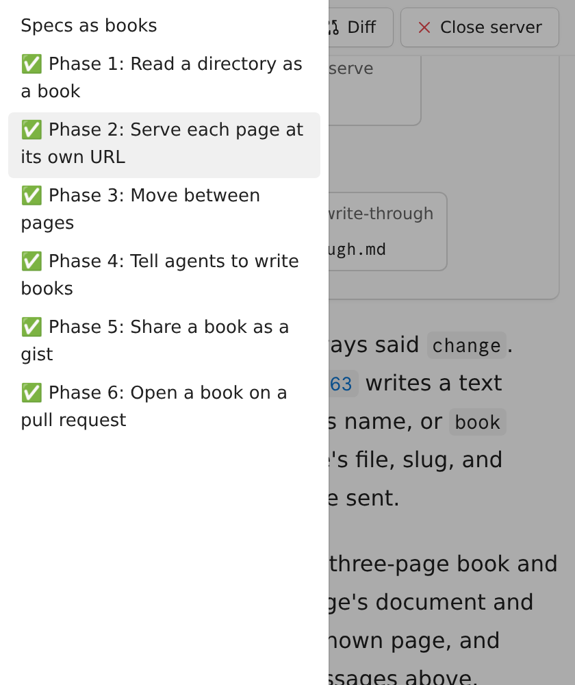
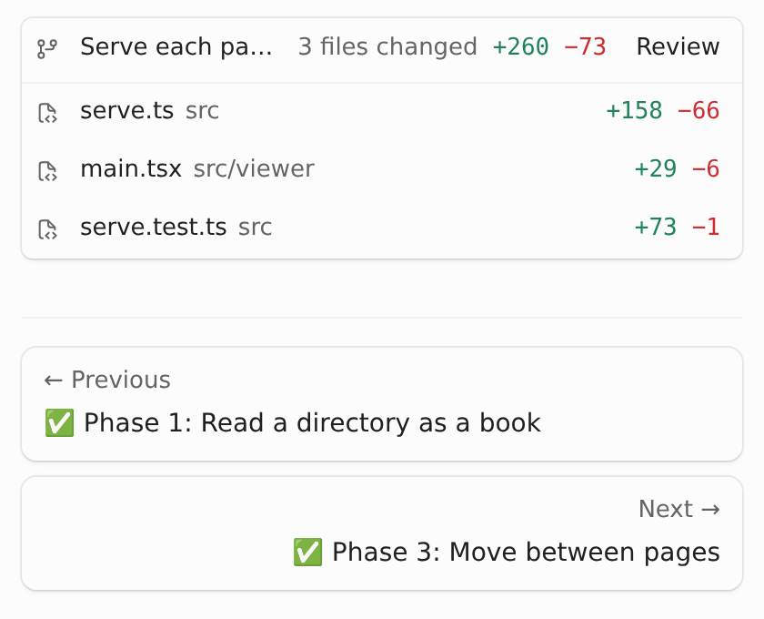

# ✅ Phase 3: Move between pages

[Phase 2](02-serve-pages.md) put each page at its own URL. This phase lets the reader see where they are in the spec and move through it without typing URLs.

**Today**

The left gutter lists the current page's headings. After Phase 2, the only way to reach another page is to type its URL.

**Proposed**

- **Page list.** The left gutter lists the spec's pages by title, with the current page marked and its headings under it. Phase titles carry their ⏳ and ✅, so the list shows the spec's progress. On a narrow window it moves into the drawer that the header's contents button opens.
- **Previous and next.** The bottom of each page links the previous and next page by title.
- **Links between pages.** A relative link to a page file, such as `[Phase 2](02-serve-pages.md)`, opens that page in place, and GitHub follows the same link in its file view. A modified click opens it in a new tab, and a link to any other file stays as it is.
- **Header.** The header shows the spec's title; the browser tab shows the page's title and then the spec's.
- **Copy comments** copies the comments from every page, under each page's title, numbered across the spec. The button counts them all, so it shows on a page with no comments of its own.

A wide window docks the page list in the gutter. The page shown here is this spec's Phase 2:



At the bottom, the page links to its neighbors by title:



On a narrow window, the contents button opens the same list in a drawer, and the links stack:

:::gallery side-by-side


:::

The host owns moving between pages, since only it knows how to load one: the local viewer asks `serve`, and the gist and GitHub viewers in [Phase 5](05-share-a-spec.md) and [Phase 6](06-open-on-a-pull-request.md) already hold every page. Each host passes the same `BookNav` to `ViewerApp`, and the page list, links, pager, and Copy comments read it from context:

```tsx
type BookNav = {
  title: string;
  pages: BookPage[]; // cover first
  current: BookPage;
  href: (page: BookPage) => string; // also names the page's saved comments
  navigate: (page: BookPage, hash: string) => void;
};

// The local viewer (src/viewer/main.tsx): load the page, then push its URL and swap it in.
navigate: (page, hash) =>
  loadPage(page.slug).then((next) => {
    history.pushState({}, "", `${pageHref(page)}${hash}`);
    setLoad(next); // ViewerApp is keyed by page file, so it remounts at the top
  });
```

The host keys `ViewerApp` by page, so each page mounts fresh, with its own comments, Reviewed files, and Diff panel, at the top or at the link's heading. Back and forward load the page the URL names; a jump to a heading on the same page stays put ([[0798496:src/viewer/main.tsx#L102-L163]]).

In the gutter, [[0798496:src/viewer/TableOfContents.tsx#L76-L97]] makes each page an entry at the top level and nests the current page's headings under it, so the docked list, the hover card, and the drawer all show the book with no other changes. [[0798496:src/viewer/bookNav.tsx#L60-L84]] gives a Markdown link to a page the page's URL and opens it in place on a plain click.

Copy comments reads the other pages' comments from `localStorage` under each page's `href`, and [[0798496:src/viewer/comments.ts#L133-L159]] groups them:

```md
Review comments on "Sessions in Postgres" (/repo/.diffmap/specs/session-store):

## Sessions in Postgres

1. In "Goals":

   > Survive restarts

   Say which restarts.

## Phase 2: Write through

2. In "Today":
   …
```

I checked the local viewer in a browser: a link in the text, the page list, the pager, and Back each move between pages without reloading the page; editing the cover leaves another page's tab alone, and editing that page reloads it; a comment saved on the cover shows in the Copy comments count on Phase 3. A single-file spec shows no page list or pager. `src/viewer/comments.test.ts` checks the grouped format, including a page with no comments and numbering that continues across pages.

```changes
0798496
src/viewer/bookNav.tsx
src/viewer/main.tsx
src/viewer/TableOfContents.tsx
src/viewer/ViewerApp.tsx
src/viewer/ComarkView.tsx
src/viewer/CopyCommentsButton.tsx
src/viewer/comments.ts
src/viewer/comments.test.ts
```
