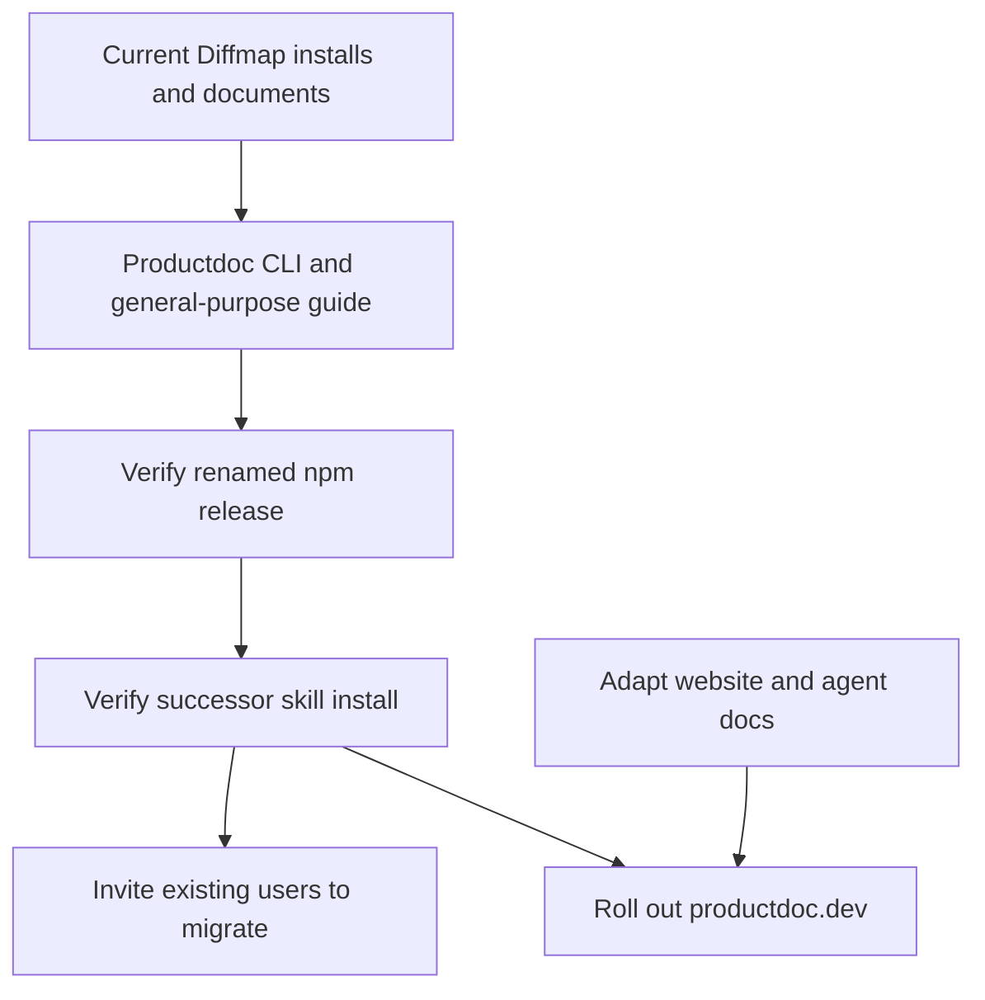

# Productdoc: general-purpose visual documents

**Productdoc is the standalone product going forward.** Diffmap is its previous name; the scope expands beyond reviewing changes to explaining existing systems, planning future work, and reviewing what changed. This is a rename and product evolution, not two permanent products or a new layer marketed on top of Diffmap.

The website will move to **productdoc.dev**. The npm package is **product-doc**, the executable default is **product-doc**, and the successor skill is **generate-product-doc**. Tanishq reports owning the domain. The npm name is now claimed through an approved first stage; trusted publishing and website hosting have not been configured by this work. Amp is the initial onboarding test target.

**Local state:** the skill stub, CLI guide, primary package/bin/help/updater rename, README copy, and fixed product/surface attribution are built locally. The actual tarball passed a clean-install smoke check; the full suite now passes 71 tests. The minimal Amp rerun verifies skill scanning, guide loading, document preview, copied feedback, and the fixed change cards in a repository without commits; [public acquisition and fresh-agent selection remain unverified](13-clean-onboarding.md). The user-approved fixed `product-doc@0.13.2` candidate has been staged and is awaiting npm validation, not approved for release; its downloaded tarball matches the tested package byte for byte. The older 0.13.1 stage remains untouched. Only npm's `0.0.0-stage` placeholder is public. Nothing is committed, pushed, or deployed. The live website, npm trust setup, public onboarding, and user migration remain future work. Both skills exist temporarily; published Diffmap releases and the legacy skill are untouched.

## A stub, not another instruction manual

The skill only loads the CLI's version-matched guide. [[guide.md]] owns the reasoning and authoring instructions as well as syntax, diagrams, call-stack diffs, media, prose previews, validation, serving, and sharing. There is one authoring source of truth.

Illustrative ownership, not a new implementation API:

```tsx
const instructions = productDocCli.run("guide");
const document = agent.author(request, evidence, instructions);
```

The main stub points at `npx product-doc guide`. That package is not released yet; public installation is gated, rather than falling back to an older guide with different instructions. In this checkout, `npm run cli -- guide` prints the updated guide without relying on an unpublished package. Existing `.diffmap/specs/` paths remain usable; do not copy documents into a separate product directory.

```callstack [Move authoring instructions to the CLI]
 document = respondToReader(request)
-├── readLongSkillManual()
-└── loadCliSyntaxGuide()
+├── readSkillStub()
+├── guide = loadVersionMatchedCliGuide()
+└── authorFromReaderQuestionAndEvidence(guide)
```

The rows are illustrative. The real local boundary is [[skills/generate-product-doc/SKILL.md]] → [[src/cli.ts]] → [[guide.md]].

## One small change per page

[The skill and guide page](01-product-doc-skill.md) shows the actual stub. [README discovery](02-discover-product-docs.md) previews the local migration copy. [Telemetry attribution](03-attribute-product-telemetry.md) is locally implemented and tested without live events.

Each remaining page is one small change or one separately approved release operation. Existing page numbers stay stable for review links; use the dependency order below rather than numeric order. The [funnel](05-shipping-funnel.md) is context, not a single implementation commit.

| Order | Small change                                                                  | Depends on                                      | Acceptance boundary                                                                          |
| ----- | ----------------------------------------------------------------------------- | ----------------------------------------------- | -------------------------------------------------------------------------------------------- |
| 1     | [Identity and migration contract](06-launch-identity.md)                      | User choices                                    | Productdoc identity, package, executable, domain and initial test target recorded.           |
| 2a    | [⏳ Telemetry attribution — built locally](03-attribute-product-telemetry.md) | Current runtime                                 | Fixed productdoc runtime label and CLI/viewer surfaces; same project, identity and opt-outs. |
| 2b    | [Real document examples](09-product-examples.md)                              | CLI guide                                       | Explain, plan and review are understandable without starting from a diff.                    |
| 3     | [⏳ Rename CLI identity — built locally](07-branded-cli.md)                   | Identity, attribution                           | One primary productdoc CLI; no dual-brand abstraction.                                       |
| 4     | [⏳ Package the successor runtime — verified locally](08-product-package.md)  | CLI rename                                      | Actual candidate tarball works outside this checkout and preserves existing documents.       |
| 5a    | [Adapt release configuration](12-release-pipeline.md)                         | Package                                         | Correct new package guard and approved publishing setup, not a second product pipeline.      |
| 5b    | [Clean Amp onboarding](13-clean-onboarding.md)                                | Package, examples                               | Candidate creates/reopens documents and completes feedback with recovery instructions.       |
| 5c    | [Adapt website content](04-product-doc-website.md)                            | Identity, examples                              | Productdoc copy, examples and semantic initial HTML; unavailable CTAs remain gated.          |
| 6a    | [Agent-readable docs](10-agent-readable-docs.md)                              | Website content                                 | Markdown, Accept negotiation, discovery links and llms.txt stay consistent.                  |
| 6b    | [Website telemetry](11-website-telemetry.md)                                  | Website, attribution                            | Test payloads/notice and opt-outs; no invented browser-to-CLI conversion.                    |
| 7     | [Publish productdoc runtime](14-runtime-release.md)                           | Release setup, onboarding                       | Specific approval, npm availability and public artifact checks.                              |
| 8     | [Finish skill/user migration](15-skill-cutover.md)                            | Live runtime                                    | Verified public successor install and tested migration guidance for existing users.          |
| 9     | [Roll out productdoc.dev](16-website-rollout.md)                              | Skill migration, website, agent docs, telemetry | Approved rollout and live smoke checks before announcing.                                    |



Runtime and website preparation can proceed in parallel. Public installation must work before enabling its CTA. Publication, npm deprecation, domain changes, redirects, and deployment need specific approval; coexistence during migration is not a commitment to maintain two products indefinitely.

## How the reader experiences the expansion

- **Explain:** begin with a recognizable action, workflow, or service outcome; show the current behavior and relevant failure path. No invented diff or phase plan.
- **Plan:** explain the problem, intended outcome, alternatives and decision. One small independent or commit-sized change per numbered page, with prerequisites and verification.
- **Review:** show actual before/after behavior and reasoning, including prose changes. Distinguish local changes, executed checks and released behavior.

Diagrams should carry reasoning rather than decorate a code walkthrough. Use media for visible behavior and keep source detail behind references unless it changes the reader's decision. These are CLI guide rules, not duplicate rules maintained in the skill stub.

## Preview and evidence

The running viewer uses existing infrastructure during the rename. Its cover/header title comes from this README; browser tabs retain the current “page title · README title” composition. Slugs and the portal hostname are separate from titles. Comments remain browser-local; use **Copy comments** to return feedback.

The skill's primary package command is not yet a successful public install. Tests prove guide delivery and the renamed installed package's local behavior, not public npm availability or automatic skill triggering. The telemetry phase records intercepted end-to-end checks. Empty `changes` fences mean uncommitted work, not fabricated commits.

Source evidence: [[skills/generate-product-doc/SKILL.md]], [[skills/generate-product-doc/agents/openai.yaml]], [[guide.md]], [[src/cli.ts]], [[package.json]], and [[.github/workflows/publish.yml]].
