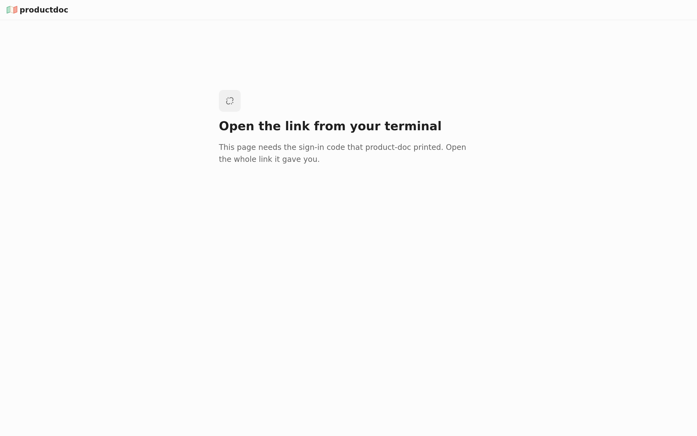
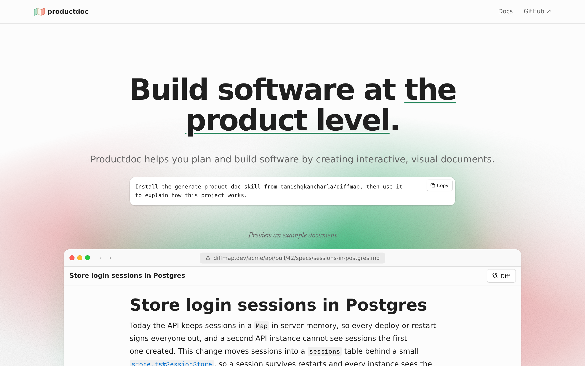

# ✅ Point the Worker at share.productdoc.dev

[The cover](README.md) settles who can share and read. This phase moves the Worker onto its own address.

**Today:** the Worker lives on a workers.dev URL. The plan was to move all of productdoc.dev onto it later, so it serves a copy of the website, and that copy is six commits behind main.

productdoc.dev's DNS already moved to Cloudflare, but its records still send every host to Vercel. That includes `share.productdoc.dev`, through a `*.productdoc.dev` record. Attaching the Worker adds a record for `share.productdoc.dev` alone, which takes precedence over the wildcard.

**Proposed:** the Worker answers only on `share.productdoc.dev`, and only for sharing: `/d/<id>`, `/device`, and `/api/*`. Any other path redirects to `https://productdoc.dev`.

Changes on the existing branch:

- `alchemy.run.ts`: always attach `share.productdoc.dev`. Drop `PRODUCTDOC_LIVE` and the abuse email forwarding. The productdoc.dev zone and its two Vercel records stay in the stack, because removing them would make the next deploy delete them.
- `src/cloud/worker.ts`: replace the website fallback with the redirect, and remove `src/cloud/site.ts`'s copy of the website routes.
- `cloud/README.md`: describe the subdomain setup.

## Expected flows

1. Open `https://productdoc.dev`: it's the current Vercel site, unchanged.
2. Open `https://share.productdoc.dev`: it redirects to productdoc.dev.
3. Open `https://share.productdoc.dev/device`: the sign-in page loads over HTTPS.
4. Run `product-doc share` without `PRODUCTDOC_ORIGIN`: it still makes a gist.

## Result

Deployed November 19. The plan changed only the Worker (its domain and admin token); the zone, Vercel records, database, and bucket were unchanged.

| Check                                      | Live result                                                   |
| ------------------------------------------ | ------------------------------------------------------------- |
| `productdoc.dev`                           | 200, `server: Vercel`                                         |
| `share.productdoc.dev/`                    | 301 → `https://productdoc.dev/`                               |
| `share.productdoc.dev/docs?x=1`            | 301 → `https://productdoc.dev/docs?x=1`                       |
| `share.productdoc.dev/device`              | 200 over HTTPS                                                |
| `share.productdoc.dev/api/config`          | 200, `providers: []` until [Phase 2](02-sign-in-and-proof.md) |
| `share --help` without `PRODUCTDOC_ORIGIN` | the gist command                                              |

:::gallery side-by-side


:::

```changes
41e377b
alchemy.run.ts
src/cloud/worker.ts
src/cloud/protocol.ts
cloud/README.md

ignore:
cloud/.env.example
src/cli.ts
src/cloud/client/SharedApp.tsx
src/cloud/site.ts
src/cloud/takedown.ts
```
