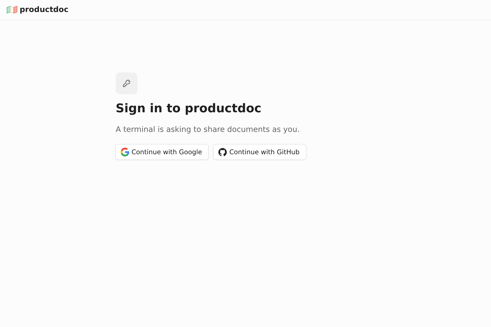
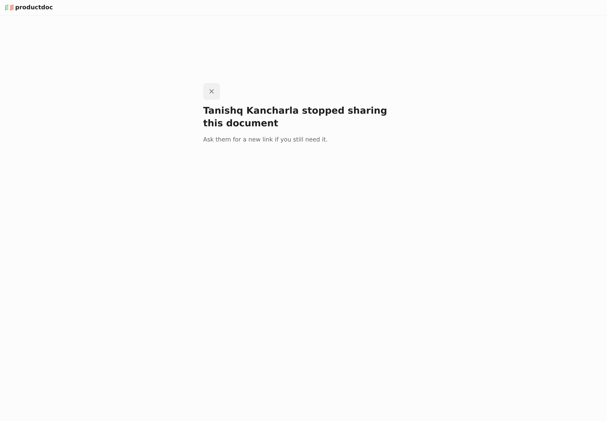
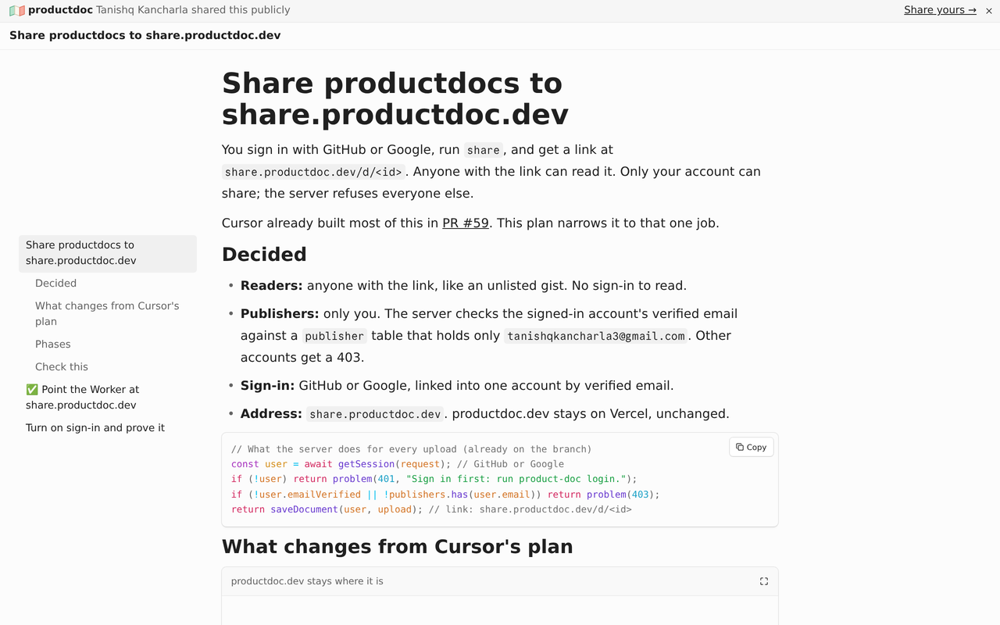
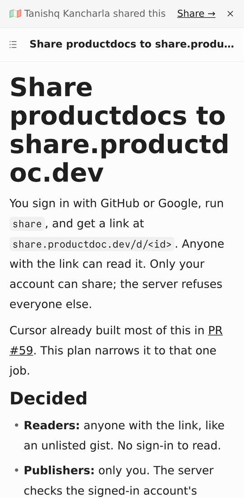
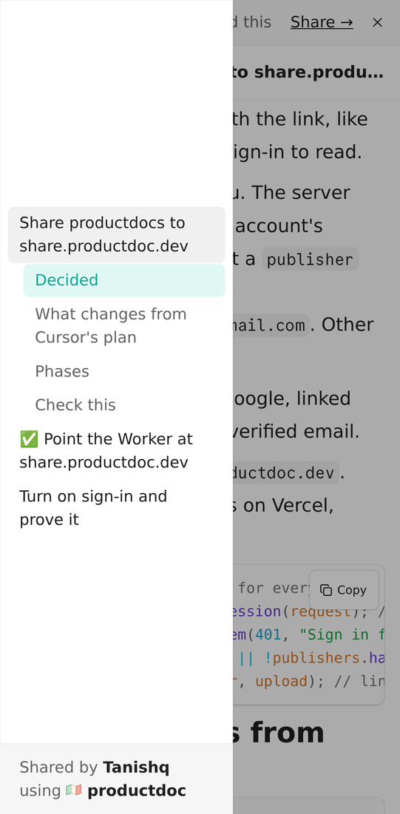

# ✅ Turn on sign-in and prove it

[Phase 1](01-share-subdomain.md) put the Worker on `share.productdoc.dev`. This phase turns on GitHub and Google sign-in and tests sharing end to end on the real deployment.

**Today:** the deployed Worker has no sign-in providers, so nobody can share.

**Proposed:** create the two OAuth apps, store their secrets, and deploy.

| App                 | Callback URL                                            |
| ------------------- | ------------------------------------------------------- |
| GitHub OAuth app    | `https://share.productdoc.dev/api/auth/callback/github` |
| Google OAuth client | `https://share.productdoc.dev/api/auth/callback/google` |

Cloudflare credentials and the admin token are kept as Amp secrets, not on one machine, so a later thread can redeploy.

## Expected flows

1. You run `share` on a real productdoc, sign in with GitHub, approve the terminal, and get a link.
2. A signed-out browser opens the link and sees the same pages, diffs, source, and media as `serve` shows locally.
3. You sign in with Google: it's the same account, and `share` works.
4. A different GitHub account signs in and runs `share`: it's refused with "Sharing to productdoc.dev isn't open to this account."
5. `share --stop`: the link now says you stopped sharing it, and its files no longer load.
6. An agent fetches the link's `.md` version and reads the document as text.

## Result

Deployed November 20. `/api/config` lists both providers, `google` and `github`.

| Flow                    | Live result                                                                                                                                       |
| ----------------------- | ------------------------------------------------------------------------------------------------------------------------------------------------- |
| 1. Share with GitHub    | Signed in with GitHub, approved the terminal, got [share.productdoc.dev/d/f10u1c4q5j](https://share.productdoc.dev/d/f10u1c4q5j).                   |
| 2. Signed-out reader    | Every page, diff, and screenshot loads without signing in.                                                                                         |
| 3. Google, same account | Signed out, signed in with Google: same user ID, now with `github` and `google` linked. `share` worked.                                              |
| 4. Someone else         | With your email taken off the `publisher` list, upload returned 403. No second real account has tried yet. A missing or fake token returns 401. |
| 5. `share --stop`       | The page says you stopped sharing, and its files return 404.                                                                                      |
| 6. `.md` version        | Returns the document as Markdown.                                                                                                                 |

Development sign-in returns 404 and email sign-up returns 400 on the deployment, so GitHub and Google are the only ways in.

:::gallery side-by-side


:::

The reader also got a pass for phones: the page no longer scrolls sideways, the sharing bar fits on one line with an X to close it, the contents button lines up with the logo, and the contents drawer is centered with a credit at the bottom.

:::gallery side-by-side



:::

```changes
41e377b..b580c7d
src/viewer/share/SharedPage.tsx
src/viewer/TableOfContents.tsx
src/viewer/TocButton.tsx
src/viewer/share/DevicePage.tsx

ignore:
src/viewer/share/ProviderLogos.tsx
src/viewer/ViewerApp.tsx
src/cloud/client/SharedApp.tsx
```
