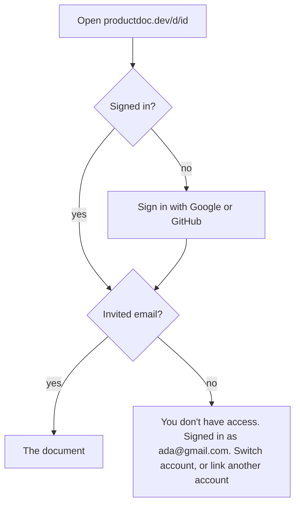

# Phase 5: Restricted access and invitations

[Phase 2](03-share-from-the-viewer.md) added the share dialog with Public access, [Phase 3](04-one-link-per-document.md) one link per document, and [Phase 4](05-live-link.md) live links. This phase adds **Restricted**: only the people the owner adds by email can open the link. People without a productdoc account get an invitation to sign in.

**Today, after Phase 4**

Every shared document is public to anyone with its link.

**Proposed**

The dialog's access menu offers **Restricted**, "Only people you've added get access", as in Halo. Once this lands it is the default for a document's first share, so nothing becomes public without the owner choosing it. As in Halo, Restricted shows no browser frame; only Public previews how the link will look. Choosing it shows:

- **Add people by email**, which checks each entry is a full address, such as name@example.com.
- **People with access**: the owner first, then each person added, each with a remove button. While there are unsaved changes, the heading reads "People · invitations send when you share".
- The main button names the change: **Share with 2 people**, **Unshare with 1 person**, **Restrict access**, **Make public**, or **Update access**.

```flow [Sharing with people]
share-dialog--first-share
  share-dialog--people-added: Add ada@acme.com and grace@acme.com
    share-dialog--signing-in: Click "Share with 2 people"
      share-dialog--sharing: Approve the code in the productdoc.dev popup
        share-dialog--shared: The upload finishes
  share-dialog--choose-public: Choose Public
  share-dialog--invalid-email: Add "ada@acme"
```

Opening the dialog on a document shared this way lists who has access:

```preview [The dialog on a document shared with people]
share-dialog--shared-with-people
```

The CLI takes the same choices: `product-doc share <dir> --restricted --add ada@acme.com --add grace@acme.com`, or `--public`.

## Invitations

When the owner shares with someone, the Worker emails them through Cloudflare Email Sending, from `share@productdoc.dev`:

```text [The invitation]
Subject: Tanishq shared "Session store" with you

Tanishq Kancharla (tanishq@example.com) shared a productdoc with you.

  Open "Session store"  →  https://productdoc.dev/d/k3v9q2xa7m

Sign in with Google or GitHub using ada@acme.com to open it.
```

A person who already has a productdoc account gets the same email without the last line. Removing someone sends nothing; their access ends at once.

## Opening a Restricted link



The Worker checks access on every request for the manifest and every blob. It matches the document's `document_member` emails against `user_email`, which holds every verified address on the reader's linked accounts. So a reader invited at their work Google address can also open the link after signing in with a GitHub account linked to it.

The "no access" page names the account the reader is signed in with and offers to switch accounts or link another, since a wrong account is the usual cause. It does not say whether the document exists, so a stranger guessing links learns nothing.

## Previews and HTML in Restricted documents

[Phase 6](07-previews-and-html.md) runs previews and HTML in frames on `<id>.productdocusercontent.com`, which cannot read productdoc.dev's cookie. For a Restricted document, productdoc.dev gives each frame a short-lived signed link. The usercontent Worker checks it once, then sets a `Partitioned` cookie for that document's subdomain, so the frame keeps working inside productdoc.dev and nowhere else.

## Changing access later

Switching a document from Public to Restricted takes effect at once for new requests. Public blobs may already sit in Cloudflare's cache under their hash, so the switch purges the document's URLs from it. Switching to Public keeps the member list, so switching back restores it, as Halo does.

## Todos

- [ ] The `document_member` and `user_email` tables, filled from each linked account's verified emails
- [ ] Restricted in the dialog: adding and removing people, and the button labels for each change
- [ ] `--restricted`, `--add`, and `--public` on `product-doc share`
- [ ] Access checks on every manifest and blob request, with `Cache-Control: private`
- [ ] Sign-in on productdoc.dev for readers, and the "no access" page with switch and link account
- [ ] Invitation emails through Cloudflare Email Sending, with the daily limit
- [ ] Purge the cache when a document becomes Restricted
- [ ] Make Restricted the default for a first share
- [ ] Tests for access by a linked account's email, and for a removed person

```changes

```
