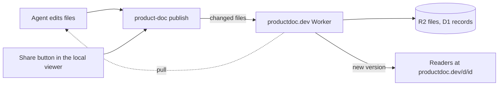

# Productdoc: share a document

Share a productdoc at a link on productdoc.dev that, like a Notion page, always shows the latest edits. Agents share with `npx product-doc share`; people share from a **Share** button in the local viewer, with a dialog modeled on [Halo's](https://github.com/cashew-labs/halo/blob/main/packages/web/src/panes/ShareAppForm.tsx).

diffmap, diffmap.dev, and the `@tanishqkancharla/diffmap` package don't change.

## The design

- **Files stay the source of truth.** Agents keep editing Markdown in the repo. productdoc.dev works like a git remote: `publish` pushes edits, `pull` brings in someone else's.
- **The document folder remembers its link.** Sharing writes `.productdoc.json` into the folder, and it's committed with the document. Any agent on any machine sees it, so no agent has to remember anything.
- **The CLI tells agents when to publish.** On a shared document, `validate` and `serve` say when the link is behind. The guide says to finish edits with `product-doc publish`.
- **No toggle.** A shared link always follows the document. The header shows **Shared**, or **Shared · 2 to publish** when it's behind.
- **The link works with the machine turned off.** Sharing uploads pages, media, diffs, source files, and built previews.
- **Access:** Public, or Restricted to people added by email, who get an invitation.

## Phases

1. [Publish from the CLI](02-publish-from-the-cli.md): `product-doc share` makes a public link. **The first version.**
2. [Share from the viewer](03-share-from-the-viewer.md): the Share button and dialog, Public only.
3. [Keep the link current](04-keep-the-link-current.md): `publish`, `pull`, and readers seeing edits live.
4. [Restricted access and invitations](05-restricted-and-invites.md)
5. [Previews and HTML](06-previews-and-html.md)
6. [Definitions and commit ranges](07-definitions-and-ranges.md)
7. [Later: teams and CI](08-later.md)

[Where it runs](01-where-it-runs.md) covers the platform: Cloudflare, Better Auth, storage, limits, and security.

## Decided

- Cloudflare for productdoc.dev. diffmap.dev stays on Vercel.
- Better Auth with Google and GitHub, with account linking.
- No GitHub app, and no cloud editing tools.
- Teams later.
