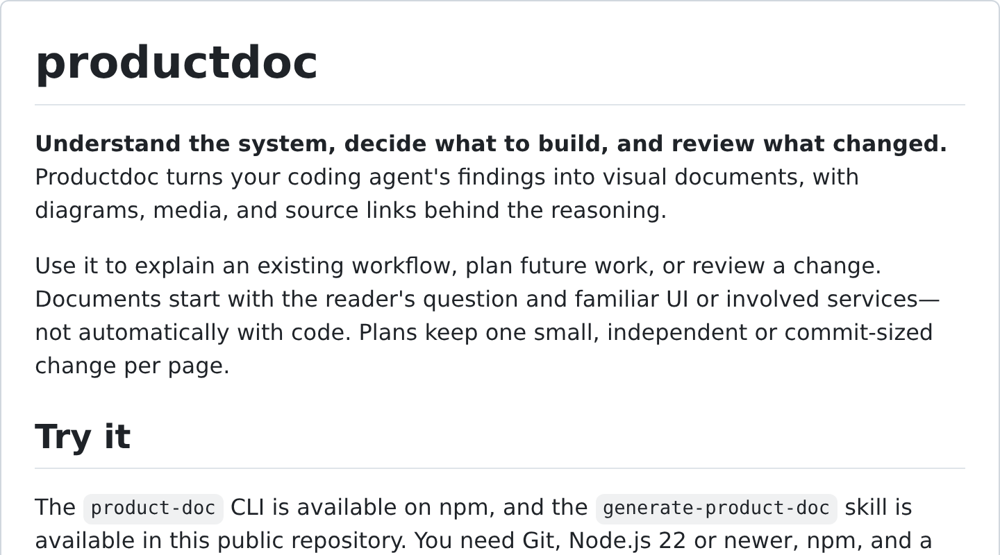
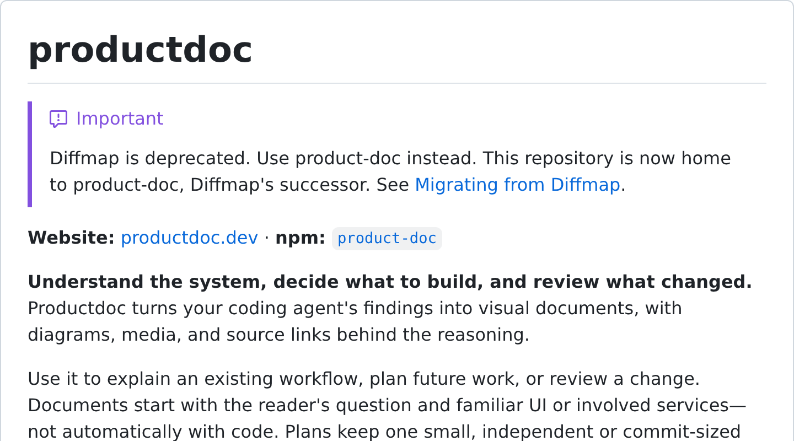

# Put product-doc at the top of the README

Visitors to [github.com/tanishqkancharla/diffmap](https://github.com/tanishqkancharla/diffmap) should see product-doc first, and should learn right away that Diffmap is deprecated. This matches the final Diffmap release, which tells users "Diffmap is deprecated, use product-doc instead."

Status: approved and built in the working tree; not pushed yet. The About sidebar is still unchanged because the orb's GitHub token cannot edit repository settings.

## What visitors see today

The README already opens with `# productdoc` and the product-doc pitch, so product-doc is technically first. But the top never says Diffmap is deprecated, and it does not link productdoc.dev or the npm package. A visitor who came for Diffmap only learns what happened in "Migrating from Diffmap", about 30 lines down, which still says Diffmap "is being retired".

## Proposed README top

Add a short deprecation notice and one line of links above the existing pitch. Everything else at the top stays the same. Compare the notice and the links line under the title:

:::gallery side-by-side


:::

Both captures come from GitHub's own Markdown renderer, so the Proposed side is how the notice will look on GitHub.

```diff [README.md top]
 # productdoc

+> [!IMPORTANT]
+> Diffmap is deprecated. Use product-doc instead. This repository is now home to product-doc, Diffmap's successor. See [Migrating from Diffmap](#migrating-from-diffmap).
+
+**Website:** [productdoc.dev](https://productdoc.dev) · **npm:** [`product-doc`](https://www.npmjs.com/package/product-doc)
+
 **Understand the system, decide what to build, and review what changed.** Productdoc turns ...
```

The `[!IMPORTANT]` block is a GitHub alert. It renders as the purple callout on GitHub and as a plain quote on npm.

## Matching the deprecation release

"Migrating from Diffmap" changes one sentence so the README and the release say the same thing:

```diff [README.md, Migrating from Diffmap]
-Diffmap is being retired. Use `generate-product-doc` and `product-doc` for new work, not the legacy skill or package.
+Diffmap is deprecated. Use `generate-product-doc` and `product-doc` for new work, not the legacy `generate-diffmap` skill or `@tanishqkancharla/diffmap` package.
```

## Not in this change

- **GitHub's About sidebar.** Approved, but not done from here. It still says "big diff energy" with diffmap.dev as the website. Changing it to the package description, "Visual documents to explain systems, plan work, and review changes", and https://productdoc.dev would finish the job. Tanishq approved this, but it needs a token with admin rights on the repository settings.
- **The repository name.** It stays `diffmap`; the README already says the URL is kept.
