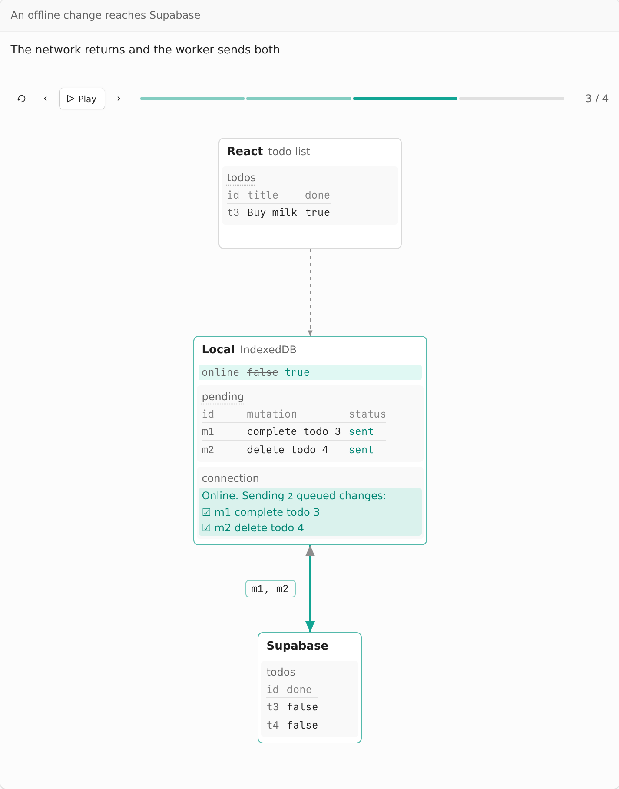
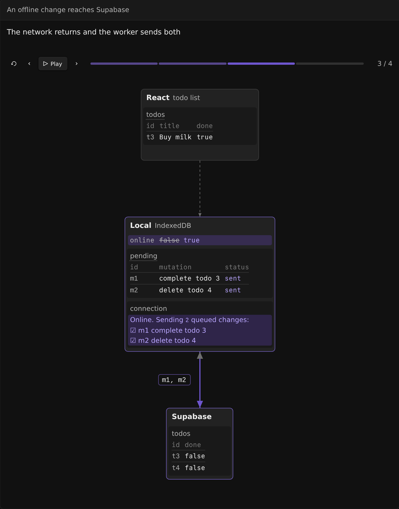
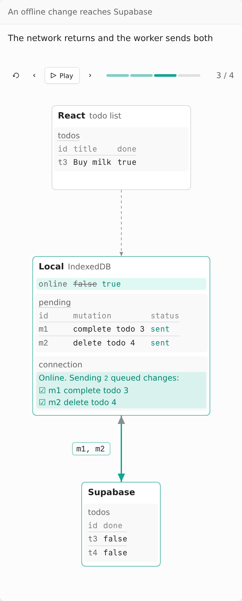
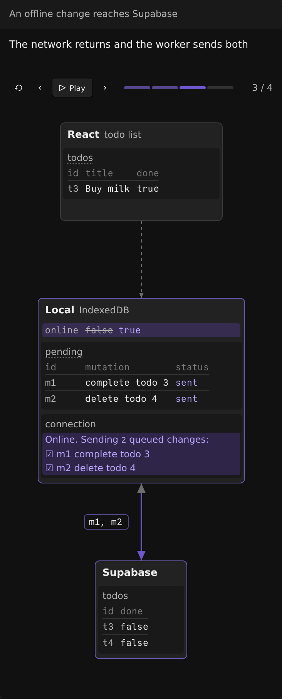
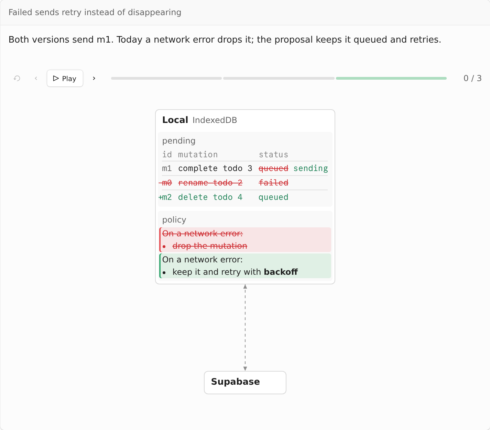
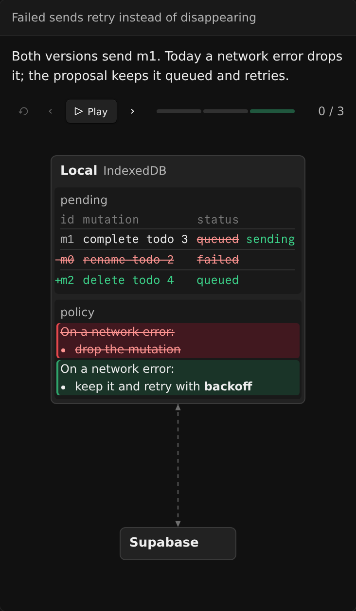

# ✅ Phase 2: Text state

[Phase 1](01-inspectable-state.md) moved rules and decisions out of state. Some state is still prose: a checklist, a draft message, a plan the service follows. This phase adds a `text` shape for it.

**Today**

Prose has to fit on one `state key = value` line. The eval's `Build.readiness = ready only after acceptance checks pass` packs a checklist into a sentence, and the card grows as wide as the sentence.

**Proposed**

A service can hold Markdown under a key. It renders as prose in the card, wraps at about 36 characters, and a step can replace it. Built in c379aba.

## Syntax

```text
service Build "CI"
  text checks
    > What CI has verified for this build.
    | - [x] Unit tests
    | - [ ] Acceptance on device

step "The device farm passes the acceptance run"
  Build.checks =
    | - [x] Unit tests
    | - [x] Acceptance on device
    > Ready to hand to Release.
  %% A one-line text can stay on the update line:
  %% Build.checks = **Ready** for release
```

- `text <key>` declares it. Indented `|` lines under it are its Markdown, one source line each. With no `|` lines it starts empty.
- `Service.key =` followed by `|` lines replaces the whole text in a step. `Service.key = one line` replaces it with one line.
- `>` lines keep their meaning: under the declaration, a tooltip description; under an update, a note beside the text.
- A text that no step changes is a longer service description that stays visible.

## How it looks

Step through it. `Local.connection` is a text: it starts as a sentence, becomes a checklist in step 3, and goes back to a sentence in step 4. A text sits on the same soft panel as a table, under its title. A changed text takes the teal highlight a changed value gets; the old text isn't repeated beside it, and ← shows it.

```services
service React "todo list"
service Local "IndexedDB"
  text connection
    > What the sync worker tells the user.
    | Offline. Changes **queue** until the network returns.
service Supabase

start "The connection text follows the sync worker"
  > The text changes twice: when sending starts and when the queue empties.
step "Alice completes a todo while offline"
  React -> Local: complete t3
step "Alice deletes another"
  React -> Local: delete t4
step "The network returns and the worker sends both"
  Local -> Supabase: m1, m2
  Local.connection =
    | Online. Sending `2` queued changes:
    | - [x] m1 complete todo 3
    | - [x] m2 delete todo 4
    > A checklist, with inline code and bold.
step "Supabase confirms both"
  Supabase -> Local: ack m1, m2
  Local.connection = Online. Nothing queued.
```

Captured from the [services fixture](../../../fixtures/services/README.md), on the step where the text changes:

:::gallery grid




:::

### In a `services diff`

`text` follows the existing diff rules. Its `|` lines take the sign they start with, so Today reads the unmarked and `-` lines and Proposed the unmarked and `+` lines. A `-` or `+` step update replaces the text on that side only. Where the sides differ, the card shows Today's text struck through in red above Proposed's in green:

```services diff
 service Local "IndexedDB"
   text policy
     | On a network error:
-    | - drop the mutation
+    | - keep it and retry with **backoff**
 service Supabase

 start "Failed sends retry instead of disappearing"
 step "The worker sends m1"
   Local -> Supabase: m1
```

:::gallery side-by-side


:::

## Implementation

- [[src/services.ts#parseServiceDiagram]] reads `text <key>` and `|` lines. A `|` line appends to the open text declaration or text update, the way `>` appends to a description; `Service.key =` with nothing after it must be followed by `|` lines.
- [[src/services.ts#serviceStateAt]] replays a text as its Markdown string for each side.
- [[src/viewer/ServiceStateBlock.tsx#StateBlock]] draws the block under the card's key/value rows. [[src/viewer/ServiceStateBlock.tsx#StateMarkdown]] supports paragraphs, bulleted and numbered lists, `[ ]`/`[x]` checklists, bold, italic, and inline code, which is what state text needs; it doesn't pull the page's Markdown parser into the viewer bundle.
- [[src/viewer/ServiceStage.tsx#widestState]] reserves the widest text any step or side shows, so the card keeps its size while the reader steps.

## Tests

In [[src/parseViewer.test.ts]]:

- A text replaced by a multi-line update replays to the new Markdown at that step, keeps the indentation after each bar, and a later one-line update replaces it again.
- In a diff, a text with a `-` line and a `+` line gives each side its own Markdown.
- `Service.key =` with no text and no `|` lines fails on its line.

```changes
c379aba
src/services.ts
src/viewer/ServiceStateBlock.tsx
src/viewer/ServiceStage.tsx
src/parseViewer.test.ts

ignore:
README.md
guide.md
fixtures/diagram-diffs/README.md
fixtures/services/README.md
```
