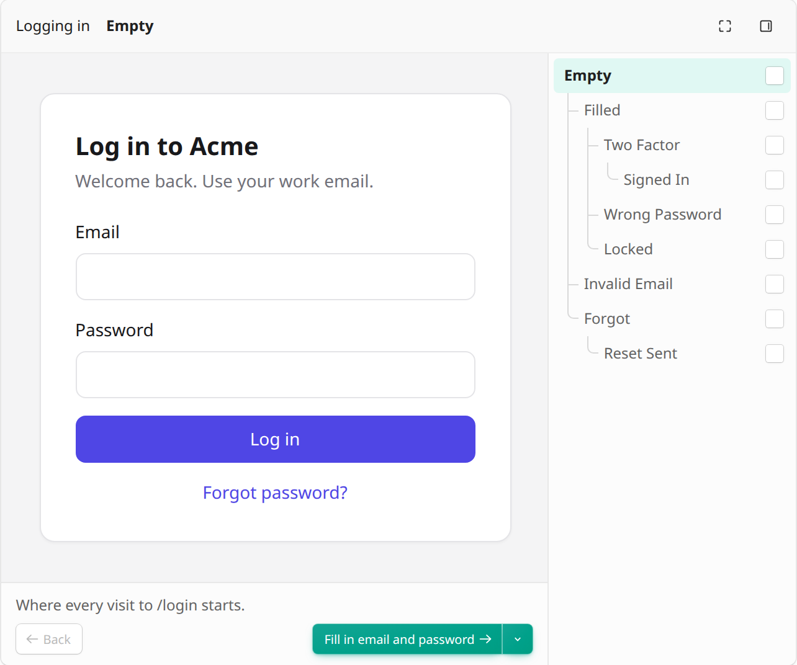
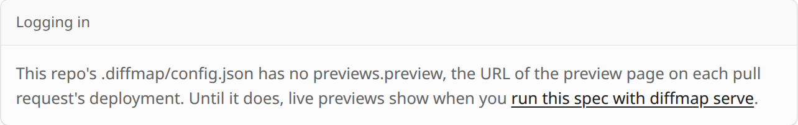
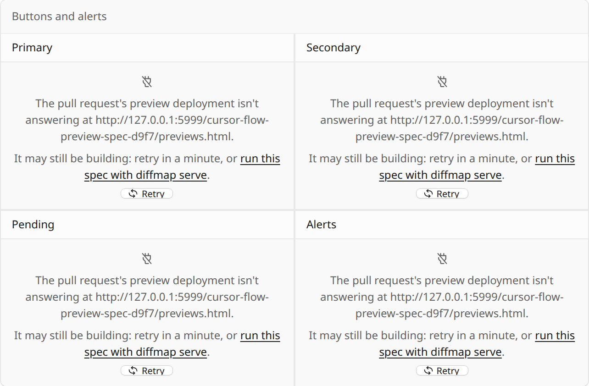

# ✅ Phase 6: Previews on diffmap.dev, and the guide

[Phase 2](02-preview-block.md) through [Phase 5](05-expanded-flow.md) work in the local viewer. This phase shows previews on a pull request, and tells agents how to write them.

**Today**

On diffmap.dev, a spec can only show what is committed: text, diagrams, and screenshots. A `preview` or `flow` block there says to run the spec with `diffmap serve`.

**Proposed**

On diffmap.dev, both blocks load the app's preview page from the pull request's preview deployment, so the reviewer gets the same live UI as the author. The URL comes from `previews.preview` in the repo's `.diffmap/config.json`:

```json [.diffmap/config.json]
{
  "previews": {
    "local": "http://localhost:5173/previews.html",
    "preview": "https://myapp-git-{branch}-myteam.vercel.app/previews.html"
  }
}
```

diffmap.dev reads the config at the commit the spec is pinned to, nearest the spec first and then each parent directory up to the repo root, as `serve` does on disk ([[d7c47ab:src/github/fetchRepo.ts#L265-L305]]). It fills the placeholders from the pull request that [[d7c47ab:src/github/fetchRepo.ts#L324-L366]] already reads for its head SHA, which now also returns the head branch ([[d7c47ab:src/diffmapConfig.ts#L75-L109]]):

- `{sha}` is the pinned commit.
- `{pull}` is the pull request's number.
- `{branch}` is the head branch as Vercel and Netlify put it in a hostname: lowercase, with every run of characters other than letters and digits turned into `-`. So `cursor/flow-preview-spec` becomes `cursor-flow-preview-spec`.

On a pull request, the GitHub view hands the blocks that config and the pull request through a context ([[d7c47ab:src/github/GitHubApp.tsx#L300-L316]]), and the local viewer keeps reading `serve`'s config as before ([[d7c47ab:src/viewer/previews/config.ts#L6-L25]]). [[d7c47ab:src/viewer/previews/PreviewBlock.tsx#L79-L130]] picks `previews.local` locally and the filled `previews.preview` on diffmap.dev.

When the blocks can't show live UI, they say why and link to running the spec locally. A flow on a pull request plays the same as it does locally:



The repo has no `previews.preview`:



The deployment doesn't answer, because it is still building, or is private:



A spec opened by commit, with no pull request to fill `{pull}` or `{branch}` from, names the missing placeholder and links to the same instructions.

The guide splits into topics, so an agent reads the UI parts only when a change has UI. `diffmap guide` still prints the main guide, now with a short "UI changes" section that sends the agent to two topics ([[guide.md]]):

- `diffmap guide ui` prints how to show a UI change: live when it has stories, otherwise screenshots and recordings ([[guide/ui.md]]). This was the main guide's "Capture UI changes" section.
- `diffmap guide previews` prints the new "Live previews" topic ([[guide/previews.md]]), covering:
  - when to use a `preview` block, a `flow` block, or screenshots;
  - the fence syntax;
  - a one-time setup in the app: the libraries, the preview page for Vite and Next.js, the frame header on the dev server and on preview deployments, and `.diffmap/config.json`;
  - how to write the stories, and how to check each state before handing back the spec.

Feedback stays in the main guide. The topics ship in the package beside `guide.md`, so they always match the installed viewer, as the main guide does ([[src/cli.ts]]).

[[skills/generate-diffmap/SKILL.md]] names previewing components and user flows in its description, so agents pick it for the requests that used to trigger flow-preview. The flow-preview repo's README will point to diffmap, in a separate PR in that repo.

Checked with the diffmap.dev build (`npm run build:gist`, served with `npm run preview:gist`) on this pull request, with Playwright standing in for GitHub's answer for `.diffmap/config.json`:

- With `previews.preview` set to the example app's page, with all three placeholders, every block loaded `previews.html?branch=cursor-flow-preview-spec-d9f7&sha=b22c0c0…&pull=40`, and the log-in flow stepped through its states.
- Without `previews.preview`, which is this repo's real config, the blocks showed the notice above.
- With a port nothing listens on, every frame showed the deployment notice after 8 seconds.

The local viewer still loaded all seven frames on the examples page. Tests cover filling the URL, the config lookup order, and reading the config from GitHub.

This repo's own `.diffmap/config.json` has no `previews.preview` yet. The example app has no preview deployment, so on diffmap.dev this spec's blocks show the notice.

```changes
d7c47ab
src/diffmapConfig.ts
src/readDiffmapConfig.ts
src/github/fetchRepo.ts
src/github/GitHubApp.tsx
src/viewer/previews/config.ts
src/viewer/previews/PreviewBlock.tsx
src/viewer/previews/PreviewFrame.tsx
guide.md
skills/generate-diffmap/SKILL.md

ignore:
src/serve.ts
src/github/fetchRepo.test.ts
src/viewer/previews/previews.test.ts
```

```changes
9779b1e
guide.md
guide/ui.md
guide/previews.md
src/cli.ts
src/viewer/previews/PreviewFrame.tsx
package.json

ignore:
src/cli.test.ts
```
