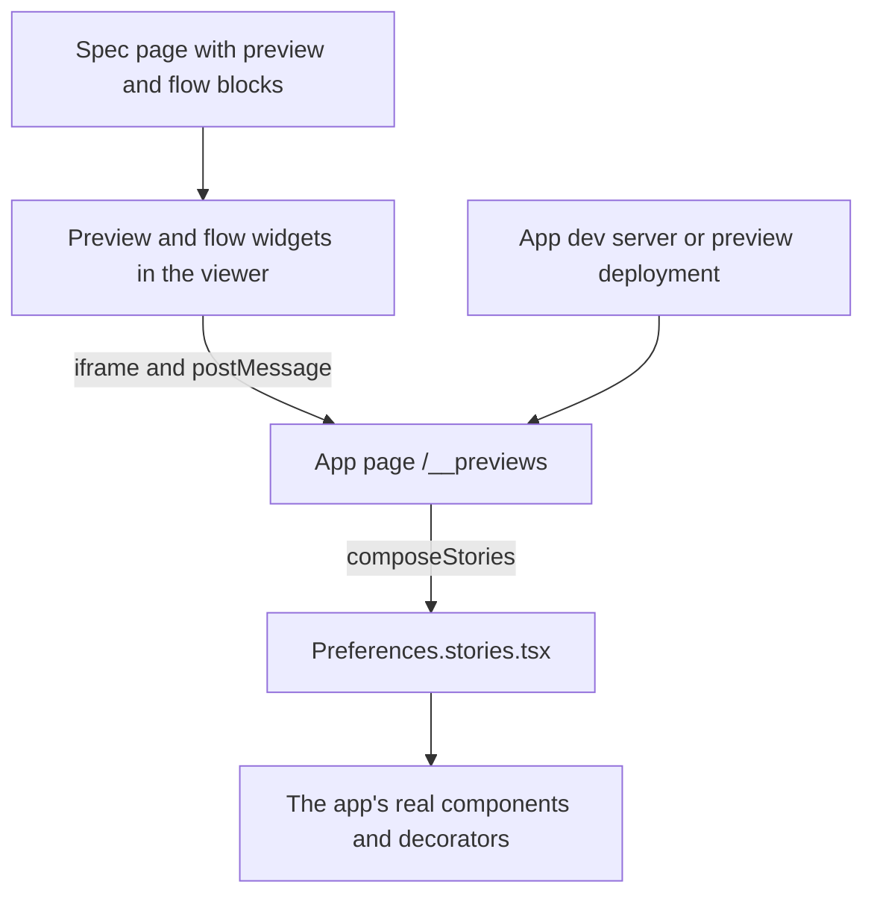

# Live UI in a diffmap spec: stories and flows

A spec for a UI change should let the reader see the change, not a description or a still of it. This spec adds two interactive blocks to diffmap, both running the app's real components with their real styles and animations:

- A **`preview`** block shows components or new designs on their own: one story, or several variants side by side.
- A **`flow`** block shows a user journey: a set of those stories joined by what the user does to move between them, with breadcrumbs, next-step buttons, and a map. It brings [flow-preview](https://github.com/tanishqkancharla/flow-preview) into diffmap.

The people using this build web apps. They already have a design system, a bundler, a dev server, and usually a preview deployment for each pull request. Many already write [Storybook](https://storybook.js.org) stories. So diffmap does not build their components, and it does not invent a format for describing them. Each piece of UI is a story in Storybook's format, rendered by Storybook's own library inside the app, and diffmap draws its controls around it.

## Problem

**What a diffmap spec shows today.** For a UI change, [[guide.md]] asks for one screenshot per state, with Today beside Proposed in a gallery. Screenshots are not interactive, show no animation or hover state, and leave the reader to piece together from prose how the states connect.

**How flow-preview renders components.** The skill's generator ([`scripts/generate.mjs`](https://github.com/tanishqkancharla/flow-preview/blob/e9894aa/scripts/generate.mjs)) writes a second app to `tmp/<name>/`, with its own `package.json`, its own React, Maui, and Vite, and its own `npm install`. That second build knows nothing about the project's own build. Path aliases, Tailwind or PostCSS, CSS modules, SVG loaders, environment variables, global stylesheets, fonts, theme classes, and app-wide providers all have to be recreated by hand, and flow-preview's [`SKILL.md`](https://github.com/tanishqkancharla/flow-preview/blob/e9894aa/SKILL.md) spends a whole section on keeping that copy in line with the app. Each state is described in a flow-preview-only format, the canvas is built to fill a browser window, and the preview lives only in `tmp/` on the agent's machine, so a reviewer never sees it.

## Solution

The app gets one dev-only page, `/__previews`, that renders any story through Storybook's portable stories API, `composeStories` from `@storybook/react`. That applies the project's own decorators, so each story renders inside the app's real layout, providers, styles, and fonts, as it does in Storybook. It also runs each story's `play` function, Storybook's way of reaching a state by acting on the UI. diffmap's viewer embeds the page in an iframe, drives it with messages, and draws everything else itself.



The agent writes ordinary stories next to the component, or reuses the ones the team already has:

```tsx [src/settings/Preferences.stories.tsx]
import type { Meta, StoryObj } from "@storybook/react";
import { userEvent, within } from "storybook/test";
import { Preferences } from "./Preferences";

const meta = {
  title: "Settings/Preferences",
  component: Preferences,
} satisfies Meta<typeof Preferences>;
export default meta;
type Story = StoryObj<typeof meta>;

export const Editing: Story = {};

export const EmptyName: Story = {
  parameters: {
    docs: {
      description: { story: "Saving waits until the digest has a name." },
    },
  },
  play: async ({ canvasElement }) => {
    await userEvent.clear(within(canvasElement).getByLabelText("Digest name"));
  },
};

export const Saved: Story = {
  parameters: { docs: { description: { story: "A confirmation slides in." } } },
  play: async ({ canvasElement }) => {
    await userEvent.click(
      within(canvasElement).getByRole("button", { name: "Save preferences" }),
    );
  },
};
```

A spec shows components with a `preview` block, naming stories by their Storybook ID, and a journey with a `flow` block, which indents each story under the one it follows and names the action between them:

````text
```preview [The digest name field]
settings-preferences--editing
settings-preferences--empty-name
```

```flow [Saving preferences]
settings-preferences--editing
  settings-preferences--empty-name: Clear the name
  settings-preferences--saved: Save preferences
```
````

The stories stay plain Storybook stories, with nothing diffmap-specific in them. The journey belongs to the spec, so the same stories can appear in several flows, and a team's existing Storybook keeps working unchanged.

The `previews` key in the repo's `.diffmap/config.json` tells the viewer where the page lives, locally and on each pull request. It is diffmap's single config file, so later settings become sibling keys rather than more files:

```json
{
  "previews": {
    "local": "http://localhost:5173/__previews",
    "preview": "https://myapp-git-{branch}.vercel.app/__previews"
  }
}
```

In the page, both blocks fit the text column. The live UI is an iframe; everything around it is the viewer's own UI:

```text [A preview block, inline]
+- The digest name field ------------------------ [expand] -+
| +-------------------------+  +-------------------------+ |
| | iframe: Editing          |  | iframe: Empty name      | |
| +-------------------------+  +-------------------------+ |
|  Editing                       Empty name                 |
|                                Saving waits until ...     |
+-----------------------------------------------------------+
```

```text [A flow block, inline]
+- Saving preferences --------------------------- [expand] -+
| Editing  >  Saved                          (breadcrumbs)  |
| +-------------------------------------------------------+ |
| |   iframe: the selected story, live                    | |
| +-------------------------------------------------------+ |
| < Editing                   A confirmation slides in.     |
| +--------+  +--------+  +--------+                        |
| | [x]    |  | [ ]    |  | [ ]    |                        |
| +--------+  +--------+  +--------+                        |
|  Editing     Empty name  Saved                            |
+-----------------------------------------------------------+
```

A flow's expand button opens the full canvas over the page, with the outline, a zoomable map of every state, and the same live preview, as flow-preview lays it out today.

**What this removes, compared with flow-preview**

- The second app in `tmp/`, its install step, and keeping its React and design-system versions in line with the project.
- Copying global styles, fonts, and providers into a preview: the project's Storybook decorators already wrap them.
- A diffmap-only format for states. Stories work in Storybook, in tests through the same portable stories API, and in diffmap.
- Any new runtime dependency in diffmap's CLI: no Vite, React, Storybook, or browser automation at `serve` time.

**What it costs**

- A one-time setup in the app: the dev-only page, added by the agent the first time it writes a preview.
- `@storybook/react` and its peer `storybook` as dev dependencies, if the app does not have them. The page needs only the library; nothing runs a Storybook server.
- A running dev server to see previews locally, and a preview deployment to see them on a pull request.

## Goals

- A spec page shows components, design variants, and journeys live, in blocks that fit the text column and expand.
- Each story renders through the app's own build and decorators, so it looks and moves exactly as it does in the app.
- Moving to the next state of a flow plays the app's own transitions, by running the next story's `play` on the live UI.
- A reviewer on diffmap.dev sees the same live blocks, through the pull request's preview deployment.
- No code from the repo runs in the viewer's own page, on diffmap.dev or locally.

## Non-goals

- Building or bundling the app's code in diffmap.
- Frameworks other than React for now. Storybook's portable stories exist for Vue, Svelte, and others, so the page could follow later.
- Comparing two revisions side by side. Showing Today needs a second dev server or the base branch's deployment; that is a later spec.
- Embedding a deployed Storybook's own `iframe.html`. It would need no page in the app, but the viewer cannot size it, read its state, or switch stories without a reload across origins, so flows would lose their live transitions.
- Shipping `/__previews` to production. The page exists in development and preview builds only.

## References

- Storybook's [portable stories](https://storybook.js.org/docs/api/portable-stories/portable-stories-vitest) (`composeStories`, `setProjectAnnotations`) and [play functions](https://storybook.js.org/docs/writing-stories/play-function).
- flow-preview at [`e9894aa`](https://github.com/tanishqkancharla/flow-preview/tree/e9894aa): [`SKILL.md`](https://github.com/tanishqkancharla/flow-preview/blob/e9894aa/SKILL.md), [`scripts/generate.mjs`](https://github.com/tanishqkancharla/flow-preview/blob/e9894aa/scripts/generate.mjs), [`assets/FlowCanvas.tsx`](https://github.com/tanishqkancharla/flow-preview/blob/e9894aa/assets/FlowCanvas.tsx), [`NOTICE`](https://github.com/tanishqkancharla/flow-preview/blob/e9894aa/NOTICE). flow-preview is Apache-2.0 and diffmap is MIT, so code that moves keeps its license and NOTICE.
- diffmap: [[src/viewer/Fence.tsx#Fence]], [[src/parseFence.ts#parseFence]], [[src/viewer/MermaidBlock.tsx#MermaidBlock]], [[src/viewer/reviewed.ts#useReviewedFiles]], [[src/serve.ts#contentSecurityPolicy]], [[src/github/fetchRepo.ts]].
