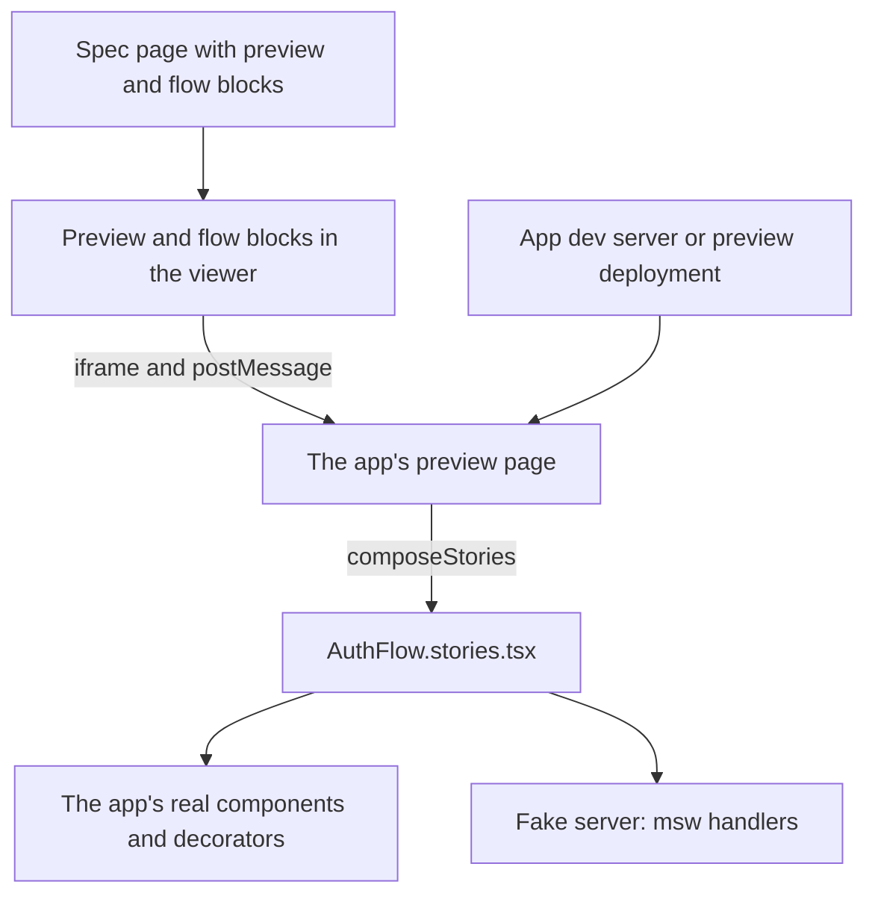
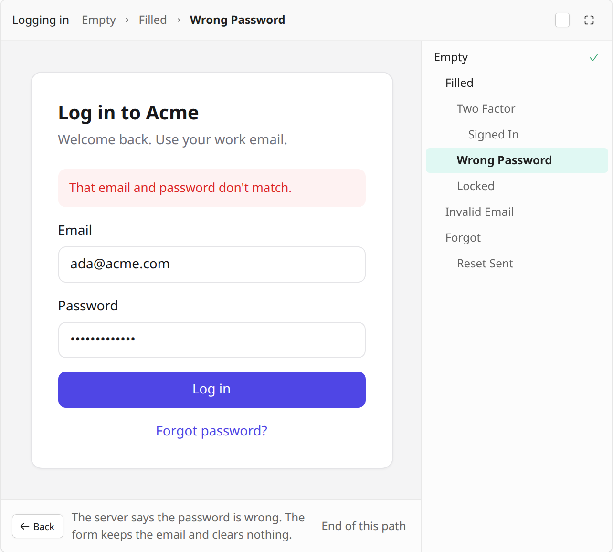
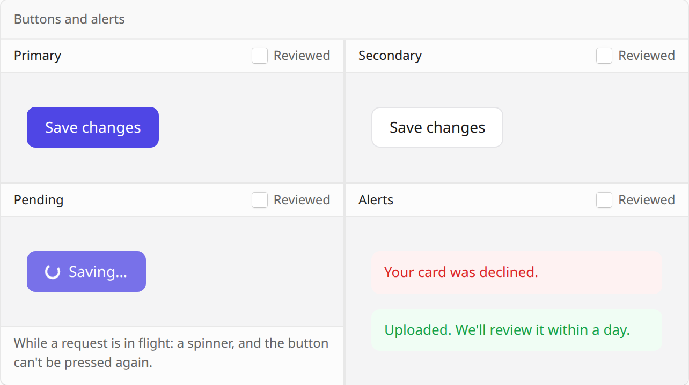
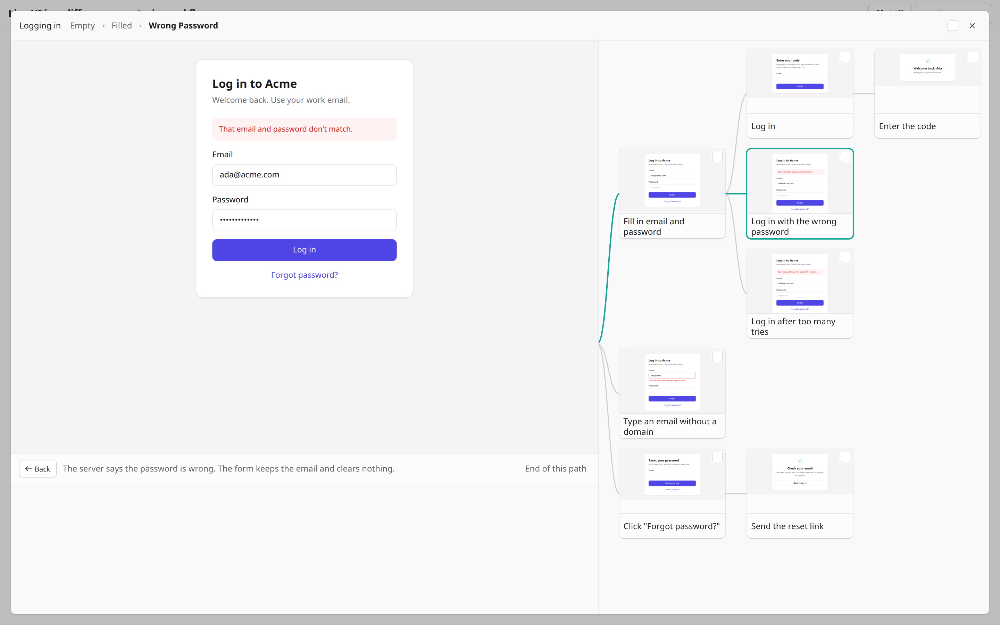

# Live UI in a diffmap spec: stories and flows

A spec for a UI change should let the reader see the change, not a description or a still of it. This spec adds two interactive blocks to diffmap, both running the app's real components with their real styles and animations:

- A **`preview`** block shows components or new designs on their own: one story, or several variants side by side.
- A **`flow`** block shows a user journey: a set of those stories joined by what the user does to move between them, with breadcrumbs, next-step buttons, and a tree of every state. It brings [flow-preview](https://github.com/tanishqkancharla/flow-preview) into diffmap.

The people using this build web apps. They already have a design system, a bundler, a dev server, and usually a preview deployment for each pull request. Many already write [Storybook](https://storybook.js.org) stories. So diffmap does not build their components, and it does not invent a format for describing them. Each piece of UI is a story in Storybook's format, rendered by Storybook's own library inside the app, and diffmap draws its controls around it.

[Examples](07-examples.md) has every block this spec describes, live, for a log-in screen, sign-up, checkout, docs search, and a file upload.

## Problem

**What a diffmap spec shows today.** For a UI change, [[guide.md]] asks for one screenshot per state, with Today beside Proposed in a gallery. Screenshots are not interactive, show no animation or hover state, and leave the reader to piece together from prose how the states connect.

**How flow-preview renders components.** The skill's generator ([`scripts/generate.mjs`](https://github.com/tanishqkancharla/flow-preview/blob/e9894aa/scripts/generate.mjs)) writes a second app to `tmp/<name>/`, with its own `package.json`, its own React, Maui, and Vite, and its own `npm install`. That second build knows nothing about the project's own build. Path aliases, Tailwind or PostCSS, CSS modules, SVG loaders, environment variables, global stylesheets, fonts, theme classes, and app-wide providers all have to be recreated by hand, and flow-preview's [`SKILL.md`](https://github.com/tanishqkancharla/flow-preview/blob/e9894aa/SKILL.md) spends a whole section on keeping that copy in line with the app. Each state is described in a flow-preview-only format, the canvas is built to fill a browser window, and the preview lives only in `tmp/` on the agent's machine, so a reviewer never sees it.

## What a reviewer wants to see: logging in

Take a developer changing the log-in screen. The reviewer wants to see every screen a person can reach: the empty form, an email without a domain, a wrong password, an account locked after too many tries, the two-factor code screen, signed in, and the forgot-password path. They want to see how those screens connect, and what happens between them: the button turning into "Logging in…" while the request is out, then the error appearing.

Most of those screens depend on what the server answered, not on anything in the browser. So reaching them takes two things:

- **What the person does,** such as typing an email and a password and pressing Log in.
- **What the server answers,** such as a 401 for a wrong password or a 429 when the account is locked.

Storybook stories carry both. A story's `play` function acts on the UI, as a person would. Its `msw` parameter gives the answers of a fake server: [Mock Service Worker](https://mswjs.io) intercepts the app's own `fetch` calls in the browser, so the component, its loading state, and its error handling all run unchanged.

## Solution

The app gets one dev-only page that renders any story through Storybook's portable stories API, `composeStories` from `@storybook/react`. That applies the project's own decorators and loaders, so each story renders inside the app's real layout, providers, styles, and fonts, with its fake server running, as it does in Storybook. diffmap's viewer embeds the page in an iframe, drives it with messages, and draws everything else itself.



The agent writes ordinary stories next to the component, or reuses the ones the team already has. In a flow, **each story after the first is one step from the story above it**: its `play` does what the person does next, and its handlers say how the server answers that step.

```tsx [src/auth/AuthFlow.stories.tsx]
const login = (status: number) =>
  http.post("/api/login", async () => {
    await delay(700);
    return HttpResponse.json({}, { status });
  });

export const Empty: Story = {};

export const Filled: Story = {
  play: async ({ canvas, userEvent }) => {
    await userEvent.type(canvas.getByLabelText("Email"), "ada@acme.com");
    await userEvent.type(canvas.getByLabelText("Password"), "correct-horse");
  },
};

export const WrongPassword: Story = {
  parameters: {
    msw: { handlers: [login(401)] },
    docs: { description: { story: "The server says the password is wrong." } },
  },
  play: async ({ canvas, userEvent }) => {
    await userEvent.click(canvas.getByRole("button", { name: "Log in" }));
    await canvas.findByText("That email and password don't match.");
  },
};
```

A spec shows components with a `preview` block, naming stories by their Storybook ID, and a journey with a `flow` block, which indents each story under the one it follows, names the action between them, and lists the happy path first:

````text
```preview [The log-in screen on its own]
auth-log-in--empty
```

```flow [Logging in]
auth-log-in--empty
  auth-log-in--filled: Fill in email and password
    auth-log-in--two-factor: Log in
      auth-log-in--signed-in: Enter the code
    auth-log-in--wrong-password: Log in with the wrong password
    auth-log-in--locked: Log in after too many tries
  auth-log-in--forgot: Click "Forgot password?"
```
````

Because each story is one step, a state is the path of stories from the start to it. To show `Wrong Password` from nothing, the page renders `Empty`, then runs `Filled`'s steps and `Wrong Password`'s steps at once. To move there from `Filled`, which is already on screen, it runs only `Wrong Password`'s step, paced so the reader sees the typing, the "Logging in…" button, and the error arrive. The stories stay plain Storybook stories, with nothing diffmap-specific in them, and the journey belongs to the spec.

The repo's `.diffmap/config.json` holds both blocks' settings, in two keys. `previews` tells the viewer where the page lives, locally and on each pull request; both blocks need it. `flows` holds settings that only flows use, and is optional: whether moving to the next state plays it on the live UI ([Phase 4](04-live-transitions.md)), and the window size the expanded flow renders at ([Phase 5](05-expanded-flow.md)). It is diffmap's single config file, so later settings become sibling keys rather than more files:

```json [.diffmap/config.json]
{
  "previews": {
    "local": "http://127.0.0.1:5200/previews.html",
    "preview": "https://myapp-git-{branch}.vercel.app/previews.html"
  },
  "flows": {
    "transitions": "play",
    "viewport": { "width": 1024, "height": 720 }
  }
}
```

This is how the blocks look in a spec page. The frames are the app's own page, rendering the story live; the header, captions, breadcrumbs, buttons, and review marks around them are the viewer's own UI.





A flow's expand button opens it over the page: the live screen at the configured window size beside a tree of thumbnails, with the path taken highlighted.



**What this removes, compared with flow-preview**

- The second app in `tmp/`, its install step, and keeping its React and design-system versions in line with the project.
- Copying global styles, fonts, and providers into a preview: the project's Storybook decorators already wrap them.
- A diffmap-only format for states. Stories work in Storybook, in tests through the same portable stories API, and in diffmap.
- Any new runtime dependency in diffmap's CLI: no Vite, React, Storybook, or browser automation at `serve` time.

**What it costs**

- A one-time setup in the app: the dev-only page, added by the agent the first time it writes a preview.
- `@storybook/react` and its peer `storybook` as dev dependencies, if the app does not have them, and `msw` with `msw-storybook-addon` for stories that need a server. The page needs only the libraries; nothing runs a Storybook server.
- A running dev server to see previews locally, and a preview deployment to see them on a pull request.

## Goals

- A spec page shows components, design variants, and journeys live, in blocks that fit the text column and expand.
- Each story renders through the app's own build, decorators, and fake server, so it looks and moves exactly as it does in the app.
- Moving to the next state of a flow plays that step on the live UI, so loading states, errors, and the app's own transitions show.
- A reviewer on diffmap.dev sees the same live blocks, through the pull request's preview deployment.
- No code from the repo runs in the viewer's own page, on diffmap.dev or locally.

## Non-goals

- Building or bundling the app's code in diffmap.
- Frameworks other than React for now. Storybook's portable stories exist for Vue, Svelte, and others, so the page could follow later.
- Comparing two revisions side by side. Showing Today needs a second dev server or the base branch's deployment; that is a later spec.
- Embedding a deployed Storybook's own `iframe.html`. It would need no page in the app, but the viewer cannot size it, read its state, or switch stories without a reload across origins, so flows would lose their live transitions.
- Shipping the preview page to production. It exists in development and preview builds only.
- A real backend. Previews answer from each story's fake server, so they never sign anyone in or charge a card.

## References

- Storybook's [portable stories](https://storybook.js.org/docs/api/portable-stories/portable-stories-vitest) (`composeStories`, `setProjectAnnotations`), [play functions](https://storybook.js.org/docs/writing-stories/play-function), and [msw-storybook-addon](https://github.com/mswjs/msw-storybook-addon).
- flow-preview at [`e9894aa`](https://github.com/tanishqkancharla/flow-preview/tree/e9894aa): [`SKILL.md`](https://github.com/tanishqkancharla/flow-preview/blob/e9894aa/SKILL.md), [`scripts/generate.mjs`](https://github.com/tanishqkancharla/flow-preview/blob/e9894aa/scripts/generate.mjs), [`assets/FlowCanvas.tsx`](https://github.com/tanishqkancharla/flow-preview/blob/e9894aa/assets/FlowCanvas.tsx), [`NOTICE`](https://github.com/tanishqkancharla/flow-preview/blob/e9894aa/NOTICE). flow-preview is Apache-2.0 and diffmap is MIT, so code that moves keeps its license and NOTICE.
- diffmap: [[src/viewer/Fence.tsx#Fence]], [[src/parseFence.ts#parseFence]], [[src/viewer/previews/FlowBlock.tsx#FlowBlock]], [[src/viewer/reviewed.ts#useReviewedFiles]], [[src/serve.ts#contentSecurityPolicy]], [[fixtures/previews-app/src/auth/AuthFlow.stories.tsx]].
