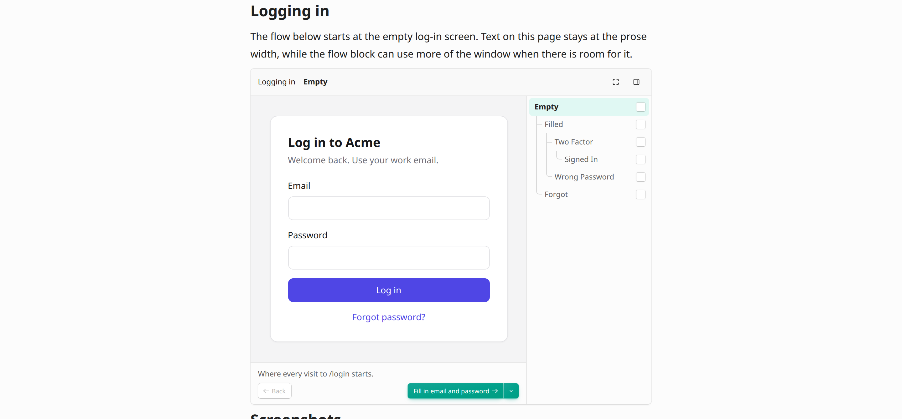
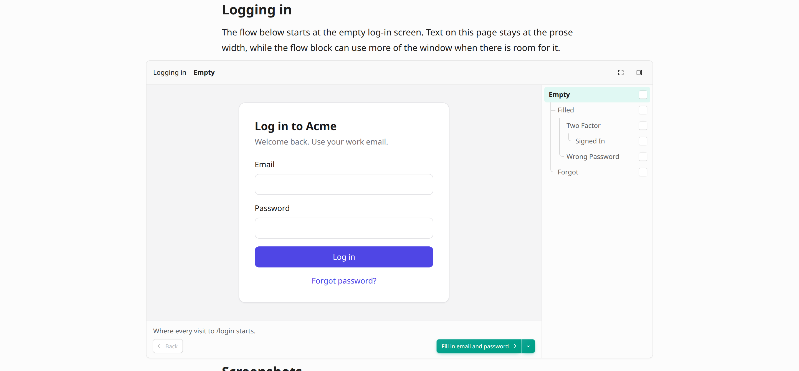
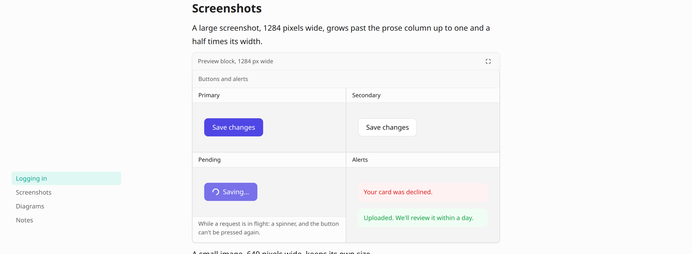
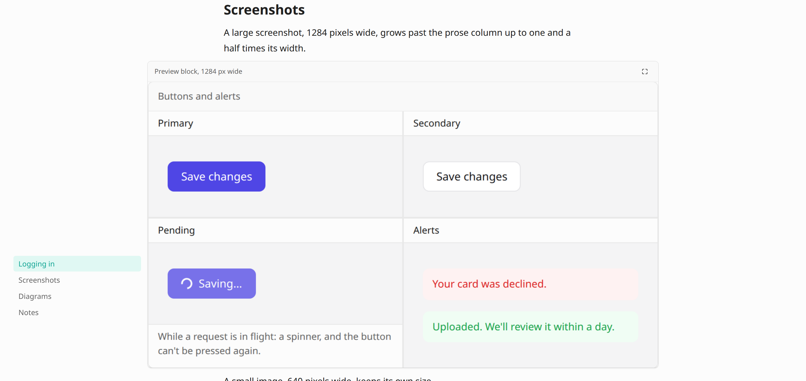
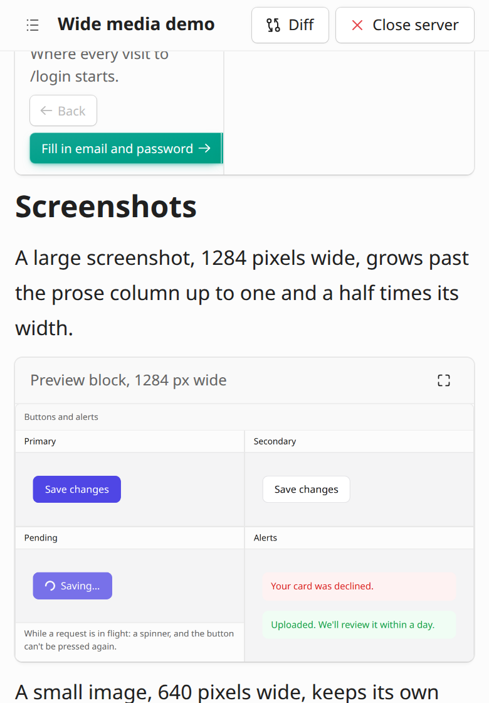

# ✅ The wide column

This page builds on the goals on the [cover](README.md).

**Today**

Every block is exactly as wide as the text. A small image is stretched to fill that width, and a large one is shrunk to it.

**Proposed**

Media can use the room beside the text, up to 1.5 times the prose width, and stops at the table of contents.

## Design

- **Width.** A wide block can be up to `min(150%, article width − 2 × inset)`. Here 150% is 1.5 times the prose column and the article width is `100cqw`. A block is never narrower than the text.
- **Centered.** A wide block grows the same amount on each side of the text, so it stays lined up with the text.
- **Fill or fit.** Previews, flows, galleries, and HTML blocks fill the wide width. Images, videos, and Mermaid diagrams grow only as far as their own width.
- **No upscaling.** An image inside its card is centered at its own size, up to the card's width. A small image no longer stretches to the card's edges. A long caption doesn't make the card wider.
- **Table of contents.** The inset is 0 with no table of contents. It is 48 px, the side margin, when the contents shows as lines. It is 240 px, the widest the list gets, when the list shows in the margin. So a wide block stops at the list's edge.
- **Diff panel and narrow windows.** `100cqw` follows the article, so opening the Diff panel or narrowing the window shrinks wide blocks back toward the text width. Below 600 px they match the text.
- **Scope.** Only blocks directly in the page widen. A block inside `::details` or a gallery cell keeps the width it has there.
- **Tokens.** The rules use Maui's prose column (`proseMaxWidth`) and the viewer's existing table of contents margins. They add no new colors or spacing.

## At desktop width

In a 1440 px window, the flow grows from 641 px to 912 px and stops at the table of contents.

:::gallery side-by-side


:::

A 1284 px screenshot grows by the same amount. A 640 px image on the same page stays 640 px.

:::gallery side-by-side


:::

## In a narrow window

At 390 px, the flow and the screenshot are the same width as the text, and the page doesn't scroll sideways.



## Checks

- Measured in Chrome at 390, 700, 1024, 1200, 1440, and 1920 px, and with the Diff panel open at 1440 and 1920 px. No wide block crossed the table of contents or the Diff panel, and the article never scrolled sideways. At 1920 px the cap held: 960 px against a 640 px column.
- Expanding the flow still fills the window.
- `npm run typecheck`, `npm run lint`, and `npm test` pass.

```changes
25aa299
src/viewer/ViewerApp.tsx
src/viewer/Media.tsx
src/viewer/TableOfContents.tsx
```
