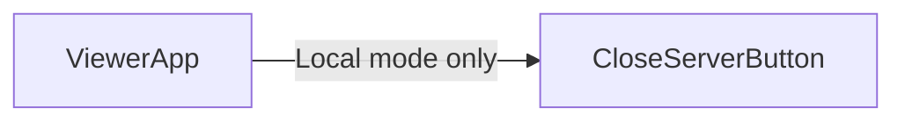
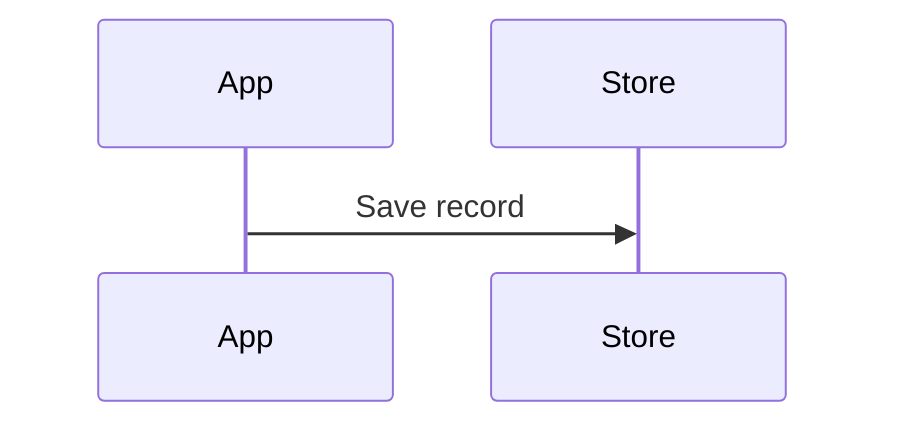

# diffmap


diffmap is a set of personal skills as well as a web-viewer for Markdown files. It has a unique form of showing diffs using a mixture of callstack diffs and mermaid diagram links, which I've found to be personally extremely helpful in understanding massive diffs.

```sh
npx @tanishqkancharla/diffmap serve path/to/file.md
```

Bare `npx @tanishqkancharla/diffmap path/to/file.md` is the same as `serve`.

Share a secret gist and print a `diffmap.dev` link (requires [`gh`](https://cli.github.com/) logged in). Does not start a local server:

```sh
npx @tanishqkancharla/diffmap share path/to.md
```

Hosted viewer: `https://diffmap.dev/g/<gistId>` (optional `/<file.md>`; `#heading` is the table of contents). The page fetches the gist in the browser from `api.github.com`. Gists are unlisted, not private.

## Agent skills

```sh
npx skills add tanishqkancharla/diffmap --skill generate-diffmap
```

Keeps a spec in `specs/` that stays true to what's planned versus already in the tree. Serve it with diffmap. Share from a GitHub PR (`https://diffmap.dev/<owner>/<repo>/pull/<n>/specs/<name>.md`) or `npx @tanishqkancharla/diffmap share`.

Options:

- `--port <n>` — pin a listen port (default: a free port)
- `--root <dir>` — workspace root for file excerpts (default the directory you ran the command from)

**Close server** in the top right stops the server. Hosted gist and GitHub viewers have no local server, so they omit this control.

The server also stops after 24 hours without a page or source request.
Loading or refreshing the page resets the timer; background health checks and
Vite connections do not keep it alive.

List every running viewer, including viewers using custom ports:

```sh
npx @tanishqkancharla/diffmap list
```

Update a global install to the latest `@tanishqkancharla/diffmap` on npm. `diffmap --update` does the same thing:

```sh
diffmap update
```

If you are already on the latest version, it says so and exits. Otherwise it runs the global install for the package manager that installed diffmap (`npm install --global`, `pnpm add --global`, or `bun add --global`) and prints the old and new versions. Under `npx`, or when it cannot tell how diffmap was installed, it prints the command to run instead of installing anything.

Request the page with `Accept: text/markdown` to read the current source file
instead of the rendered HTML. Use the URL printed by `serve`:

```sh
curl -H 'Accept: text/markdown' http://127.0.0.1:<port>/
```

## Library

```ts
import {
  startServer,
  parseFence,
  parseViewerDocument,
} from "@tanishqkancharla/diffmap";
```

`parseViewerDocument` turns markdown into the page document with [md4x](https://github.com/unjs/md4x). `startServer` listens. The generate-diffmap skill owns document shape; the viewer does not.

## Fences

| Fence info string                              | Viewer                                                                                            |
| ---------------------------------------------- | ------------------------------------------------------------------------------------------------- |
| `mermaid`                                      | Beautiful Mermaid                                                                                 |
| `services`                                     | Animated service diagram you can play or step through                                             |
| `callstack` or `diff` containing `└──` / `├──` | Interactive stack rows, no file header                                                            |
| `diff` or `diff:path` with a file path         | Pierre patch with Pierre’s file header                                                            |
| `diff` with no path                            | Pierre patch, no file header                                                                      |
| `changes` with a commit, range, or empty body  | Files changed card with a Review button; empty means uncommitted changes                          |
| `start:end:path`                               | Pierre file excerpt with Pierre’s file header                                                     |
| `html`                                         | Trusted HTML from this file. diffmap does not sanitize it. Only use it for local files you wrote. |
| other langs                                    | Maui `CodeBlock`                                                                                  |

Fences keep whitespace. Use them for mermaid, call stacks, and diffs.

## MDC

md4x Comark components map to the same views:

```md
::mermaid
flowchart TD
A --> B
::

::callstack
startServer
+└── createViteServer
::

::diff{path="src/cli.ts"}
--- a/src/cli.ts
+++ b/src/cli.ts
::

::file{path="src/cli.ts" start="1" end="20"}
::

::changes{rev="a1b2c3d"}
::

::html
<aside>Note.</aside>
::
```

`.md` and `.mdx` are both markdown. Curly braces in prose are plain text.

## Link call stacks to source changes

Append a reference to a call stack line to link it. Paths are relative to `--root`.

- `[[path/to/file.ts#symbolName]]` links a TypeScript or JavaScript declaration,
  including qualified names such as `[[src/store.ts#Store.save]]`. Ambiguous
  names show the qualified names you can use instead.
- `[[path/to/file]]` links a whole file and `[[path/to/file#L12-L30]]` a line
  range. These work with any language.
- `[[<sha>:path/to/file#L12-L30]]` or `[[<sha>:path/to/file]]` links a change
  in a commit. `<sha>` is a 7–40 character lowercase commit SHA, or a range
  `<sha>..<sha>`.

```callstack
 shareMarkdownFile [[src/share.ts#shareMarkdownFile]]
+└── gistViewerUrl # print the diffmap.dev link [[d14ae1a:src/share.ts#L55-L59]]
```

A reference without a commit opens the Diff panel on uncommitted changes
(working tree against HEAD), focused on that file or range. If the file has no
uncommitted changes, the panel shows the current file.

A commit reference opens the Diff panel on every file changed in that commit or
range, with a sticky header per file, scrolled to the linked file and lines.
Line numbers are the file's lines after the commit. The file must be changed in
that commit and the range must fit the new file; `serve` and `share` run git and
fail at startup otherwise. Deleted lines cannot be referenced, and a commit
cannot be combined with `#symbol`.

Multiple references on one stack line are allowed. The references are hidden in
the rendered stack, and linked rows support mouse clicks and keyboard activation.

A `changes` fence shows a commit's files as a card. Each row shows the file name
and +N −M. **Review** opens the Diff panel on all files; a row focuses that file.
An empty body (or `working`) means uncommitted changes.

````md
```changes
a1b2c3d
```
````

References open in one shared panel beside the walkthrough. Selecting a stack
line or diagram element highlights it and scrolls the panel to the linked code
range. When a target has several references, buttons above the source viewer
select among them. On narrow windows the source panel sits below the walkthrough.
Documents without references keep the single-panel layout.

Malformed references produce a parse error.

On a GitHub-hosted spec, commit diffs come from the GitHub API. It returns patch
hunks only, so only lines near changes are reachable, and the Diff button opens
the pull request's full diff.

A shared gist is a snapshot taken when you run `diffmap share`. It saves every
referenced commit and every `changes` card, including uncommitted ones, to
`diffmap-changes.json`. It saves the current contents of every file that a file
excerpt or a reference without a commit reads to `diffmap-files.json`. In the
gist, those references open the saved file; symbols resolve to their first
matching line, and Cmd-click definitions only work in a local viewer. Commit
your work and point references at the commit before sharing, so the gist shows
the diff instead of a bare file.

Cmd-click (or Ctrl-click) a TypeScript or JavaScript symbol in the source panel
to open its definition. Use Back to retrace navigation and return to the reference.
Resolution uses the workspace's TypeScript configuration and current files.

Run `npx @tanishqkancharla/diffmap fixtures/annotations.md` for an example
with commit references, multiple files, and unchanged context.

## Animated service diagrams

A `services` fence shows services, their state, and the events they send each
other, then replays those events step by step. Readers press **Play**, step with
the arrow buttons or ← and →, or click the progress bar to jump to a step.

````md
```services
service Browser "login page"
  state cookie = none
service API "HTTP server" [[src/api.ts]]
  > Receives every request and routes it to a service.
  service Auth
    state attempts = 0
      > Failures since the last success. Five locks the account.

step "The browser submits the form"
  Browser -> API: POST /login
step "The API asks Auth to verify"
  API -> Auth: verify(alice) [[src/api.ts#login]]
    > Sends the username and the password from the form.
  Auth.attempts = 1
    > Counted before the check, so a crash still counts as a failure.
step "The API sets the session cookie"
  API -> Browser: 200 Set-Cookie
  Browser.cookie = sid=s_81f
```
````

- `service <Name> "label"` declares a service. Indent a `service` line under
  another to nest it. Names are unique within the diagram.
- `state <key> = <value>` declares a value and its initial state. Indent it under
  its service.
- `step "caption"` starts a step at column 0. The caption is required: a
  sentence that says what happens, shown under the controls. Indented lines
  under it are `From -> To: label` events and `Service.key = value` updates.
  Every event in a step travels at once, and the updates land when the events
  arrive.
- A `>` line adds text to the line above it. Indent it further than that line;
  consecutive `>` lines join.
  - Under a service or state, it is a description: the name gets a dotted
    underline and the text shows in a tooltip on hover or focus.
  - Under a step, it explains the step and shows under the caption.
  - Under an event or update, it is a note for that step. Notes appear in a
    column beside the diagram once the step's events land, each joined by a
    line to its event label or state row.
- `%%` starts a comment line.
- Append `[[reference]]` to a `service` line or an event to link it to source.

Services must be declared before the first step, and updates may only change
declared state. [ELK](https://eclipse.dev/elk/) lays the services out left to
right, or top to bottom when that fits the column better, and routes one
connection between each pair of services that talk. A request and its reply
share that connection. Indentation is significant, so `services` has no MDC form.
See [the runnable examples](fixtures/services.md).

## Link Mermaid nodes and edges

Inside a Mermaid fence, add `%% ref node:<id> [[reference]]` to link a node or
participant, or `%% ref edge:<index> [[reference]]` to link an edge or sequence
message. Edge indices start at zero in declaration order. The same file, symbol,
and commit references work here. Keep one directive per target; append
multiple references to that directive when needed.

````md



````

Click a linked shape, edge line, or edge label, or focus it with Tab and press
Enter or Space. Directives are Mermaid comments, so they remain hidden and do
not change the diagram when rendered by other Mermaid tools. Missing diagram
targets display an error. See [the runnable example](fixtures/references.md).

## Link from prose

Write any reference in a paragraph, list item, or table cell, such as
`See [[src/store.ts#Store.save]] for the write path.` or
`Close server landed in [[dae6b98:src/viewer/CloseServerButton.tsx]].` It
renders as clickable inline code labeled with the file name and fragment
(`store.ts#Store.save`) and opens the same source panel. References inside code spans and link text stay
literal, so `` `[[path]]` `` shows the syntax itself.
