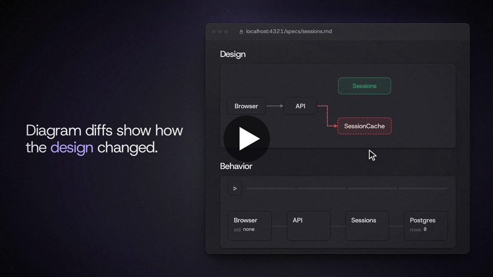
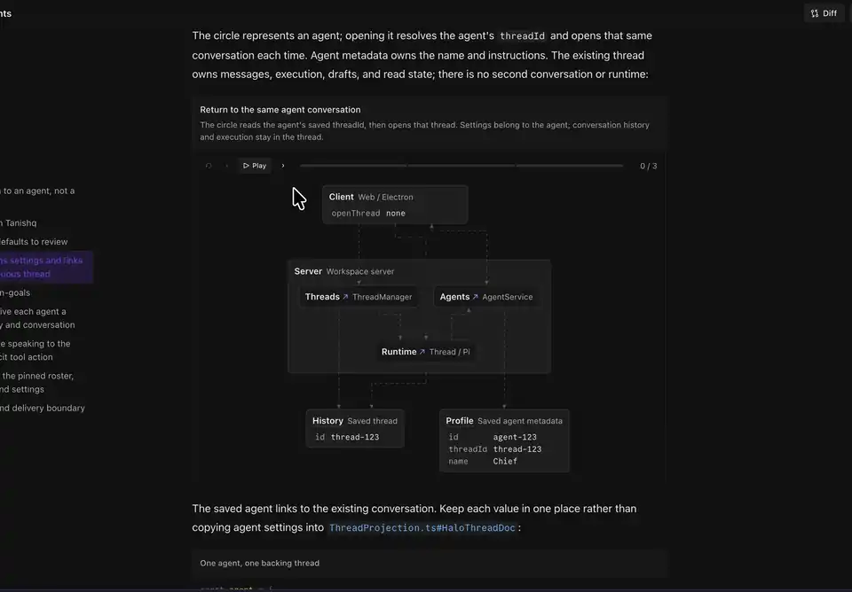
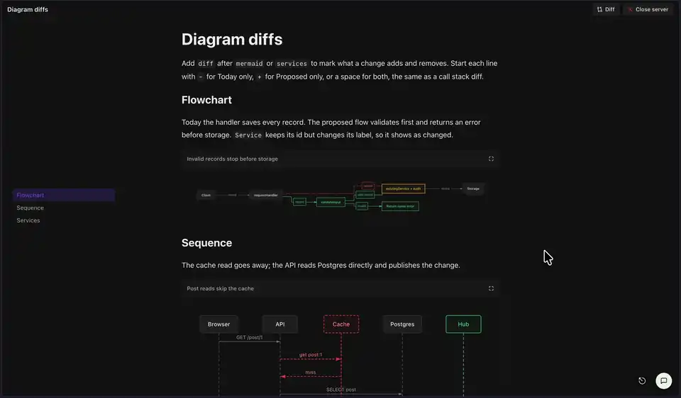
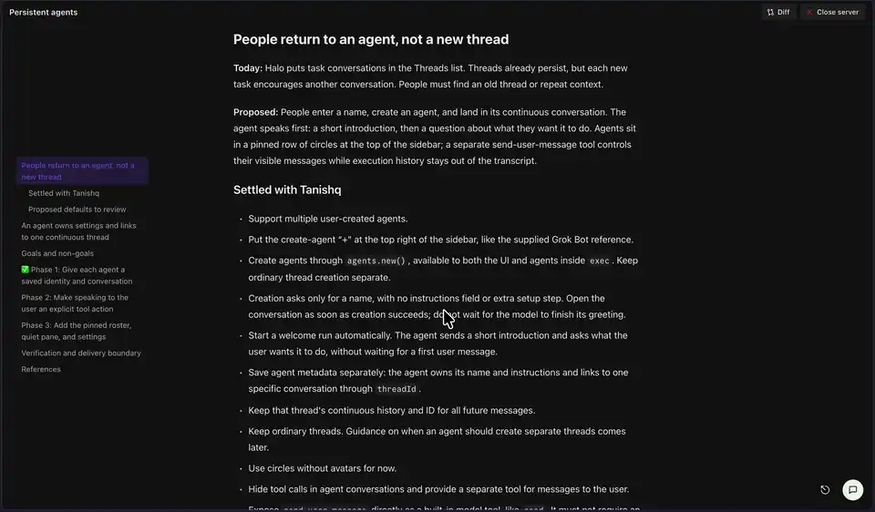
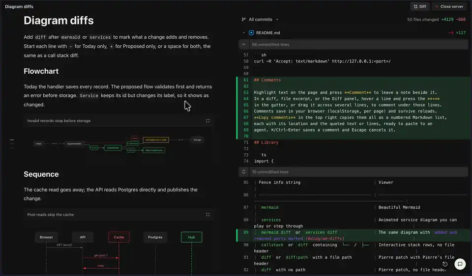
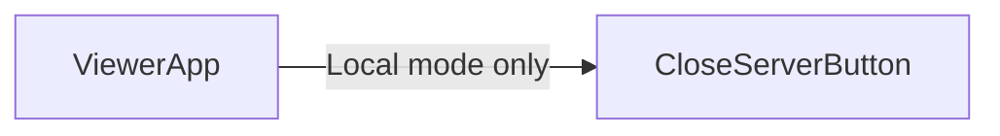
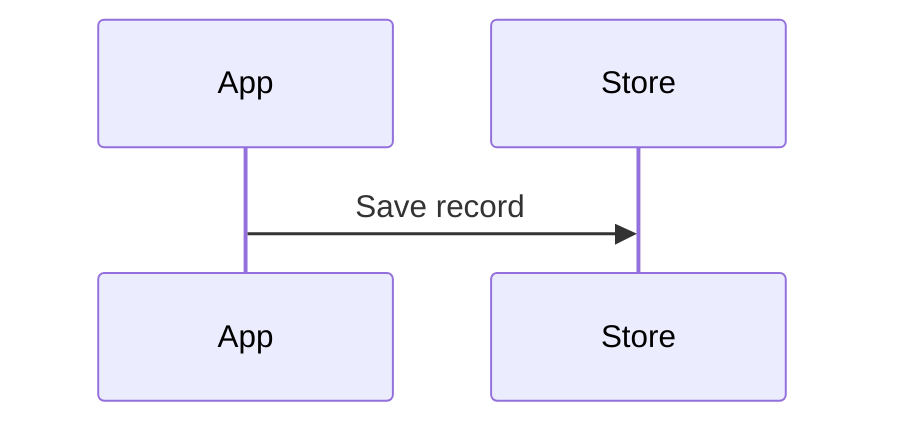

# diffmap

[](https://x.com/tanishqk/status/2116212881125691850)

**Your coding agent writes more code than you can review.** You should spend your review time on design decisions and risky changes, not boilerplate.

diffmap is an agent skill that lets your agent explain its changes to you visually. The agent writes a spec with interactive diagrams, and each part of a diagram links back to its source code.

> Want a cloud-hosted viewer for sharing diffmaps with your team? [Upvote Diffmap Cloud](https://github.com/tanishqkancharla/diffmap/issues/32) so I know there's interest.

## Try it

You can try diffmap before you install it. In a repository that has changes, paste this prompt into your agent:

```text
Write a diffmap spec for the changes on this branch. Use github.com/tanishqkancharla/diffmap
```

If you like the result, install the skill:

```sh
npx skills add tanishqkancharla/diffmap --skill generate-diffmap
```

The skill keeps a spec in `specs/` that stays true to what is planned and what is already in the tree. diffmap is open source and MIT licensed. Specs are served locally by default, but you can choose to [share one as an unlisted gist](#share-a-spec-with-a-link-experimental) and open it on diffmap.dev.

The skill is a short pointer: your agent loads the full instructions from `npx @tanishqkancharla/diffmap guide`, so they update with diffmap itself. When the skill file itself changes, update it with `npx skills update generate-diffmap`.

## See the main ideas

Your agent picks the best diagram for each idea, and each part of a diagram links to its code. [diffmap.dev](https://diffmap.dev) walks through each one on an example pull request.

### Service diagrams

A service diagram shows each service and its state. Each step shows one event and the state that the event changes, so you do not have to remember the state. Press **Play** to step through it. See [Animated service diagrams](#animated-service-diagrams) for the syntax.



### Diagram and call stack diffs

A Mermaid or service diagram can show a change in one picture: red parts exist only today, and green parts are new. In a service diagram diff, each value shows today's state crossed out next to the new state. Call stacks show a change the same way, with `+` rows for new code and `-` rows for code the change removes. See [Diagram diffs](#diagram-diffs).



### Phases and commits

The agent writes the plan in phases, each small enough to be one commit. When a phase is done, the spec shows a card for its commit with the files to review, most important first. Click a file to open its diff. Every link in the phase then points at that commit, so it keeps showing the code from that commit after the file changes.



### Comments

Highlight text on the page and press **Comment** to leave a note beside it.
In a diff, file excerpt, or the Diff panel, hover a line and press the **+**
in the gutter, or drag it across several lines, to comment under those lines.
Comments save in your browser (localStorage, per page) and survive reloads.
**Copy comments** in the top right copies them all as a numbered Markdown list,
each with its location and the quoted text or lines, ready to paste to an
agent. ⌘/Ctrl-Enter saves a comment and Escape cancels it.



## Run the viewer

```sh
npx @tanishqkancharla/diffmap serve path/to/file.md
```

Bare `npx @tanishqkancharla/diffmap path/to/file.md` is the same as `serve`.

Options:

- `--port <n>` — pin a listen port (default: a free port)
- `--root <dir>` — workspace root for file excerpts (default the directory you ran the command from)

**Close server** in the top right stops the server. Hosted gist and GitHub viewers have no local server, so they omit this control.

The server also stops after 24 hours without a page or source request.
Loading or refreshing the page resets the timer; background health checks and
the live-reload connection do not keep it alive.

Check a spec without starting a server or publishing anything:

```sh
npx @tanishqkancharla/diffmap validate path/to/file.md
```

`validate` uses the viewer's parser to check Markdown, diagrams, and annotations.
It exits 0 with `valid: true` on success and 1 with the parse error on failure.
Use `--json` for machine-readable output. It does not resolve source files or
Git commits. Run it after edits, including when reusing an already-running viewer.
After updating diffmap itself, restart existing viewers so they use the new parser.

List every running viewer, including viewers using custom ports:

```sh
npx @tanishqkancharla/diffmap list
```

Update a global install to the latest `@tanishqkancharla/diffmap` on npm. `diffmap --update` does the same thing:

```sh
diffmap update
```

If you are already on the latest version, it says so and exits. Otherwise it runs the global install for the package manager that installed diffmap (`npm install --global`, `pnpm add --global`, or `bun add --global`) and prints the old and new versions. Under `npx`, or when it cannot tell how diffmap was installed, it prints the command to run instead of installing anything.

Request the page with `Accept: text/markdown` to read the current source file
instead of the rendered HTML. Use the URL printed by `serve`:

```sh
curl -H 'Accept: text/markdown' http://127.0.0.1:<port>/
```

## Share a spec with a link (experimental)

Share an unlisted gist and print a `diffmap.dev` link (requires [`gh`](https://cli.github.com/) logged in). Does not start a local server:

```sh
npx @tanishqkancharla/diffmap share path/to.md
```

Hosted viewer: `https://diffmap.dev/g/<gistId>` (optional `/<file.md>`; `#heading` is the table of contents). The page fetches the gist in the browser from `api.github.com`. Gists are unlisted, not private.

A spec committed to a GitHub pull request also opens at `https://diffmap.dev/<owner>/<repo>/pull/<n>/specs/<name>.md`.

## Library

```ts
import {
  startServer,
  parseFence,
  parseViewerDocument,
} from "@tanishqkancharla/diffmap";
```

`parseViewerDocument` turns markdown into the page document with [md4x](https://github.com/unjs/md4x). `startServer` listens. The guide that `diffmap guide` prints owns document shape; the viewer does not.

## Fences

| Fence info string                              | Viewer                                                                                            |
| ---------------------------------------------- | ------------------------------------------------------------------------------------------------- |
| `mermaid`                                      | Beautiful Mermaid                                                                                 |
| `services`                                     | Animated service diagram you can play or step through                                             |
| `mermaid diff` or `services diff`              | The same diagram with [added and removed parts marked](#diagram-diffs)                            |
| `callstack` or `diff` containing `└──` / `├──` | Interactive stack rows, no file header                                                            |
| `diff` or `diff:path` with a file path         | Pierre patch with Pierre’s file header                                                            |
| `diff` with no path                            | Pierre patch, no file header                                                                      |
| `changes` with a commit, range, or empty body  | Files changed card with a Review button; empty means uncommitted changes                          |
| `start:end:path`                               | Pierre file excerpt with Pierre’s file header                                                     |
| `html`                                         | Trusted HTML from this file. diffmap does not sanitize it. Only use it for local files you wrote. |
| other langs                                    | Highlighted code with optional [titles, highlights, and notes](#highlight-lines-and-add-notes)    |

Fences keep whitespace. Use them for mermaid, call stacks, and diffs.

### Highlight lines and add notes

In a code fence, `{2,4-6}` after the language highlights those lines. Comment
lines at the bottom of the fence add notes that show on hover or keyboard focus:

````md
```ts {2-3}
function requestHandler(record: RecordInput) {
  const error = validateInput(record);
  if (error) return error;
  return existingService(record);
}
// [!note L2 validateInput] Returns an error when `name` is blank, otherwise undefined.
// [!note L3] Early return, so storage never sees an invalid record.
```
````

- `[!note L3]` or `[!note L3-L5]` notes a line range, shown as a blue snippet highlight.
- `[!note L3 save]` or `[!note L3-L5 save]` notes the first whole-word
  occurrence of `save` on each specified line, shown with a dotted underline.
- `[!note save]` applies fence-wide, matching the first whole-word occurrence
  on each line. A scoped note takes precedence over a fence-wide note for the
  same match. Matching is textual, not semantic symbol resolution.
- Start note lines with `//`, `#`, or `--`. The viewer removes them, so line
  numbers count only the code above. Backticks in a note render as code.
- A symbol that does not appear within its scope, overlapping line notes, or a line number
  outside the fence is a parse error. A note line above other code stays code.

Add `[Title]` after the language to show a title above the code, as in
` ```ts [src/request.ts] {2-3} `. Call stacks and `mermaid` fences take a
title the same way, as in ` ```mermaid diff [Request flow] `, or
`::callstack{title="Request flow"}` and `::mermaid{title="Request flow"}` in
MDC. A `services` fence uses its [start caption](#animated-service-diagrams)
instead.

Call stacks take the same highlights and notes, counting rows from the first.
Write their notes with `#`. A symbol note matches the row text you see, not
hidden references. Inside a linked row, symbol notes show on hover only; the
row itself keeps keyboard focus.

Run `npx @tanishqkancharla/diffmap fixtures/code-notes.md` for an example.

## MDC

md4x Comark components map to the same views:

```md
::mermaid
flowchart TD
A --> B
::

::callstack
startServer
+└── createViteServer
::

::diff{path="src/cli.ts"}
--- a/src/cli.ts
+++ b/src/cli.ts
::

::file{path="src/cli.ts" start="1" end="20"}
::

::changes{rev="a1b2c3d"}
::

::html
<aside>Note.</aside>
::

::details{summary="How it works"}
Folded content: prose, lists, and any fence above.
::
```

`::details` folds its content under the `summary` label until the reader opens it.
`.md` and `.mdx` are both markdown. Curly braces in prose are plain text.

## Images, videos, and galleries

Show screenshots and recordings with Markdown image syntax. Paths are relative
to the spec file.

```md


```

A `.mp4`, `.webm`, `.mov`, `.m4v`, or `.ogv` file renders as a video player;
anything else is an image. On its own line, it shows centered in a card, with
its alt text as the title row. A title, as in ``, shows on
hover.

Group related images and videos in a gallery, with the layout after `:::gallery`:

```md
:::gallery side-by-side


:::
```

- `side-by-side` puts every item in one row, to compare before and after or one
  page at several widths.
- `grid` wraps items into rows, to scan states or variants.
- `carousel` shows one item at a time with Previous and Next (← and →), to step
  through a flow. Add a title after the layout, as in
  `:::gallery carousel [Saving a record]`; it stays in the title row while the
  current item's label changes below it.

Each item's alt text is its visible label. A gallery holds only images and
videos, and `::gallery{layout="grid"}` works too. The syntax matches galleries
in Amp threads.

`serve` loads media from beside the spec, and a spec on a GitHub pull request
loads it from the same commit. `share` fails when a spec uses local media,
because a gist holds only text files; link media by https URL to share it.

Run `npx @tanishqkancharla/diffmap fixtures/media.md` for an example.

## Link call stacks to source changes

Append a reference to a call stack line to link it. Paths are relative to `--root`.

- `[[path/to/file.ts#symbolName]]` links a TypeScript or JavaScript declaration,
  including qualified names such as `[[src/store.ts#Store.save]]`. Ambiguous
  names show the qualified names you can use instead.
- `[[path/to/file]]` links a whole file and `[[path/to/file#L12-L30]]` a line
  range. These work with any language.
- `[[<sha>:path/to/file#L12-L30]]` or `[[<sha>:path/to/file]]` links a change
  in a commit. `<sha>` is a 7–40 character lowercase commit SHA, or a range
  `<sha>..<sha>`.

```callstack
 shareMarkdownFile [[src/share.ts#shareMarkdownFile]]
+└── gistViewerUrl # print the diffmap.dev link [[d14ae1a:src/share.ts#L55-L59]]
```

A reference without a commit opens the Diff panel on uncommitted changes
(working tree against HEAD), focused on that file or range. If the file has no
uncommitted changes, the panel shows the current file.

A commit reference opens the Diff panel on every file changed in that commit or
range, with a sticky header per file, scrolled to the linked file and lines.
Line numbers are the file's lines after the commit. The file must be changed in
that commit and the range must fit the new file; `serve` and `share` run git and
fail at startup otherwise. Deleted lines cannot be referenced, and a commit
cannot be combined with `#symbol`.

Multiple references on one stack line are allowed. The references are hidden in
the rendered stack, and linked rows support mouse clicks and keyboard activation.

A `changes` fence shows a commit's files as a card. Each row shows the file name
and +N −M. **Review** opens the Diff panel on all files; a row scrolls to that
file without expanding its unchanged lines.
An empty body (or `working`) means uncommitted changes.

Lines after the rev list the files to review, in order. The card shows those
first and folds the rest under a dimmed **N other files** row that expands and
collapses. Review opens the Diff panel in the same order. With no list, the card
shows every file.

List files a reviewer can skip after an `ignore:` line. They fold away with the
rest; with nothing to review, the card says no files are marked as important. When a commit's fence lists files, `serve` prints a warning naming each
changed file that is in neither list, so no file is left out by accident.
`serve` and `share` fail if a listed file is not changed in that commit.

````md
```changes
a1b2c3d
src/request.ts
src/validate.ts

ignore:
package-lock.json
```
````

References open in one shared panel beside the walkthrough. Selecting a stack
line or diagram element highlights it and scrolls the panel to the linked code
range. When a target has several references, buttons above the source viewer
select among them. On narrow windows the source panel sits below the walkthrough.
Documents without references keep the single-panel layout.

Malformed references produce a parse error.

On a GitHub-hosted spec, commit diffs come from the GitHub API. It returns patch
hunks only, so only lines near changes are reachable, and the Diff button opens
the pull request's full diff.

A shared gist is a snapshot taken when you run `diffmap share`. It saves every
referenced commit and every `changes` card, including uncommitted ones, to
`diffmap-changes.json`. It saves the current contents of every file that a file
excerpt or a reference without a commit reads to `diffmap-files.json`. In the
gist, those references open the saved file; symbols resolve to their first
matching line, and Cmd-click definitions only work in a local viewer. Commit
your work and point references at the commit before sharing, so the gist shows
the diff instead of a bare file.

Cmd-click (or Ctrl-click) a TypeScript or JavaScript symbol in the source panel
to open its definition. Use Back to retrace navigation and return to the reference.
Resolution uses the workspace's TypeScript configuration and current files.

Run `npx @tanishqkancharla/diffmap fixtures/annotations.md` for an example
with commit references, multiple files, and unchanged context.

## Animated service diagrams

A `services` fence shows services, their state, and the events they send each
other, then replays those events step by step. Readers press **Play**, step with
the arrow buttons or ← and →, or click the progress bar to jump to a step.

````md
```services
service Browser "login page"
  state cookie = none
service API "HTTP server" [[src/api.ts]]
  > Receives every request and routes it to a service.
  service Auth
    state attempts = 0
      > Failures since the last success. Five locks the account.

start "Alice logs in"
  > The API checks her password with Auth, then sets a session cookie.
step "The browser submits the form"
  Browser -> API: POST /login
step "The API asks Auth to verify"
  API -> Auth: verify(alice) [[src/api.ts#login]]
    > Sends the username and the password from the form.
  Auth.attempts = 1
    > Counted before the check, so a crash still counts as a failure.
step "The API sets the session cookie"
  API -> Browser: 200 Set-Cookie
  Browser.cookie = sid=s_81f
```
````

- `service <Name> "label"` declares a service. Indent a `service` line under
  another to nest it. Names are unique within the diagram.
- `state <key> = <value>` declares a value and its initial state. Indent it under
  its service.
- `start "caption"` at column 0, before the first step, titles the whole
  diagram, such as `start "Alice logs in"`. It stays in the title row while the
  reader steps. A `>` line under it gives an overview of the whole process,
  shown under the title until the first step. A `services` fence takes no
  `[Title]`; the start caption is its title.
- `step "caption"` starts a step at column 0. The caption is required: a
  sentence that says what happens, shown under the title row above the
  controls. Indented lines
  under it are `From -> To: label` events and `Service.key = value` updates.
  A step's events travel one after another, in the order written, and the
  updates land when the last one arrives.
- A `>` line adds text to the line above it. Indent it further than that line;
  consecutive `>` lines join.
  - Under a service or state, it is a description: the name gets a dotted
    underline and the text shows in a tooltip on hover or focus.
  - Under `start` or a step, it explains the caption and shows under it.
  - Under an event or update, it is a note for that step. Notes appear in a
    column beside the diagram once the step's events land, each joined by a
    line to its event label or state row.
  - Under a service name on its own line in a step, it is a note on that
    service for the step, joined by a line to the service box.
- `%%` starts a comment line.
- Append `[[reference]]` to a `service` line or an event to link it to source.

Services must be declared before the first step, and updates may only change
declared state. [ELK](https://eclipse.dev/elk/) lays the services out left to
right, or top to bottom when that fits the column better, and routes one
connection between each pair of services that talk. A request and its reply
share that connection. Indentation is significant, so `services` has no MDC form.
See [the runnable examples](fixtures/services.md).

## Diagram diffs

Add `diff` after `mermaid` or `services` to show a change in one diagram.
Start every line with `-` for Today only, `+` for Proposed only, or a space
for both, as in a call stack diff. Indentation starts after that column.

````md
```mermaid diff
 flowchart LR
   Client --> Handler
-  Handler --> Service
+  Handler --> Validate
+  Validate --> Service
```
````

diffmap draws every line once, so both versions share one layout. Nodes,
edges, sequence participants, and messages that only Today has are red and
dashed; those only Proposed has are green. A node whose label differs between
the versions is amber and shows its Proposed label. Each version must also be
a valid diagram on its own. To relabel a node, declare it on its own line
(`-  B[Old]`, `+  B[New]`) so its edges are not drawn twice. In a diff,
`%% ref edge:<index>` counts edges as drawn: within each run of changed lines,
`+` lines come before `-` lines.

````md
```services diff
 service API
-  service SessionCache
-    state active = 0
+  service Sessions
 service Postgres
-  state sessions = not used
+  state sessions = 0 rows

 start "Sessions move to Postgres"
-step "API caches the session"
   API -> SessionCache: create(alice)
   SessionCache.active = 1
+step "Sessions writes the session"
   API -> Sessions: create(alice)
   Sessions -> Postgres: INSERT
   Postgres.sessions = 1 row
```
````

In a `services diff`, lines inside a `-` or `+` service or step take its
sign. Today replays the unmarked and `-` lines and Proposed the unmarked and
`+` lines, so each state row shows Today's value struck through beside
Proposed's when they differ. A `-` and a `+` declaration of the same state key
give each version its own starting value. Added and removed steps color their
segment of the progress bar, and their caption starts with **Added** or
**Removed**. See [the runnable examples](fixtures/diagram-diffs.md).

## Link Mermaid nodes and edges

Inside a Mermaid fence, add `%% ref node:<id> [[reference]]` to link a node or
participant, or `%% ref edge:<index> [[reference]]` to link an edge or sequence
message. Edge indices start at zero in declaration order. The same file, symbol,
and commit references work here. Keep one directive per target; append
multiple references to that directive when needed.

````md



````

Click a linked shape, edge line, or edge label, or focus it with Tab and press
Enter or Space. Directives are Mermaid comments, so they remain hidden and do
not change the diagram when rendered by other Mermaid tools. Missing diagram
targets display an error. See [the runnable example](fixtures/references.md).

## Link from prose

Write any reference in a paragraph, list item, or table cell, such as
`See [[src/store.ts#Store.save]] for the write path.` or
`Close server landed in [[dae6b98:src/viewer/CloseServerButton.tsx]].` It
renders as clickable inline code labeled with the file name and fragment
(`store.ts#Store.save`) and opens the same source panel. References inside code spans and link text stay
literal, so `` `[[path]]` `` shows the syntax itself.

## Telemetry

The CLI sends anonymous usage events to [PostHog](https://posthog.com): which commands run, whether `serve` started, which coding agent ran it, and which features of the local viewer get used. Events never include file paths, spec contents, comments, or anything else from your repository. [TELEMETRY.md](TELEMETRY.md) lists every event and field.

Turn it off with `DIFFMAP_TELEMETRY=0` (or `false`) or `DO_NOT_TRACK=1`. It is also off when `CI` is set.

## Feedback

Found a bug, hit a confusing error, or want a feature? [Open an issue](https://github.com/tanishqkancharla/diffmap/issues/new) with what you did, what you expected, what happened, and your diffmap version (`diffmap --version`). Agents using the generate-diffmap skill do the same through `gh issue create`.
