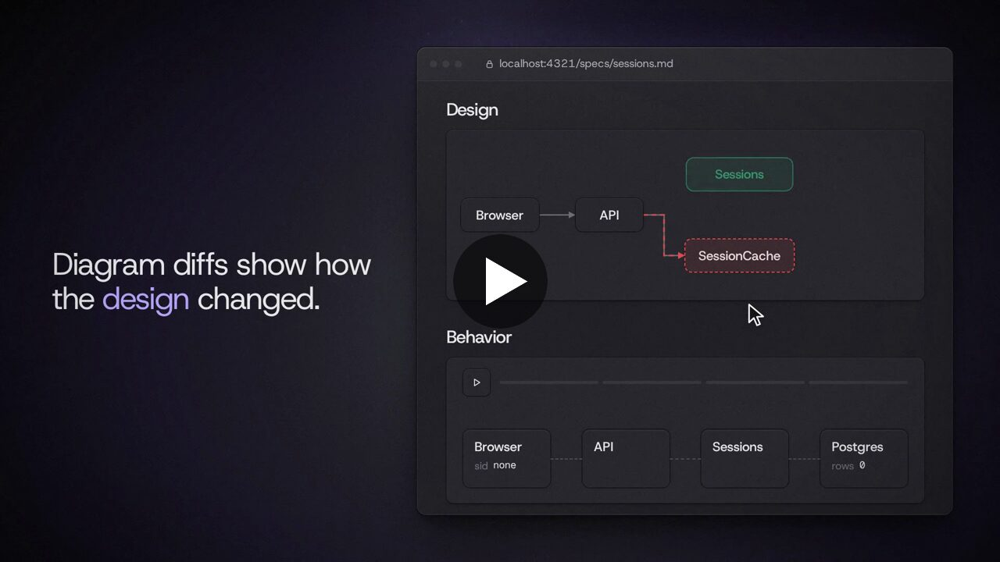
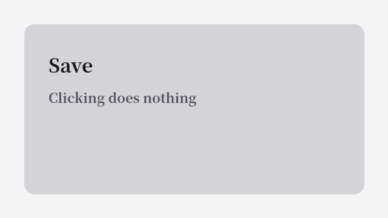
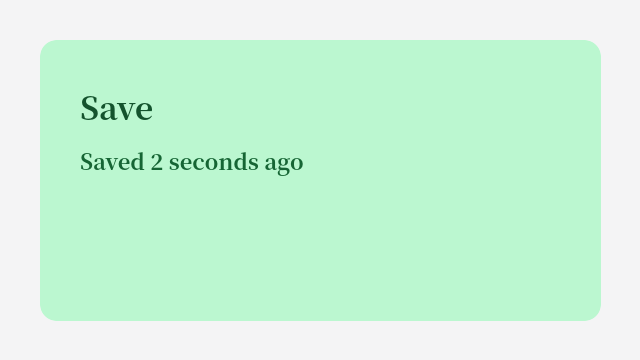
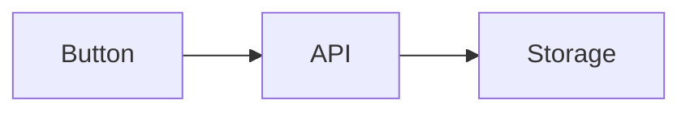

# Images, videos, and galleries

Run from the repository root. Paths are relative to this file.

## An image



## A video

A `.mp4`, `.webm`, `.mov`, `.m4v`, or `.ogv` file renders as a player.


## Side by side

:::gallery side-by-side


:::

## Grid

:::gallery grid


:::

## Carousel

::gallery{layout="carousel" title="Saving a record"}


::

## Beside other cards

Media cards share their title row with code blocks, Mermaid diagrams, and services diagrams.

```ts [src/save.ts]
export async function save(record: RecordInput) {
  await api.post("/records", record);
}
```



```services
service Browser "save page"
  state button = idle
service API
  state saved = 0

start "Alice saves a record"
  > The button shows progress until the API confirms the save.

step "The browser sends the record"
  Browser -> API: POST /records
  Browser.button = saving
    > The button shows a spinner until the response arrives.
step "The API stores it and confirms"
  > The button changes only after the API answers, so a failed save never shows as saved.
  API.saved = 1
  API -> Browser: 201 Created
  Browser.button = saved
```
