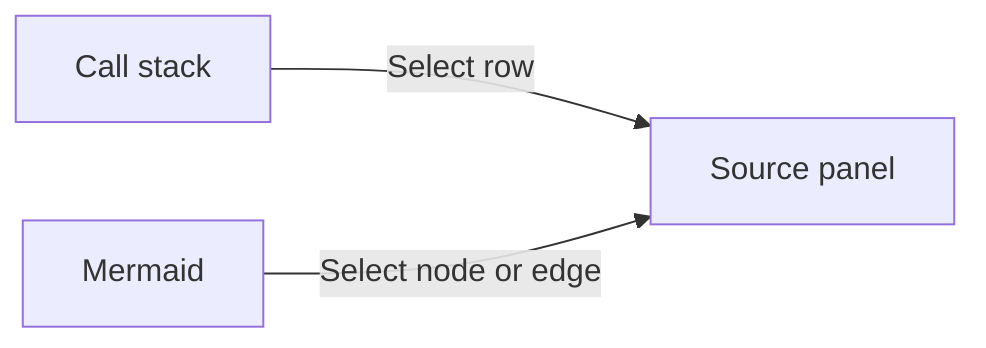
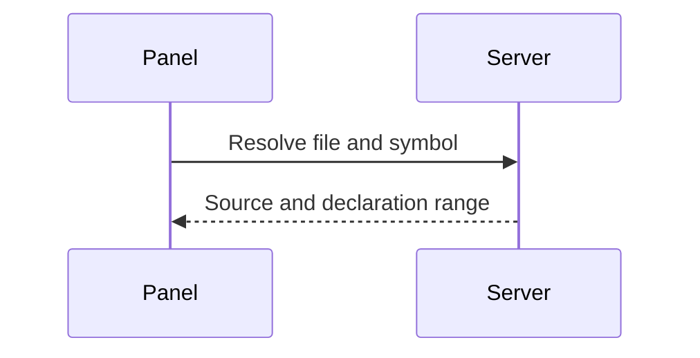
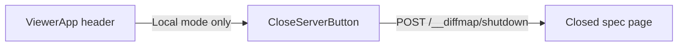

# Symbol and diagram references

Run from the repository root. The first references read the current diffmap source. The last diagram reads a commit.

```callstack
 parseViewerDocument [[src/parseViewer.ts#parseViewerDocument]]
 └── parseFence [[src/parseFence.ts#parseFence]]
     ├── parseCallStack [[src/annotations.ts#parseCallStack]]
     └── parseDiagramAnnotations [[src/diagramAnnotations.ts#parseDiagramAnnotations]]
```

## The shared source panel

Click a node, connecting line, or line label. Tab and Enter or Space also work.





## Commit references

Commit dae6b98 replaced the Done button with a quiet Close server button. Each node and edge opens the Diff panel on that commit, scrolled to the linked lines.



The deleted `DoneButton.tsx` has no node link. Deleted lines cannot be referenced.
