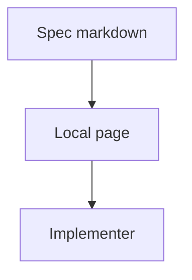

# Spec fixture

## Problem overview

Specs lived as markdown files with no local page, so mermaid, call stacks, and diff previews were hard to read. Prose may name paths such as `{workspace}/.halo/extensions/<id>/`.

## Solution overview

`pnpm exec diffmap` serves the spec with the same Maui page as a code walkthrough. The spec keeps its own section shape. The author writes the markdown, diffmap renders it locally, and the implementer reads that page.



## Goals

- A spec file in `specs/` opens as a local page.
- Mermaid, types, call stacks, and diff previews render on that page.

## Non-goals

- Changing the spec section order.

## Implementation

### Phase 1: Serve the spec file

**Today**

The CLI only serves walkthroughs. `startServer` writes walkthrough HTML, so a spec has no page.

**Proposed**

Point the CLI at a spec path and have `startServer` build the Vite page instead. A `pnpm spec` alias runs the same CLI, and generate-diffmap serves `specs/<name>.md` after writing it.

Serving starts in `startServer`. Today it reads the file as a walkthrough and writes static HTML. Instead, it creates a Vite server that renders any markdown file with the Maui page, and requests flow through the same handler as before:

```callstack
 startServer
-└── readWalkthroughOnly # write static walkthrough HTML
+└── createViteServer # build the Maui page for any markdown file
    └── handleDiffmapRequest
```

Vite needs to know which file to render and where excerpts resolve from. `StartServerInput` carries both, plus the port to listen on:

```ts
// src/serve.ts
type StartServerInput = {
  filePath: string;
  workspaceRoot: string;
  port: number;
};
```

Last, the CLI help text stops calling every file a walkthrough, so `diffmap --help` describes both uses:

```diff
 // src/cli.ts
 Cli.create("diffmap", {
-  description: "Serve a walkthrough",
+  description: "Serve a spec or code walkthrough markdown file as a local page",
```

## References

- [`src/cli.ts`](../src/cli.ts) — Starts the local server for both specs and walkthroughs.
