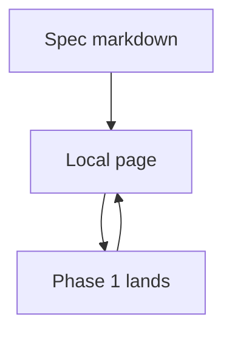

# Spec then implement

A fixture for a living spec: one phase landed, one still planned.

## Problem overview

Readers need one page that shows what already shipped and what is still proposed.

## Solution overview

Keep both phases in the same file. The spec renders as a local page; when Phase 1 lands, the same page updates to show it. The landed phase has a real `source-diff`. The planned phase is a call stack only.



## Goals

- TOC nests both phases.
- Diff panel only has the landed patch.

## Non-goals

- Generating the patch from git in the viewer.

## Implementation

### ✅ Phase 1: Validate before saving

**Today**

`handleRequest` saves every record, including invalid ones.

**Proposed**

Validate the record in the handler and skip the write when validation fails, so storage only receives valid input.

The handler used to save unchecked. It now validates first, and only a valid record reaches `saveRecord`:

```callstack
 handleRequest
-├── saveUnchecked  # accepted invalid input [[request:old:12]]
+├── validateInput  # reject empty names [[request:new:12-13]]
 └── saveRecord  # store validated input [[request:new:14]]
```

The change is an early return. When validation fails, the handler returns the error before the save call runs:

```source-diff:request:src/request.ts
diff --git a/src/request.ts b/src/request.ts
--- a/src/request.ts
+++ b/src/request.ts
@@ -10,5 +10,6 @@
 export function handleRequest(input: Input) {
   const record = input.record;
-  saveUnchecked(record);
+  const error = validateInput(record);
+  if (error instanceof Error) return error;
   return saveRecord(record);
 }
```

### Phase 2: Tell the user why

**Today**

A rejected record returns a tagged error that the UI cannot show.

**Proposed**

Format the validation error into a message the UI can display. Phase 1's write path stays unchanged.

The formatting belongs inside validation, where the error is created. `validateInput` calls a new `formatError` before returning, and `saveRecord` is untouched:

```callstack
 handleRequest
 └── validateInput
+    └── formatError  # turn the tagged error into copy the UI can show
 └── saveRecord
```
