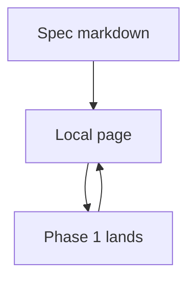

# Spec then implement

A fixture for a living spec: one phase landed, one still planned.

## Problem overview

Readers need one page that shows what already shipped and what is still proposed.

## Solution overview

Keep both phases in the same file. The spec renders as a local page; when Phase 1 lands, the same page updates to show it. The landed phase links its commit. The planned phase is a call stack only.



## Goals

- TOC nests both phases.
- Diff panel only has the landed commit.

## Non-goals

- Linking prose to deleted lines.

## Implementation

### ✅ Phase 1: Link from prose

**Today**

References only work in call stacks and Mermaid. A `[[path]]` in a paragraph renders as plain text.

**Proposed**

Split references out of prose text and render each one as clickable inline code, so a paragraph can open the source panel too.

```changes
6e4b5d3
```

The parser now walks prose text and turns each valid reference into a reference node. Code spans and link text stay literal:

```callstack
 parseViewerDocument
 └── fromNode  # convert each md4x node [[6e4b5d3:src/parseViewer.ts#L318-L326]]
-    └── keep text as is
+    ├── proseText  # split references out of text [[6e4b5d3:src/parseViewer.ts#L328-L353]]
+    │   └── parseReference  # now exported [[6e4b5d3:src/annotations.ts#L42]]
+    └── keep code spans and links literal [[6e4b5d3:src/parseViewer.ts#L361-L364]]
```

Prose references join the stack and diagram annotations, so selection works the same way for all three:

```callstack
 parseViewerDocument
+└── collectReferences  # gather prose references [[6e4b5d3:src/parseViewer.ts#L120-L128]] [[6e4b5d3:src/parseViewer.ts#L218-L224]]
```

The page renders each reference node as a button around inline code:

```callstack
 renderNode [[6e4b5d3:src/viewer/ComarkView.tsx#L64-L68]]
+└── InlineReference  # inline code that opens the source panel [[6e4b5d3:src/viewer/ComarkView.tsx#L173-L189]]
```

### Phase 2: Show the commit in the label

**Today**

A prose reference shows the file name and fragment. A commit reference looks the same as a current-file reference.

**Proposed**

Prefix the label with the short commit SHA so readers can tell landed changes from current files. Uncommitted references keep the plain label.

The label is built where the reference node is created. `proseText` passes the commit to a new `referenceLabel` option, and the renderer is untouched:

```callstack
 proseText
 └── referenceLabel
+    └── prefix the short SHA  # a1b2c3d:file.ts#L12-L30
 └── InlineReference
```
