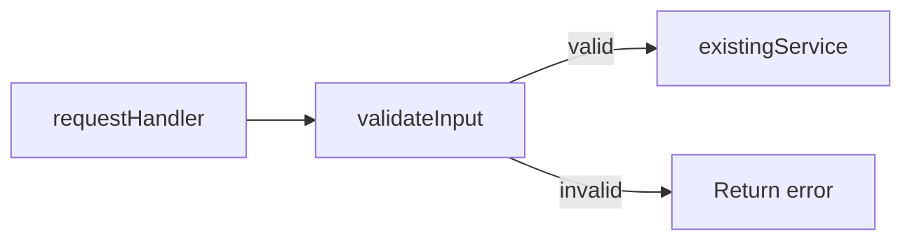

# Living spec

A spec is one Markdown file at `specs/<short-kebab-case-name>.md` that shows the current system, the plan, and the work done. Update it as the plan changes and work lands. For a walkthrough of an existing pull request, use its spec if it has one; otherwise write under `tmp/`. Check the repo's paths and symbols before writing.

**Settle scope first.** Before writing a new spec, read the relevant code, then ask the user about each unclear choice, such as which design, where new behavior lives, what is in scope, or how phases split. Give options and your pick for each. Write once they are settled; ask again when implementation turns up a new one.

## Serve and share

Run from the repo root:

```sh
npx @tanishqkancharla/diffmap list                   # reuse the URL if this file is already served
npx @tanishqkancharla/diffmap serve specs/<name>.md
npx @tanishqkancharla/diffmap share specs/<name>.md  # only when asked; prints https://diffmap.dev/g/<id>
```

Leave the server running and give the user the file path and URL. Open the browser only when asked. A shared gist is unlisted: anyone with the URL can read it. A spec on a pull request is also at `https://diffmap.dev/<owner>/<repo>/pull/<n>/specs/<name>.md`, pinned to a commit.

## Shape

**Top-down.** Start with what changes for the end client: the person using the product (UI and UX), or the developer calling the code, CLI, or API. Then work back from the entry point they touch, layer by layer, to the implementation. This holds for the spec and for each phase.

The spec has a title, a problem overview (who is affected, what the current behavior costs them, why now), a solution overview (client-facing changes first, then the flows that deliver them, with diagrams), goals, non-goals, phases, and **References**.

**Phases.** Keep each small enough to commit alone. Headings are plain when planned, ⏳ in progress, ✅ done. Open each with **Today** and **Proposed**, a few sentences each from the client's view: what they see and do now and the problem it causes; what changes, how that solves it, and why the phase comes here when order matters. Name concrete differences, such as a command, flag, screen, error, return type, or step the client no longer takes. For an internal change, say so and name the client-facing change it prepares. Keep both after the phase is done.

Then tell the phase as a story: show the client-facing change (usage snippet, CLI session, API call, UI state), then work back through each layer to the new logic and data shapes. Show the change rather than describe it: alternate short paragraphs with visuals, and when a paragraph needs more than three sentences, use a visual instead. Each paragraph sets up the visual after it. Every phase has:

- at least one call stack diff;
- pseudocode for each piece of new logic, in the repo's main language;
- a Mermaid diagram whenever control flow, data flow, or state changes;
- a type for each new data shape.

Never end a phase with a task list or checkboxes.

**Call stacks.** `-` marks the original code, `+` the change, and `└──` / `├──` the tree. Name each row after a real function; when a row sums up work, write a verb phrase: `+├── run executor schema migrations`, not `+├── Executor schema migrations`. Write `#` comments as actions that give a purpose, return value, or side effect.

**Links.** Link existing source with [references](#source-references); write planned symbols as plain text.

## Prose

Follow Orwell's six rules from "Politics and the English Language" in all prose, comments, and diagram labels. Code names are not jargon.

## Example phase

````md
### ⏳ Phase 1: Validate request input

**Today**

The handler passes records straight to the service. A client that sends an empty name gets a success response, and the bad record surfaces later as a storage error the client never sees, so they keep sending bad input.

**Proposed**

A client that sends an empty name gets an error naming the `name` field, so they can fix the request right away. Bulk import in Phase 2 needs every saved record to be valid, so this check comes first.

From the client's side, the same empty-name request now fails at once:

```ts
const response = await client.saveRecord({ name: "" });
// before: { ok: true }
// after:  { ok: false, error: "name must not be empty" }
```

The handler gains one step between receiving a record and saving it:

```callstack
 requestHandler [[src/request.ts#requestHandler]]
+├── validateInput # reject empty names
 └── existingService [[src/service.ts#existingService]]
```

A valid record reaches the service unchanged. An invalid one stops at validation, so nothing reaches storage:



In code, the check is an early return:

```ts
function requestHandler(record: RecordInput) {
  const error = validateInput(record);
  if (error) return error;
  return existingService(record);
}
```
````

## When a phase is complete

Before starting the next phase:

1. Commit the code, then commit the spec update separately, since the spec names the code commit's SHA.
2. Add a `changes` fence with that SHA right after Today and Proposed. It renders the phase's summary card.
3. Point every reference the phase changed at the commit: stack rows, `%% ref` directives, and prose.
4. Update diagrams, call stacks, and pseudocode to match what was built, and mark the heading ✅.
5. Restart `serve`; it checks commit references at startup.

The example phase then has:

````md
```changes
a1b2c3d
```

```callstack
 requestHandler [[a1b2c3d:src/request.ts#L8-L20]]
+├── validateInput # reject empty names [[a1b2c3d:src/validate.ts#L1-L9]]
 └── existingService [[src/service.ts#existingService]]
```
````

## Source references

Paths are relative to the repo root.

- `[[path/to/file.ts#symbolName]]` links a TypeScript or JavaScript declaration; qualify ambiguous ones, as in `[[src/store.ts#Store.save]]`.
- `[[path]]` links a file; `[[path#L12-L30]]` a line range.
- `[[<sha>:path#L12-L30]]` links lines in a commit, or `<base>..<head>` for a phase over several commits, where `<base>` is the commit before the first. Lines are numbered after the commit, so deleted lines cannot be linked. Find them with `git show <sha> -- <path>` and `git show <sha>:<path> | nl -ba`.
- A reference without a commit opens that file's uncommitted changes, or the current file when it has none; this works only in a local viewer.
- In prose, references render as clickable inline code; wrap one in backticks to show the syntax.
- In Mermaid, `%% ref node:<id> [[reference]]` links a node or participant and `%% ref edge:<index> [[reference]]` an edge or message, counting from zero in declaration order. Use one directive per target, with several references when needed.

Fences: `mermaid` draws a diagram, `callstack` stack rows, `changes` a commit or range summary (empty for uncommitted changes), and `html` trusted HTML you wrote. Other languages are pseudocode and types.

## Look up the rest

- Full reference and fence syntax → [diffmap README](https://github.com/tanishqkancharla/diffmap#link-call-stacks-to-source-changes)
- Worked examples → [annotations](https://github.com/tanishqkancharla/diffmap/blob/main/fixtures/annotations.md) and [diagrams](https://github.com/tanishqkancharla/diffmap/blob/main/fixtures/references.md) fixtures
