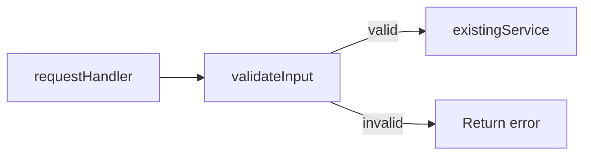

# Living spec

Keep one Markdown file that shows the current system, the plan, and the work completed. Update it as the plan changes and implementation progresses.

Write specs at `specs/<short-kebab-case-name>.md`. Check the repo's paths and symbols before writing. For a walkthrough of an existing pull request, use its spec if available; otherwise write under `tmp/`.

Before writing a new spec, work out its scope with the user in the conversation. Read the relevant code, then ask design questions wherever the approach is ambiguous or unclear, such as which design to choose, where new behavior should live, what is in scope, or how phases should split. Give the options and your recommendation for each question. Go back and forth until the open questions are settled, then write the spec. Ask again when implementation reveals a new ambiguity.

## Serve and share

Run these commands from the repo root:

```sh
npx @tanishqkancharla/diffmap list
npx @tanishqkancharla/diffmap serve specs/<name>.md
```

The shorthand `npx @tanishqkancharla/diffmap specs/<name>.md` also serves the file. Reuse the URL from `list` when that file is already served. Leave the server running and give the user the file path and URL. Open the browser when requested.

When the user asks to share, run:

```sh
npx @tanishqkancharla/diffmap share specs/<name>.md
```

Use the hosted URL it prints: `https://diffmap.dev/g/<id>`. The gist is unlisted and readable by anyone with the URL. A spec on a pull request is available at `https://diffmap.dev/<owner>/<repo>/pull/<n>/specs/<name>.md`; that URL is pinned to a commit.

## File structure

Explain top-down, in the spec as a whole and in each phase. Start with what changes for the end client: the person using the product (UI and UX) or the developer calling the code, CLI, or API (DX). Then work backward from that desired change to the code that delivers it: the entry point the client touches first, then each layer beneath it, ending with implementation details. A reader should know what the client will see before reading how any of it works.

Start with a title, problem overview, and solution overview. The problem overview gives the motivation for the whole spec: who is affected, what the current behavior costs them, and why the change is worth making now. Open the solution overview with the client-facing changes, then explain the system flows that deliver them alongside the relevant diagrams. Follow with goals, non-goals, implementation phases, and **References**.

Keep each phase small enough to commit on its own. Prefix in-progress phase headings with ⏳ and completed phase headings with ✅. Planned phases use plain headings.

Start each phase with **Today** and **Proposed**. Use a few simple sentences for each, written from the end client's point of view. Today describes what the client sees and does before the phase, and the problem that causes them. Proposed describes what changes for the client, how that solves the problem, and why the phase comes at this point in the plan when the order matters. Name concrete differences, such as a new command, flag, screen, error message, return type, or step the client no longer takes. When a phase changes nothing a client can see, such as an internal refactor, say so in Proposed and name the client-facing change it prepares for. Keep this comparison when the phase is completed.

After Today and Proposed, tell the phase's work as a top-down story. First show the client-facing change itself, such as a usage snippet, CLI session, API call, or UI state. Then work backward through the code: the entry point that delivers the change, then each layer it calls, ending with the new logic and data shapes. Interleave pseudocode, Mermaid diagrams, and call stack diffs between short paragraphs. Show the change rather than describe it. Every phase needs at least one call stack diff, pseudocode for each piece of new logic, a diagram whenever control flow, data flow, or state changes, and a type for each new data shape. When a paragraph runs past three sentences, replace the explanation with a visual. Each paragraph sets up the next visual, and each visual shows the step the paragraph just described. Do not stack visuals without prose between them, and do not end a phase with a task list or checkboxes. Call stack diffs use `-` for the original code, `+` for the change, and `└──` / `├──` for the call tree. Use `#` comments to explain a purpose, return value, or side effect.

Name each call stack row after a real function or method. When a row summarizes work instead, write it as a verb phrase that says what the code does, not a noun for the thing involved. Write `+├── run executor schema migrations`, not `+├── Executor schema migrations`, and `+└── load the encrypted credential provider`, not `+└── encrypted credential provider`. Write `#` comments as actions too.

Write pseudocode in the source repo's main language, using its familiar syntax and a matching code fence.

Link existing source with `[[path]]` or `[[path#symbol]]`. Show symbols that are still planned as plain text. The spec can contain planned, in-progress, and completed phases together.

## Example phase

Adapt this example to the work:

````md
### ⏳ Phase 1: Validate request input

**Today**

The handler passes records straight to the service. A client that sends an empty name gets a success response, and the bad record surfaces later as a storage error the client never sees. They cannot trace the broken record back to their request, so they keep sending bad input.

**Proposed**

A client that sends an empty name gets an error naming the `name` field, so they can fix the request right away. Bulk import in Phase 2 needs every saved record to be valid, so this check comes first.

From the client's side, the same empty-name request now fails immediately:

```ts
const response = await client.saveRecord({ name: "" });
// before: { ok: true }
// after:  { ok: false, error: "name must not be empty" }
```

Behind that response, the handler gains one step between receiving a record and saving it:

```callstack
 requestHandler [[src/request.ts#requestHandler]]
+├── validateInput # reject empty names
 └── existingService [[src/service.ts#existingService]]
```

A valid record continues to the service unchanged. An invalid one stops at validation and returns an error, so nothing reaches storage:



In code, the check is an early return before the existing call:

```ts
function requestHandler(record: RecordInput) {
  const error = validateInput(record);
  if (error) return error;
  return existingService(record);
}
```
````

## When a phase is complete

Before starting the next phase:

1. Commit the phase's code, then commit the spec update separately, since the spec names the code commit's SHA.
2. Add a `changes` fence with that SHA right after Today and Proposed. It renders the phase's summary card: the commit title, files changed with lines added and removed, and a Review button.
3. Point every reference the phase changed at the commit, in stack rows, Mermaid `%% ref` directives, and prose.
4. Update the diagrams, call stack diffs, and pseudocode to match what was built, and mark the heading ✅.
5. Restart `serve`; it checks commit references at startup.

After Today and Proposed, the example phase becomes:

````md
```changes
a1b2c3d
```

```callstack
 requestHandler [[a1b2c3d:src/request.ts#L8-L20]]
+├── validateInput # reject empty names [[a1b2c3d:src/validate.ts#L1-L9]]
 └── existingService [[src/service.ts#existingService]]
```
````

## Source references

`[[path/to/file.ts#symbolName]]` links to a current TypeScript or JavaScript declaration. Use a qualified name such as `[[src/store.ts#Store.save]]` for ambiguous symbols. `[[path]]` links a whole file; `[[path#L12-L30]]` links a line range. Paths are relative to the repo root. References also work in prose, where they render as clickable inline code; wrap one in backticks to show the syntax literally. A reference without a commit opens that file's uncommitted changes, or the current file when it has none; this only works in a local viewer.

`[[<sha>:path#L12-L30]]` links lines in a commit. Use a 7–40 character SHA, or `<base>..<head>` for a phase spread over several commits, where `<base>` is the commit before the first one. The file must change in that commit. Line numbers are the file's lines after the commit; find changed lines with `git show <sha> -- <path>` and number them with `git show <sha>:<path> | nl -ba`. Deleted lines cannot be referenced, and a commit cannot be combined with `#symbol`.

In Mermaid, link nodes or participants with `%% ref node:<id> [[reference]]` and edges or sequence messages with `%% ref edge:<index> [[reference]]`. Edge indices start at zero in declaration order. Use one directive per target, with multiple references on that directive as needed.

A `mermaid` fence draws a diagram; a `callstack` fence draws stack rows; a `changes` fence summarizes a commit or range, and an empty one summarizes uncommitted changes. Use other language fences for pseudocode and types. Use `html` fences for trusted HTML you authored: the viewer renders it directly.

The full syntax is in the [diffmap README](https://github.com/tanishqkancharla/diffmap#link-call-stacks-to-source-changes), the [annotations](https://github.com/tanishqkancharla/diffmap/blob/main/fixtures/annotations.md) fixture, and the [diagrams](https://github.com/tanishqkancharla/diffmap/blob/main/fixtures/references.md) fixture.
