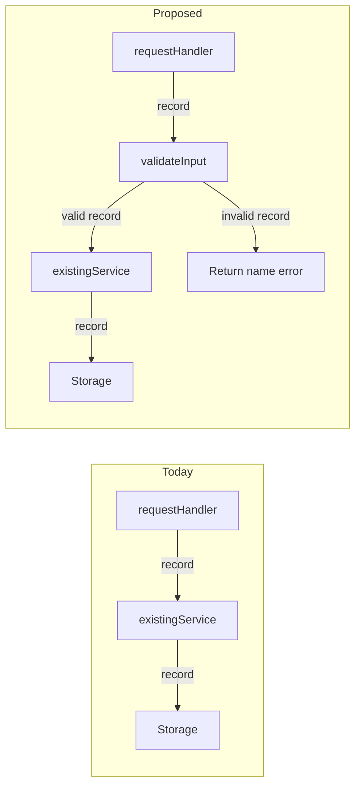

# Living spec

A spec is one Markdown file at `specs/<short-kebab-case-name>.md` that shows the current system, the plan, and the work done. Update it as the plan changes and work lands. For a walkthrough of an existing pull request, use its spec if it has one; otherwise write under `tmp/`. Check the repo's paths and symbols before writing.

**Settle scope first.** Before writing a new spec, read the relevant code, then ask the user about each unclear choice, such as which design, where new behavior lives, what is in scope, or how phases split. Give options and your pick for each. Write once they are settled; ask again when implementation turns up a new one.

## Serve and share

Run from the repo root:

```sh
npx @tanishqkancharla/diffmap list                   # reuse the URL if this file is already served
npx @tanishqkancharla/diffmap serve specs/<name>.md
npx @tanishqkancharla/diffmap share specs/<name>.md  # only when asked; prints https://diffmap.dev/g/<id>
```

Leave the server running and give the user the file path and URL. Open the browser only when asked. Before sharing, commit finished work and point its references at the commit, as in [When a phase is complete](#when-a-phase-is-complete): a gist is a snapshot with no git, so it shows commit diffs, but a reference without a commit only opens the file as it was when shared. A shared gist is unlisted: anyone with the URL can read it, including every file it snapshots. A spec on a pull request is also at `https://diffmap.dev/<owner>/<repo>/pull/<n>/specs/<name>.md`, pinned to a commit.

## Shape

**Top-down.** Start with what changes for the end client: the person using the product (UI and UX), or the developer calling the code, CLI, or API. Then work back from the entry point they touch, layer by layer, to the implementation. This holds for the spec and for each phase.

The spec has a title, a problem overview (who is affected, what the current behavior costs them, why now), a solution overview (client-facing changes first, then the flows that deliver them, with diagrams), goals, non-goals, phases, and **References**.

**Phases.** Keep each small enough to commit alone. Headings are plain when planned, ⏳ in progress, ✅ done. Open each with **Today** and **Proposed**, a few sentences each from the client's view: what they see and do now and the problem it causes; what changes, how that solves it, and why the phase comes here when order matters. Name concrete differences, such as a command, flag, screen, error, return type, or step the client no longer takes. For an internal change, say so and name the client-facing change it prepares. Keep both after the phase is done.

Then tell the phase as a story: show the client-facing change (usage snippet, CLI session, API call, UI state), then work back through each layer to the new logic and data shapes. Show the change rather than describe it: alternate short paragraphs with visuals, and when a paragraph needs more than three sentences, use a visual instead. Each paragraph sets up the visual after it. Every phase has:

- at least one call stack diff;
- pseudocode for each piece of new logic, in the repo's main language;
- diagrams that orient the reader and show what changes, not only control flow;
- a type for each new data shape.

Never end a phase with a task list or checkboxes.

**Diagrams.** Make diagrams a default way to explain specs and walkthroughs, not an optional illustration after the prose. Use `mermaid` fences, or `services` for stateful services that send each other events. Open the solution overview with a diagram of the system and its boundaries. In each phase, put a focused diagram beside the explanation it supports, before the implementation detail. Use diagrams for ownership, dependencies, data shapes and relationships, user journeys, runtime order, control flow, data flow, and state changes.

- Pick the view that answers the reader's question: a flowchart for paths or ownership, a sequence for interactions over time, a state diagram for lifecycles, or a relationship graph for data and dependencies. When the flow is messages between stateful services, such as a request crossing a server and a database, use a `services` fence so the reader can step through each event and watch state change.
- When replacing behavior, show **Today** and **Proposed** with matching names and layout so the difference is visible. For added behavior, show the new path and where it joins the existing system.
- Label nodes and arrows with concrete components, inputs, outputs, and conditions. Show important boundaries and failure paths; link existing source with `%% ref` directives.
- Keep each diagram focused on one question. Split a large diagram into an overview and local views; do not repeat the same diagram to meet a quota. Call stacks explain function-level data flow, while diagrams explain how the parts fit together. Use both rather than treating one as a substitute for the other.

**Call stacks.** Write every `callstack` fence as readable data-flow pseudocode, not a list of function names or vague steps. Read top to bottom as `result = function(inputs)`:

- Use named variables, function arguments, and returned values. Feed each output into the later calls that use it, and show explicit `return value` rows, including early returns.
- Keep `-` for the original code, `+` for the change, and an unmarked space for unchanged rows. Keep `└──` / `├──` and indentation to show calls inside a function; nest a callee's work beneath its call.
- Calls with only side effects need no assigned result: `await storage.save(record)` is enough. Show conditions and retries where they affect the flow.
- Link real functions with source references. In proposals, unlinked helper names are pseudocode, not promises of extra public APIs; state this beside the stack when introducing such helpers.
- Keep `#` comments short enough to read in the viewer. Use them for purpose or a non-obvious effect, not to repeat the call.

**Links.** Link existing source with [references](#source-references); write planned symbols as plain text.

## Prose

Follow Orwell's six rules from "Politics and the English Language" in all prose, comments, and diagram labels. Code names are not jargon.

## Example phase

This self-contained example uses illustrative files and a commit SHA, not Diffmap source paths. The code below defines the functions named in its stacks.

````md
### ⏳ Phase 1: Validate request input

**Today**

The handler passes records straight to the service. A client that sends an empty name gets a success response, and the bad record surfaces later as a storage error the client never sees, so they keep sending bad input.

**Proposed**

A client that sends an empty name gets an error naming the `name` field, so they can fix the request right away. Bulk import in Phase 2 needs every saved record to be valid, so this check comes first.

From the client's side, the same empty-name request now fails at once:

```ts
const response = await client.saveRecord({ name: "" });
// before: { ok: true }
// after:  { ok: false, error: "name must not be empty" }
```

Today every record reaches storage. In the proposed flow, a valid record follows the same save path, but an invalid one returns an error before storage. The unlinked `validateInput` helper is pseudocode, not a proposed public API:



The call stack shows how the validation result controls the return path:

```callstack
 response = requestHandler(record) [[src/request.ts#requestHandler]]
-└── return existingService(record) [[src/service.ts#existingService]]
+├── error = validateInput(record) # reject empty names
+├── if error: return error
+├── result = existingService(record) [[src/service.ts#existingService]]
+│   ├── storage.save(record)
+│   └── return { ok: true }
+└── return result
```

In code, the check is an early return:

```ts
type RecordInput = { name: string };
declare const storage: { save(record: RecordInput): void };

// src/request.ts (imports omitted)
function requestHandler(record: RecordInput) {
  const error = validateInput(record);
  if (error) return error;
  const result = existingService(record);
  return result;
}

// src/validate.ts
function validateInput(record: RecordInput) {
  if (record.name.trim() === "") {
    return { ok: false, error: "name must not be empty" };
  }
  return undefined;
}

// src/service.ts (stand-in for the existing save)
function existingService(record: RecordInput) {
  storage.save(record); // side effect; no result needed
  return { ok: true };
}
```
````

## When a phase is complete

Before starting the next phase:

1. Commit the code, then commit the spec update separately, since the spec names the code commit's SHA.
2. Add a `changes` fence with that SHA right after Today and Proposed. It renders the phase's summary card.
3. Point every reference the phase changed at the commit: stack rows, `%% ref` directives, and prose.
4. Update diagrams, call stacks, and pseudocode to match what was built, and mark the heading ✅.
5. Restart `serve`; it checks commit references at startup.

The example phase then has:

````md
```changes
a1b2c3d
```

```callstack
 response = requestHandler(record) [[a1b2c3d:src/request.ts#L8-L20]]
-└── return existingService(record) [[src/service.ts#existingService]]
+├── error = validateInput(record) [[a1b2c3d:src/validate.ts#L1-L9]]
+├── if error: return error
+├── result = existingService(record) [[src/service.ts#existingService]]
+│   ├── storage.save(record)
+│   └── return { ok: true }
+└── return result
```
````

## Source references

Paths are relative to the repo root.

- `[[path/to/file.ts#symbolName]]` links a TypeScript or JavaScript declaration; qualify ambiguous ones, as in `[[src/store.ts#Store.save]]`.
- `[[path]]` links a file; `[[path#L12-L30]]` a line range.
- `[[<sha>:path#L12-L30]]` links lines in a commit, or `<base>..<head>` for a phase over several commits, where `<base>` is the commit before the first. Lines are numbered after the commit, so deleted lines cannot be linked. Find them with `git show <sha> -- <path>` and `git show <sha>:<path> | nl -ba`.
- A reference without a commit opens that file's uncommitted changes, or the current file when it has none. A shared gist opens the file as it was when shared.
- In prose, references render as clickable inline code; wrap one in backticks to show the syntax.
- In Mermaid, `%% ref node:<id> [[reference]]` links a node or participant and `%% ref edge:<index> [[reference]]` an edge or message, counting from zero in declaration order. Use one directive per target, with several references when needed.

Fences: `mermaid` draws a diagram, `services` an animated diagram of services, their state, and the events between them, `callstack` stack rows, `changes` a commit or range summary (empty for uncommitted changes), and `html` trusted HTML you wrote. Other languages are pseudocode and types.

## Look up the rest

- Full reference and fence syntax → [diffmap README](https://github.com/tanishqkancharla/diffmap#link-call-stacks-to-source-changes)
- Worked examples → [annotations](https://github.com/tanishqkancharla/diffmap/blob/main/fixtures/annotations.md), [diagrams](https://github.com/tanishqkancharla/diffmap/blob/main/fixtures/references.md), and [services](https://github.com/tanishqkancharla/diffmap/blob/main/fixtures/services.md) fixtures
