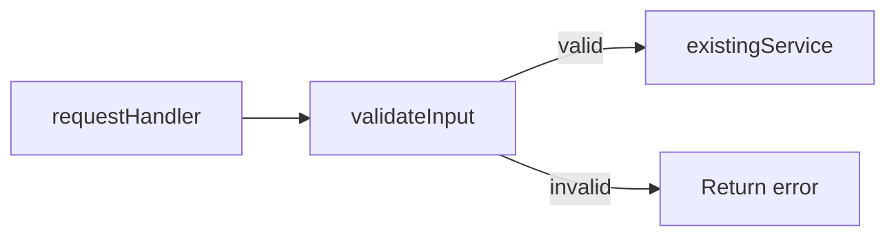

# Living spec

Keep one Markdown file that shows the current system, the plan, and the work completed. Update it as the plan changes and implementation progresses.

Write specs at `specs/<short-kebab-case-name>.md`. Check the repo's paths and symbols before writing. For a walkthrough of an existing pull request, use its spec if available; otherwise write under `tmp/`. Ask for clarification when the answer would change the plan or phase boundaries.

## Serve and share

Run these commands from the repo root:

```sh
npx @tanishqkancharla/diffmap list
npx @tanishqkancharla/diffmap serve specs/<name>.md
```

The shorthand `npx @tanishqkancharla/diffmap specs/<name>.md` also serves the file. Reuse the URL from `list` when that file is already served. Leave the server running and give the user the file path and URL. Open the browser when requested.

When the user asks to share, run:

```sh
npx @tanishqkancharla/diffmap share specs/<name>.md
```

Use the hosted URL it prints: `https://diffmap.dev/g/<id>`. The gist is unlisted and readable by anyone with the URL. A spec on a pull request is available at `https://diffmap.dev/<owner>/<repo>/pull/<n>/specs/<name>.md`; that URL is pinned to a commit.

## File structure

Start with a title, problem overview, and solution overview. Explain the system flows alongside the relevant diagrams. Follow with goals, non-goals, implementation phases, and **References**.

Keep each phase small enough to commit on its own. Prefix in-progress phase headings with ⏳ and completed phase headings with ✅. Planned phases use plain headings.

Start each phase with **Today** and **Proposed**. Use a few simple sentences for each: Today describes the behavior before the phase; Proposed explains the change and why it helps. Keep this comparison when the phase is completed.

After Today and Proposed, tell the phase's work as a story: walk through the change in the order a reader needs it, and interleave pseudocode, Mermaid diagrams, and call stack diffs between short paragraphs. Show the change rather than describe it. Every phase needs at least one call stack diff, pseudocode for each piece of new logic, a diagram whenever control flow, data flow, or state changes, and a type for each new data shape. When a paragraph runs past three sentences, replace the explanation with a visual. Each paragraph sets up the next visual, and each visual shows the step the paragraph just described. Do not stack visuals without prose between them, and do not end a phase with a task list or checkboxes. Call stack diffs use `-` for the original code, `+` for the change, and `└──` / `├──` for the call tree. Use `#` comments to explain a purpose, return value, or side effect.

Name each call stack row after a real function or method. When a row summarizes work instead, write it as a verb phrase that says what the code does, not a noun for the thing involved. Write `+├── run executor schema migrations`, not `+├── Executor schema migrations`, and `+└── load the encrypted credential provider`, not `+└── encrypted credential provider`. Write `#` comments as actions too.

Write pseudocode in the source repo's main language, using its familiar syntax and a matching code fence.

Link existing source with `[[path]]` or `[[path#symbol]]`. Show symbols that are still planned as plain text. The spec can contain planned, in-progress, and completed phases together.

End each phase with its `changes` summary fence, after all explanatory prose, diagrams, call stacks, and pseudocode, and before the next phase or section. Use an empty fence for uncommitted work; replace it with the phase's commit SHA or range when complete. Do not put the summary immediately after Today and Proposed.

## Example phase

Adapt this example to the work:

````md
### ⏳ Phase 1: Validate request input

**Today**

The handler passes records straight to the service. Empty names reach storage.

**Proposed**

Validate each record before calling the service. Return an error for an empty name so storage receives valid records.

The handler gains one step between receiving a record and saving it:

```callstack
 requestHandler [[src/request.ts#requestHandler]]
+├── validateInput # reject empty names
 └── existingService [[src/service.ts#existingService]]
```

A valid record continues to the service unchanged. An invalid one stops at validation and returns an error, so nothing reaches storage:



In code, the check is an early return before the existing call:

```ts
function requestHandler(record: RecordInput) {
  const error = validateInput(record);
  if (error) return error;
  return existingService(record);
}
```

```changes

```
````

## When a phase is complete

Before starting the next phase:

1. Commit the phase's code, then commit the spec update separately, since the spec names the code commit's SHA.
2. Add or update the `changes` fence with that SHA at the end of the phase, after its walkthrough and before the next phase or section. It renders the phase's summary card: the commit title, files changed with lines added and removed, and a Review button.
3. Point every reference the phase changed at the commit, in stack rows, Mermaid `%% ref` directives, and prose.
4. Update the diagrams, call stack diffs, and pseudocode to match what was built, and mark the heading ✅.
5. Restart `serve`; it checks commit references at startup.

The completed example keeps its walkthrough and finishes with the summary:

````md
```callstack
 requestHandler [[a1b2c3d:src/request.ts#L8-L20]]
+├── validateInput # reject empty names [[a1b2c3d:src/validate.ts#L1-L9]]
 └── existingService [[src/service.ts#existingService]]
```

After the remaining diagrams and pseudocode, close the phase with its changes:

```changes
a1b2c3d
```
````

## Source references

`[[path/to/file.ts#symbolName]]` links to a current TypeScript or JavaScript declaration. Use a qualified name such as `[[src/store.ts#Store.save]]` for ambiguous symbols. `[[path]]` links a whole file; `[[path#L12-L30]]` links a line range. Paths are relative to the repo root. References also work in prose, where they render as clickable inline code; wrap one in backticks to show the syntax literally. A reference without a commit opens that file's uncommitted changes, or the current file when it has none; this only works in a local viewer.

`[[<sha>:path#L12-L30]]` links lines in a commit. Use a 7–40 character SHA, or `<base>..<head>` for a phase spread over several commits, where `<base>` is the commit before the first one. The file must change in that commit. Line numbers are the file's lines after the commit; find changed lines with `git show <sha> -- <path>` and number them with `git show <sha>:<path> | nl -ba`. Deleted lines cannot be referenced, and a commit cannot be combined with `#symbol`.

In Mermaid, link nodes or participants with `%% ref node:<id> [[reference]]` and edges or sequence messages with `%% ref edge:<index> [[reference]]`. Edge indices start at zero in declaration order. Use one directive per target, with multiple references on that directive as needed.

A `mermaid` fence draws a diagram; a `callstack` fence draws stack rows; a `changes` fence summarizes a commit or range, and an empty one summarizes uncommitted changes. Use other language fences for pseudocode and types. Use `html` fences for trusted HTML you authored: the viewer renders it directly.

The full syntax is in the [diffmap README](https://github.com/tanishqkancharla/diffmap#link-call-stacks-to-source-changes), the [annotations](https://github.com/tanishqkancharla/diffmap/blob/main/fixtures/annotations.md) fixture, and the [diagrams](https://github.com/tanishqkancharla/diffmap/blob/main/fixtures/references.md) fixture.
