# Bring flow-preview into diffmap

[flow-preview](https://github.com/tanishqkancharla/flow-preview) is an agent skill that turns a user journey into an interactive canvas of real UI states. diffmap is the skill and viewer that explains a change as a living spec. Both tell an agent to show a person what a change does, both are built on React, Vite, and Maui, and both ship today as separate skills from separate repos. This spec moves flow-preview into the diffmap repo and npm package, and links each skill's guidance to the other.

This spec is a single file because it was asked for at `specs/flow-preview.md`. A spec written with the guide today would be a `.diffmap/specs/<name>/` directory with one page per phase, as [[guide.md]] says; each phase below is written so it can later become its own page.

## Problem

**What flow-preview does today.** An agent that is asked to preview a journey runs the skill's generator from the project root:

```sh
node .agents/skills/flow-preview/scripts/generate.mjs preferences-flow 4180
npm --prefix tmp/preferences-flow install --workspaces=false
npm --prefix tmp/preferences-flow run dev
```

The generator ([`scripts/generate.mjs`](https://github.com/tanishqkancharla/flow-preview/blob/e9894aa/scripts/generate.mjs)) writes `tmp/<name>/` with a private `package.json`, `index.html`, `main.tsx`, `vite.config.mjs`, and a starter `scenario.tsx`, and copies two assets beside them: the canvas ([`assets/FlowCanvas.tsx`](https://github.com/tanishqkancharla/flow-preview/blob/e9894aa/assets/FlowCanvas.tsx), about 1,500 lines) and a Vite helper ([`assets/previewConfig.mjs`](https://github.com/tanishqkancharla/flow-preview/blob/e9894aa/assets/previewConfig.mjs)) that dedupes React and Maui and limits the dev server to the source folders the preview imports. The preview's dependencies are copied from the skill's own `package.json`. The preview then never imports from the skill again, so it keeps working if the skill moves.

The agent edits `scenario.tsx`: a `FlowScenario` of `FlowNode`s, each a state with a parent, an incoming action, a note, and a `render` that adapts the project's real component with local fixtures. The canvas draws the states as a map of thumbnails with an outline, breadcrumbs, and a live preview of the selected state. A reviewer ticks a checkbox per state; the tick is stored in `localStorage` with a fingerprint of the thumbnail, so it clears when that state's UI changes. An opt-in `comparison` prop shows two revisions of the same journey, with added, removed, and modified states marked. [`SKILL.md`](https://github.com/tanishqkancharla/flow-preview/blob/e9894aa/SKILL.md) holds the authoring rules, much of the canvas's visual contract, and a verification checklist; its Playwright suite copies the skill into a throwaway project, generates a preview, deletes the skill copy, and drives the result.

**What diffmap does today.** [[skills/generate-diffmap/SKILL.md]] is a short pointer: it tells the agent to run `npx @tanishqkancharla/diffmap guide`, which prints [[guide.md]] from the installed package ([[src/cli.ts#cli]]). So the instructions always match the viewer that serves the spec. The package ships `bin.js`, `guide.md`, `lib`, and `viewer-dist` ([[package.json]]), not the skill itself; people install the skill with `npx skills add tanishqkancharla/diffmap --skill generate-diffmap`. A `diffmap install-skill` command that copies the skill out of the package was proposed in [#27](https://github.com/tanishqkancharla/diffmap/pull/27) and closed without merging, so it does not exist on `main`.

**Where they overlap.**

| flow-preview                                               | diffmap                                                                                               |
| ---------------------------------------------------------- | ----------------------------------------------------------------------------------------------------- |
| Each state rendered from the real component                | [Capture UI changes](../guide.md#capture-ui-changes): one screenshot per state, default first         |
| `comparison` of two revisions, each from its own worktree  | Today beside Proposed in a `side-by-side` gallery, Today captured from the base commit in a worktree  |
| Per-state review checkbox, fingerprinted in `localStorage` | Per-file "reviewed" mark, keyed to a hash of the diff, in [[src/viewer/reviewed.ts#useReviewedFiles]] |
| Map of states joined by incoming actions                   | `mermaid` flowcharts and `services` diagrams of the same journey                                      |
| Per-state `note` explaining how the user got there         | `>` notes under diagram steps, and a sentence above each capture                                      |
| Verify light, dark, narrow, keyboard; inspect screenshots  | Look at each capture with the expected result in mind; say which checks you ran                       |
| Skill installed from its own repo, assets read from there  | Pointer skill installed from the diffmap repo, guide read from the npm package                        |

The two skills disagree in places a person would notice. flow-preview's rules mention Halo, Amp orbs, and `.amp/in/artifacts/`, which mean nothing outside that monorepo. It pins Maui 0.0.59 while diffmap's viewer uses 0.0.62. And an agent writing a diffmap spec for a UI change has no reason to know flow-preview exists, so it captures single screenshots of a multi-step journey whose states it then has to describe in prose.

## Solution

Keep flow-preview its own skill, with its own runtime, but ship it from the diffmap package the same way `generate-diffmap` ships: a short pointer skill, instructions printed by the CLI, and assets read from the installed package. Then make each guide name the other where their work meets: a spec phase that changes a journey points the agent to a flow preview, and the flow preview's captures and comparisons land in that phase's `media/` folder as Today and Proposed.

```mermaid diff [flow-preview ships from the diffmap package]
 flowchart TD
-    FPR[flow-preview repo] -->|skills add| FS[flow-preview skill]
-    FS -->|generate.mjs| TMP[Preview in tmp]
+    PKG[diffmap package] -->|install-skill| FS[flow-preview skill]
+    FS -->|flow guide| AG[Agent]
+    AG -->|flow new| TMP[Preview in tmp]
+    PKG -->|canvas and helper| TMP
+    TMP -->|captures| MED[Spec media folder]
     DMR[diffmap repo] -->|skills add| GS[generate-diffmap skill]
     GS -->|guide| AG
     %% ref node:PKG [[package.json]]
     %% ref node:GS [[skills/generate-diffmap/SKILL.md]]
     %% ref node:DMR [[guide.md]]
```

**What merges**

- **Distribution.** The canvas, Vite helper, generator, tests, and rules move into this repo. One npm version carries both skills, and `diffmap update` updates both.
- **The pointer pattern.** `skills/flow-preview/SKILL.md` keeps flow-preview's name and trigger description, so agents pick it for the same requests, but its body only says to run `diffmap flow guide`.
- **Guidance where the skills meet.** The diffmap guide's [Capture UI changes](../guide.md#capture-ui-changes) section sends multi-state journeys to flow-preview. The flow guide sends its final screenshots to the spec's `media/<phase-slug>/` and maps a `comparison` onto Today and Proposed.
- **Dependency pins.** The preview's React, Maui, Vite, `motion`, and `purse-styles` versions follow the viewer's, so a fix in one reaches the other in the same release.

**What stays separate**

- **The canvas runtime.** A flow preview compiles and runs the project's own components, with the project's dependencies, in a Vite dev server the agent starts. The diffmap viewer is a prebuilt bundle (`viewer-dist`) served by [[src/serve.ts#startServer]], and it also runs on diffmap.dev, where no project code exists. The canvas cannot live inside the viewer, and the viewer does not depend on React or Vite at runtime: [[package.json]] lists them as dev dependencies only. The preview keeps its own private `package.json` and install step.
- **Review marks.** Both skills fingerprint a review in `localStorage` so it clears when the reviewed thing changes, but one reviews UI states and the other reviews file diffs, in different origins. Neither reads the other's marks.
- **The skill names and triggers.** "Preview this onboarding flow" and "write a spec for this change" are different requests. One skill that does both would load the full canvas contract into every spec, and every spec rule into every preview.

## Goals

- An agent with the diffmap package installed can generate a flow preview without a second repo or skill source.
- A spec phase that changes a UI journey shows that journey's states, captured from a flow preview, in the phase's media folder.
- Generated previews still run on their own after the package updates or moves, and existing previews keep working untouched.
- `diffmap install-skill` installs either skill from the package, at the package's version.

## Non-goals

- Rendering a live flow preview inside the diffmap viewer. A local-only embed is possible later (the viewer's content security policy in [[src/serve.ts#contentSecurityPolicy]] does not block frames), but it would not work on diffmap.dev or in a shared gist, so captures come first.
- A new fence kind for flows. A flow's map is already expressible as a `mermaid` flowchart, and its states as a gallery.
- Changing the canvas's visual contract or its `FlowScenario` API.
- Retiring the flow-preview repo. That repo is outside this change; Phase 4 only proposes a README note there.

## References

- flow-preview at [`e9894aa`](https://github.com/tanishqkancharla/flow-preview/tree/e9894aa): [`SKILL.md`](https://github.com/tanishqkancharla/flow-preview/blob/e9894aa/SKILL.md), [`scripts/generate.mjs`](https://github.com/tanishqkancharla/flow-preview/blob/e9894aa/scripts/generate.mjs), [`assets/`](https://github.com/tanishqkancharla/flow-preview/tree/e9894aa/assets), [`test/`](https://github.com/tanishqkancharla/flow-preview/tree/e9894aa/test), [`NOTICE`](https://github.com/tanishqkancharla/flow-preview/blob/e9894aa/NOTICE).
- diffmap: [[guide.md]], [[skills/generate-diffmap/SKILL.md]], [[src/cli.ts]], [[src/update.ts#runUpdate]], [[src/viewer/Fence.tsx#Fence]], [[src/viewer/Media.tsx]].
- [#27](https://github.com/tanishqkancharla/diffmap/pull/27), the closed `install-skill` proposal this spec revives.

## Phase 1: Import flow-preview into `flow/`

Nothing in diffmap knows about flow previews yet. This phase copies the flow-preview repo into a top-level `flow/` directory, unchanged in behavior, with its own checks.

**Today**

flow-preview lives only in its own repo. An agent installs it with `npx skills add tanishqkancharla/flow-preview`.

**Proposed**

Nothing changes for agents yet. The repo gains `flow/` with:

```text
flow/
  FlowCanvas.tsx        from assets/, copied into each preview
  previewConfig.mjs     from assets/, copied into each preview
  package.json          private; the preview's dependencies, not diffmap's
  guide.md              SKILL.md's body, without front matter
  tsconfig.json         typechecks the canvas against the preview's dependencies
  playwright.config.ts
  test/fixtures.ts
  test/FlowCanvas.spec.ts
  LICENSE               Apache-2.0, from flow-preview
  NOTICE                attribution to Saffron Health and Halo PR #606
```

The canvas stays outside `src/` so [[tsconfig.build.json]] never compiles it into `lib/` and the viewer build never bundles it. flow-preview is Apache-2.0 and diffmap is MIT, so `flow/LICENSE` and `flow/NOTICE` travel with the files that carry that license, including in the npm tarball in [Phase 2](#phase-2-diffmap-flow-new-and-diffmap-flow-guide).

`flow/package.json` takes flow-preview's dependency list, with versions moved to the viewer's: Maui from 0.0.59 to 0.0.62, and the others to the ranges in [[package.json]]. The root gets scripts that run the imported checks from `flow/`: `typecheck:flow`, and `test:flow` for the Playwright suite, which needs Chromium and so stays out of `npm test`. The Playwright fixture uses `await using`, which needs Node 24; `.github/workflows/publish.yml` already runs Node 24, while the package's `engines` stays at Node 22 because the generator itself only needs `node:fs`.

`guide.md` drops the Halo and Amp orb text: the `amp orb service start` command, the portal URL rule, `.halo` and `.amp` in the deny list explanation, and `.amp/in/artifacts/`. It keeps every rule about the canvas and scenarios.

```changes

```

## Phase 2: `diffmap flow new` and `diffmap flow guide`

[Phase 1](#phase-1-import-flow-preview-into-flow) put the canvas and its rules in `flow/`. This phase lets an agent use them through the diffmap CLI, and adds the `flow-preview` pointer skill.

**Today**

The agent runs `node .agents/skills/flow-preview/scripts/generate.mjs <name> [port]`, which reads the assets and dependency list from the skill's folder and prints Amp orb commands.

**Proposed**

The agent runs the same steps through diffmap, from the project root:

```sh
npx @tanishqkancharla/diffmap flow guide
npx @tanishqkancharla/diffmap flow new preferences-flow --port 4180
npm --prefix tmp/preferences-flow install --workspaces=false
npm --prefix tmp/preferences-flow run dev
```

`flow` is an incur command group mounted on [[src/cli.ts#cli]], as incur's nested `Cli` supports. `flow new` is the generator ported to TypeScript, and it writes the same files with the same rules: a lowercase kebab-case name, a port from 1024 to 65535, and never overwriting an existing `tmp/<name>/`. It reads its assets and dependency list from the installed package rather than from a skill folder, and it prints the next commands instead of Amp ones.

```callstack [diffmap flow new]
 result = flowNew(name, port) # in a new src/flow.ts
 ├── error = checkName(name) # same pattern as generate.mjs
 ├── dir = createPreviewDir(cwd, name) # mkdir tmp/name, fails if it exists
 ├── deps = readPreviewDependencies() # flow/package.json from the package root
 ├── copyAssets(dir) # FlowCanvas.tsx and previewConfig.mjs, COPYFILE_EXCL
 ├── writeStarter(dir, deps, port) # package.json, index.html, main.tsx, vite.config.mjs, scenario.tsx
 └── return { dir, next: ["npm install", "npm run dev"] }
```

None of these helpers exist yet; they are pseudocode for one function.

`flow guide` prints `flow/guide.md`, just as `guide` prints [[guide.md]]. [[package.json]] adds `flow` to `files`, so the canvas, helper, guide, dependency list, `LICENSE`, and `NOTICE` ship in the tarball; `flow/test` and its Playwright config are excluded.

The new `skills/flow-preview/SKILL.md` keeps flow-preview's name and description so agents trigger it for the same requests, and copies the pointer shape of [[skills/generate-diffmap/SKILL.md]]:

```md
---
name: flow-preview
description: Generates interactive Maui user-flow canvases with linked states and persistent review checkboxes. Use when previewing, comparing, or reviewing a user journey across multiple UI states.
---

Before you build a flow preview, run this from the project root and follow what it prints:

    npx @tanishqkancharla/diffmap flow guide
```

The Playwright fixture switches from copying the skill folder to running `flow new` from a packed copy of diffmap, and still deletes that copy before driving the preview, so the test keeps proving that previews outlive what generated them.

```changes

```

## Phase 3: `diffmap install-skill`

[Phase 2](#phase-2-diffmap-flow-new-and-diffmap-flow-guide) added a second pointer skill. This phase lets an agent install either one from the package, so one `npm` install is all a project needs.

**Today**

Skills come only from GitHub, through the Skills CLI: `npx skills add tanishqkancharla/diffmap --skill generate-diffmap`. Nothing records which diffmap version a skill copy came from.

**Proposed**

```sh
npx @tanishqkancharla/diffmap install-skill              # both skills, into ./.agents/skills/
npx @tanishqkancharla/diffmap install-skill flow-preview # one skill
npx @tanishqkancharla/diffmap install-skill --global     # into ~/.agents/skills/
```

This follows [#27](https://github.com/tanishqkancharla/diffmap/pull/27)'s design, extended to two skills: `skills/` joins `files` in [[package.json]], and the command copies each skill folder to where `npx skills add` would put it, writes the package version to `.diffmap-version` inside it, and reports each skill as installed, already current, or updated from one version to another. A copy from `npx skills add` has no marker, so the command replaces it. The command is not called `skills` because incur already owns `skills add`.

Since both pointer skills fetch their instructions from the CLI, a skill copy only goes stale when its trigger description changes. [[src/update.ts#runUpdate]] does not touch skill copies; after an update, the agent can run `install-skill` again.

```changes

```

## Phase 4: Connect the guides

[Phase 2](#phase-2-diffmap-flow-new-and-diffmap-flow-guide) made the flow guide reachable from the CLI. This phase makes each guide send the agent to the other at the point where their work meets.

**Today**

[[guide.md]] tells the agent to take one screenshot per state of a UI change. flow-preview's guide tells it to save final screenshots to an Amp folder or "the project's artifact directory". Neither mentions the other.

**Proposed**

An agent writing a spec phase that changes a journey of more than two or three states builds a flow preview of it, then captures the states the phase changes from the preview into `media/<phase-slug>/`. When the phase is a change to an existing journey, it builds the preview with a `comparison` of the base commit and the working tree, and the paired Before and After panels become the phase's Today and Proposed `side-by-side` gallery. The spec carries static captures, so it still reads on GitHub and diffmap.dev; the live preview stays a local tool the agent can point the reader to.



```mermaid [A spec phase that changes a journey]
flowchart LR
    G[diffmap guide] -->|journey with many states| F[diffmap flow guide]
    F -->|flow new and scenario.tsx| P[Flow preview]
    P -->|comparison of base and working tree| C[Before and After panels]
    C -->|screenshots| M[media folder]
    M -->|side-by-side gallery| S[Spec phase page]
    %% ref node:G [[guide.md]]
    %% ref node:S [[src/viewer/Media.tsx]]
```

The edits:

- [[guide.md]], Capture UI changes: one bullet that sends multi-state journeys and before-and-after journey comparisons to `diffmap flow guide`.
- `flow/guide.md`, Review and verify: save final captures under the spec's `media/<phase-slug>/` when the preview supports a spec, otherwise in the project's artifact directory; label Before and After as Today and Proposed in the spec.
- `README.md`: a short flow-preview section next to the generate-diffmap install line.
- The flow-preview repo's README (outside this repo, so a separate PR there): say that flow-preview now ships with diffmap and how to install it.

```changes

```
