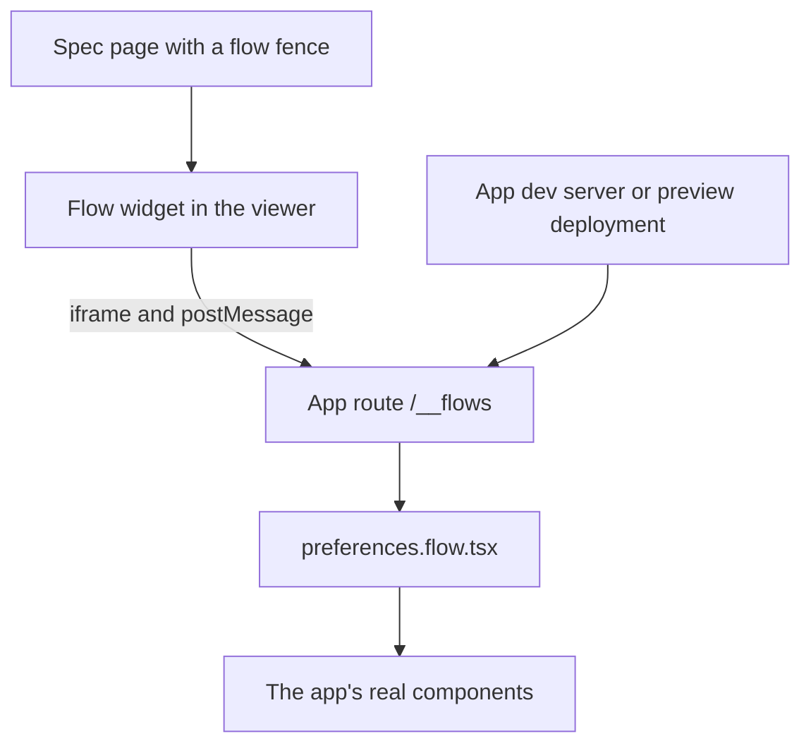

# Flow widget: live UI journeys in a diffmap spec

[flow-preview](https://github.com/tanishqkancharla/flow-preview) is an agent skill that turns a user journey into an interactive canvas of real UI states. This spec brings the idea into diffmap as an interactive widget, a `flow` fence, so a spec can show the journey a change affects right beside the text that explains it, running the app's real components with their real styles and animations.

The people using this build web apps. They already have a design system, a bundler, a dev server, and usually a preview deployment for each pull request. So diffmap does not build their components. It embeds their own app, on a small dev-only route, and draws the flow's controls around it.

This spec is a single file because it was asked for at `specs/flow-preview.md`. A spec written with the guide today would be a `.diffmap/specs/<name>/` directory with one page per phase, as [[guide.md]] says; each phase below is written so it can later become its own page.

## Problem

**How flow-preview renders components today.** The skill's generator ([`scripts/generate.mjs`](https://github.com/tanishqkancharla/flow-preview/blob/e9894aa/scripts/generate.mjs)) writes a second app to `tmp/<name>/`, with its own `package.json`, its own React, Maui, and Vite, and its own `npm install`. The agent's `scenario.tsx` imports the project's components by relative path, and that second Vite build compiles them, using a helper ([`assets/previewConfig.mjs`](https://github.com/tanishqkancharla/flow-preview/blob/e9894aa/assets/previewConfig.mjs)) that dedupes React and limits which folders the dev server may read.

That second build knows nothing about the project's own build. Path aliases, Tailwind or PostCSS, CSS modules, SVG loaders, environment variables, global stylesheets, fonts, theme classes, and app-wide providers all have to be recreated by hand. flow-preview's [`SKILL.md`](https://github.com/tanishqkancharla/flow-preview/blob/e9894aa/SKILL.md) spends a whole section telling the agent to load the app's global styles and fonts and to compare each state against the running app, because the copy drifts. The canvas, about 1,500 lines in [`assets/FlowCanvas.tsx`](https://github.com/tanishqkancharla/flow-preview/blob/e9894aa/assets/FlowCanvas.tsx), is built to fill a browser window, and the preview lives only in `tmp/` on the agent's machine, so a reviewer of the pull request never sees it.

**What a diffmap spec shows today.** For a UI change, [[guide.md]] asks for one screenshot per state, with Today beside Proposed in a gallery. Screenshots are not interactive, show no animation, and leave the reader to piece together from prose how the states connect.

## Solution

The app gets one dev-only route, `/__flows`, that renders any state of any flow inside the app's real layout, providers, styles, and fonts. diffmap's viewer embeds that route in an iframe and draws everything else itself.



The agent writes the flow next to the app's code, in the app's own language and build:

```tsx [src/flows/preferences.flow.tsx]
import { defineFlow } from "@tanishqkancharla/diffmap/flow";
import { Preferences } from "../settings/Preferences";

export default defineFlow({
  id: "preferences",
  title: "Saving preferences",
  initialState: "editing",
  states: [
    {
      id: "editing",
      title: "Editing",
      note: "The form opens with the saved digest name.",
      render: ({ go }) => <Preferences onSave={() => go("saved")} />,
    },
    {
      id: "saved",
      title: "Saved",
      parent: "editing",
      action: "Save preferences",
      note: "The new name is saved, and a confirmation shows.",
      render: () => <Preferences saved />,
      enter: async (ui) => ui.click("Save preferences"),
    },
  ],
});
```

The spec only names the flow:

````text
```flow [Saving preferences]
preferences
```
````

A repo-wide `.diffmap/flows.json` tells the viewer where the route lives, locally and on each pull request:

```json
{
  "local": "http://localhost:5173/__flows",
  "preview": "https://myapp-git-{branch}.vercel.app/__flows"
}
```

In the page, the widget fits the text column. The selected state is the live iframe; everything around it is the viewer's own UI:

```text [Inline, in the spec column]
+- Saving preferences -------------------------- [expand] -+
| Editing  >  Saving  >  Saved              (breadcrumbs)  |
| +------------------------------------------------------+ |
| |   iframe: the app's /__flows route, selected state   | |
| +------------------------------------------------------+ |
| < Previous state                    Save preferences >   |
| Note: what just happened, and what the user can do next  |
| +--------+  +--------+  +--------+  +--------+           |
| | [x]    |  | [ ]    |  | [ ]    |  | [ ]    |   >       |
| +--------+  +--------+  +--------+  +--------+           |
|  Editing     Saving      Saved       Error               |
+----------------------------------------------------------+
```

The expand button opens the full canvas over the page, with the outline, a zoomable map of every state, and the same live preview, as flow-preview lays it out today:

```text [Expanded, over the page]
+- Saving preferences ------------------------------------- [close] -+
| Outline     | Map: pan and zoom              | Live preview        |
| Editing [x] |                                | breadcrumbs         |
|  Saving     | [Editing] --> [Saving]         | iframe              |
|   Saved     |                  |             | < Prev  Next >      |
|   Error     |       [Error] <--+--> [Saved]  |                     |
+--------------------------------------------------------------------+
```

**What this removes, compared with flow-preview**

- The second app in `tmp/`, its install step, and keeping its React and design-system versions in line with the project.
- Copying global styles, fonts, and providers into a preview.
- The dev-server folder allowlist, which existed only to fence in that second build.
- Any new runtime dependency in diffmap's CLI: no Vite, React, or browser automation at `serve` time.

**What it costs**

- A one-time setup in the app: the dev-only route, added by the agent the first time it writes a flow.
- A running dev server to see a flow locally, and a preview deployment to see it on a pull request.
- `@tanishqkancharla/diffmap` as a dev dependency of the app, for `defineFlow` and the route's runtime.

## Goals

- A spec page shows a journey as a live widget that fits the text column and expands to the full canvas.
- Each state renders through the app's own build, so it looks and moves exactly as it does in the app.
- Moving to the next state plays the app's own transitions.
- A reviewer on diffmap.dev sees the same live widget, through the pull request's preview deployment.
- No code from the repo runs in the viewer's own page, on diffmap.dev or locally.

## Non-goals

- Building or bundling the app's code in diffmap.
- Comparing two revisions of a journey side by side, as flow-preview's `comparison` does. Showing Today needs a second dev server or the base branch's deployment; that is a later spec.
- Shipping `/__flows` to production. The route exists in development and preview builds only.

## Phase 1: The `/__flows` route

Nothing in diffmap knows about flows yet. This phase gives an app a page that can render any state of any flow, and the messages diffmap will use to drive it.

**Today**

To preview a state, an agent builds a separate app in `tmp/` and recreates the project's styles and providers inside it.

**Proposed**

The package gains a small entry point, `@tanishqkancharla/diffmap/flow`, next to today's `.` export in [[package.json]]. It exports `defineFlow` and a `FlowRoute` component. The app mounts `FlowRoute` on a dev-only route, inside its normal root layout and providers. The agent picks the route's form from the app's framework. For a Vite app, it is an extra `flows.html` entry that Vite serves in dev and that the build leaves out:

```tsx [src/flows/main.tsx]
import { createRoot } from "react-dom/client";
import { FlowRoute } from "@tanishqkancharla/diffmap/flow";
import { AppProviders } from "../AppProviders";
import "../styles/global.css";

const flows = import.meta.glob("./*.flow.tsx", { eager: true });

createRoot(document.getElementById("root")!).render(
  <AppProviders>
    <FlowRoute flows={flows} />
  </AppProviders>,
);
```

In a Next.js app, it is an `app/__flows/page.tsx` that returns `notFound()` in production. The guide carries both recipes.

`FlowRoute` reads `?flow=` and `?state=` from the URL and renders that state's `render`, so a state can be opened on its own while the agent builds the flow. Inside the widget, it talks to the viewer with `postMessage`:

```ts
// route → viewer
{ type: "flow-ready", protocol: 1, flow: { id, title, initialState, states: [{ id, title, parent, action, note }] } }
{ type: "flow-size", width, height }
{ type: "flow-state", state, fingerprint } // after each state renders
// viewer → route
{ type: "flow-show", state, how: "render" | "enter" }
{ type: "flow-mode", mode: "preview" | "thumbnail" }
// [!note fingerprint] A hash of the state's rendered HTML and classes, used for review marks.
// [!note how] "enter" runs the state's steps on the live UI; Phase 3 adds it.
```

A state's `render` gets `go(stateId)`, so the real controls in a live state can move the flow on, as the Save button does in the example above. `FlowRoute` only answers messages from the viewer origins it allows: the local viewer on `127.0.0.1` and `https://www.diffmap.dev`. The route also sends a `frame-ancestors` policy that names the same origins, so other sites cannot frame it.

```changes

```

## Phase 2: The inline flow widget

[Phase 1](#phase-1-the-__flows-route) gave the app a route that renders flow states. This phase draws the widget in the spec.

**Today**

A spec shows a journey as screenshots in a gallery ([[src/viewer/Media.tsx]]).

**Proposed**

A `flow` fence renders the inline widget. The viewer reads `.diffmap/flows.json`, loads `<local>?flow=preferences` in an iframe, and waits for `flow-ready`. It then draws the breadcrumbs, previous and next-step buttons, note, and thumbnail strip itself, with Maui, as the other fences do.

```callstack [Showing a flow fence]
 view = Fence(fence) [[src/viewer/Fence.tsx#Fence]]
+└── return FlowWidget(fence)
+    ├── url = flowUrl(flowsConfig, viewerMode) # local, or the PR's preview
+    ├── live = iframe(url + "?flow=" + fence.flow)
+    ├── flow = await message("flow-ready")
+    ├── strip = flow.states.map(thumbnailFrame) # lazy, inert iframes
+    └── on select(state): live.post({ type: "flow-show", state, how: "render" })
```

`FlowWidget`, `flowUrl`, and `thumbnailFrame` are planned names. [[src/parseFence.ts#parseFence]] learns the `flow` kind, whose body is one flow ID.

- **The live preview** is one iframe. It grows with `flow-size` up to a height cap, then scrolls.
- **Thumbnails** are small iframes in `thumbnail` mode, scaled down, inert, and loaded only when they scroll into view, so a long flow does not start a dozen copies of the app at once.
- **Review marks** sit on each thumbnail and are stored in `localStorage` per spec, flow, and state, keyed to the state's `fingerprint`, the same way [[src/viewer/reviewed.ts#useReviewedFiles]] keys reviewed files to their diff. A state whose UI changes needs reviewing again.
- **When the route cannot be reached,** the widget says so in place, with the URL it tried, such as "Start your dev server at http://localhost:5173". `serve` adds the same message to its `warnings`.

The local viewer's content security policy ([[src/serve.ts#contentSecurityPolicy]]) only restricts scripts, objects, and the base URL, so it does not block the iframe. `validate` checks that each `flow` fence names one ID and that `.diffmap/flows.json` exists; it does not reach the app.

```changes

```

## Phase 3: Live transitions

[Phase 2](#phase-2-the-inline-flow-widget) shows each state by rendering it. Selecting the next state swaps the UI at once, so the app's own transitions never play.

**Today**

flow-preview solves this with an optional `persistentPreview`, a single long-lived UI that the scenario drives between any two states, and the scenario has to track what it has applied so far.

**Proposed**

A state can declare `enter`, the steps a person takes from its parent to reach it. When the reader moves from a state to one of its children with the next-step button or the strip, the viewer sends `flow-show` with `how: "enter"`. The route keeps the live UI mounted and runs those steps on it, so menus open, heights animate, and messages appear as they do in the app. Any other jump, such as back or to a distant state, renders the target directly.

```ts
enter: async (ui) => {
  await ui.type("Digest name", "Weekly digest");
  await ui.click("Save preferences");
};
// [!note ui] Finds controls by their accessible name and acts on them at a pace a reader can follow.
```

`ui` is a few helpers in `@tanishqkancharla/diffmap/flow`, `click`, `type`, `select`, and `wait`. They are written for this route, not taken from a testing library, so the app gains no test dependency. Thumbnails always use `render`, so they stay fixed end states, and the reader's reduced-motion setting is passed through to the app.

```changes

```

## Phase 4: Expand to the full canvas

[Phase 2](#phase-2-the-inline-flow-widget) and [Phase 3](#phase-3-live-transitions) built the inline widget. This phase adds the expanded view.

**Today**

Diagrams and images expand into a full-window `Dialog` that draws a second copy of the content ([[src/viewer/MermaidBlock.tsx#MermaidBlock]]).

**Proposed**

The expand button, or Enter while the widget has focus, opens flow-preview's full layout over the page: the outline, a pannable and zoomable map of thumbnails joined by their actions, and the live preview with breadcrumbs. Escape, the close button, or a click outside it collapses it to the same state.

A second copy would reload the app and lose what the reader typed, and moving an iframe to a new place in the page reloads it too. So the live iframe stays where it is. Expanding fixes its frame to the window over a scrim, traps focus, and lays the outline and map out around it. The map's layout, sidebar resizing, and selection styling come from flow-preview's canvas, which moves into `src/viewer/flow/` without the parts that rendered states: those now come from the route.

```changes

```

## Phase 5: Flows on diffmap.dev, and the guide

[Phase 2](#phase-2-the-inline-flow-widget) through [Phase 4](#phase-4-expand-to-the-full-canvas) work in the local viewer. This phase shows flows on a pull request, and tells agents how to write them.

**Today**

On diffmap.dev, a spec can only show what is committed: text, diagrams, and screenshots.

**Proposed**

On diffmap.dev, the widget fills `preview` in `.diffmap/flows.json` from the pull request and loads the app's preview deployment in the iframe, so the reviewer gets the same live widget. `{branch}`, `{sha}`, and `{pull}` come from the pull request that [[src/github/fetchRepo.ts]] already reads for its head SHA. If the repo has no `preview` URL, or the deployment is not ready yet, the widget says so and links to running the spec locally.

[[guide.md]] gains a "Flows" section, linked from [Capture UI changes](../guide.md#capture-ui-changes):

- Use a `flow` fence when a phase changes a journey of several states or a branch, and screenshots when it changes one or two states.
- The first time, add the `/__flows` route inside the app's root providers and global styles, kept out of production, and write `.diffmap/flows.json`.
- Write each flow next to the code it shows, from the real components, with local fixtures and no requests. Keep flow-preview's rules on notes and on reaching a state through the controls a person would use.
- Open each state on its own, at `/__flows?flow=<id>&state=<id>`, and compare it with the running app before handing the spec back.

[[skills/generate-diffmap/SKILL.md]] adds "previewing a user flow" to its description, so agents pick it for the requests that used to trigger flow-preview. The flow-preview repo's README points to diffmap (a separate PR in that repo).

```changes

```

## References

- flow-preview at [`e9894aa`](https://github.com/tanishqkancharla/flow-preview/tree/e9894aa): [`SKILL.md`](https://github.com/tanishqkancharla/flow-preview/blob/e9894aa/SKILL.md), [`scripts/generate.mjs`](https://github.com/tanishqkancharla/flow-preview/blob/e9894aa/scripts/generate.mjs), [`assets/FlowCanvas.tsx`](https://github.com/tanishqkancharla/flow-preview/blob/e9894aa/assets/FlowCanvas.tsx), [`assets/previewConfig.mjs`](https://github.com/tanishqkancharla/flow-preview/blob/e9894aa/assets/previewConfig.mjs), [`NOTICE`](https://github.com/tanishqkancharla/flow-preview/blob/e9894aa/NOTICE). flow-preview is Apache-2.0 and diffmap is MIT, so code that moves keeps its license and NOTICE.
- diffmap: [[src/viewer/Fence.tsx#Fence]], [[src/parseFence.ts#parseFence]], [[src/viewer/MermaidBlock.tsx#MermaidBlock]], [[src/viewer/reviewed.ts#useReviewedFiles]], [[src/serve.ts#contentSecurityPolicy]], [[src/github/fetchRepo.ts]].
