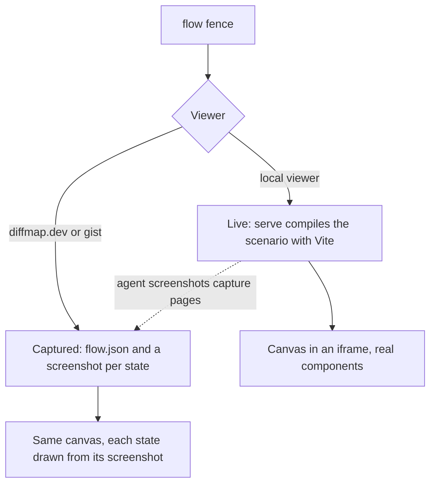

# Flow widget: bring flow-preview into diffmap

[flow-preview](https://github.com/tanishqkancharla/flow-preview) is an agent skill that turns a user journey into an interactive canvas of real UI states. This spec merges it into diffmap as a new interactive widget, a `flow` fence, so a spec can show the journey a change affects right beside the text that explains it. flow-preview stops being a separate skill: `generate-diffmap` and the guide it loads cover both.

flow-preview's canvas is designed to fill a browser window, with an outline, a zoomable map, and a preview sidebar. A spec page is a single text column. So the widget is compact inside the page and expands to the full canvas on demand.

This spec is a single file because it was asked for at `specs/flow-preview.md`. A spec written with the guide today would be a `.diffmap/specs/<name>/` directory with one page per phase, as [[guide.md]] says; each phase below is written so it can later become its own page.

## Problem

**What flow-preview does today.** An agent that is asked to preview a journey runs the skill's generator from the project root:

```sh
node .agents/skills/flow-preview/scripts/generate.mjs preferences-flow 4180
npm --prefix tmp/preferences-flow install --workspaces=false
npm --prefix tmp/preferences-flow run dev
```

The generator ([`scripts/generate.mjs`](https://github.com/tanishqkancharla/flow-preview/blob/e9894aa/scripts/generate.mjs)) writes a standalone Vite app to `tmp/<name>/` and copies in the canvas ([`assets/FlowCanvas.tsx`](https://github.com/tanishqkancharla/flow-preview/blob/e9894aa/assets/FlowCanvas.tsx), about 1,500 lines) and a Vite helper ([`assets/previewConfig.mjs`](https://github.com/tanishqkancharla/flow-preview/blob/e9894aa/assets/previewConfig.mjs)) that dedupes React and Maui and limits the dev server to the source folders the preview imports. The agent edits `scenario.tsx`: a `FlowScenario` of `FlowNode`s, where each node is a state with a parent, an incoming action, a note, and a `render` that adapts the project's real component with local fixtures.

The canvas takes the whole window. An outline lists the states on the left, a pannable, zoomable map of thumbnails sits in the middle, and the selected state's live UI sits in a sidebar on the right, with breadcrumbs and next-step buttons. Each state has a review checkbox, stored in `localStorage` with a fingerprint of its thumbnail, so the tick clears when that state's UI changes. An opt-in `comparison` prop shows two revisions of a journey, with added, removed, and modified states marked. [`SKILL.md`](https://github.com/tanishqkancharla/flow-preview/blob/e9894aa/SKILL.md) holds the authoring rules, the canvas's visual contract, and a verification checklist.

**What diffmap does today.** [[skills/generate-diffmap/SKILL.md]] tells the agent to run `diffmap guide`, which prints [[guide.md]] from the installed package. For a UI change, the guide asks for one screenshot per state in a gallery, with Today captured from the base commit beside Proposed. `serve` sends the prebuilt viewer from `viewer-dist/` ([[vite.viewer.config.ts]]), and the same viewer renders specs on diffmap.dev, where it reads every file from the pull request's pinned commit.

**Why this is a problem.** Both tools show a person what a UI change does, but they never meet:

- A flow preview lives in `tmp/` on the agent's machine. It never reaches the pull request, so a reviewer reading the spec does not see it.
- A spec shows a multi-step journey as a row of screenshots and describes in prose how the states connect, which is exactly what the flow map draws.
- Two skills give overlapping and sometimes conflicting advice on capturing UI, Today and Proposed, and review marks. flow-preview's rules also assume Halo and Amp orbs, and it pins Maui 0.0.59 while the viewer uses 0.0.62.

## Solution

A spec page gets a `flow` fence that points at a scenario file inside the spec:

````text
```flow [Saving preferences]
flows/preferences.tsx
```
````

The file is the same `FlowScenario` flow-preview uses today, saved at `.diffmap/specs/<name>/flows/preferences.tsx` and committed with the spec. In the page, the fence renders a compact widget at the width of the text column:

```text [Inline, in the spec column]
+- Saving preferences -------------------------- [expand] -+
| Editing  >  Saving  >  Saved              (breadcrumbs)  |
| +------------------------------------------------------+ |
| |   the selected state's real UI, in a dotted panel    | |
| +------------------------------------------------------+ |
| < Previous state                    Save preferences >   |
| Note: what just happened, and what the user can do next  |
| +--------+  +--------+  +--------+  +--------+           |
| | [x]    |  | [ ]    |  | [ ]    |  | [ ]    |   >       |
| +--------+  +--------+  +--------+  +--------+           |
|  Editing     Saving      Saved       Error               |
+----------------------------------------------------------+
```

The compact widget keeps what a reader needs to follow the journey: the selected state's live UI, breadcrumbs, the previous and next-step buttons, the note, and a strip of thumbnails in journey order, each with its review checkbox. The strip follows the map's column order (parent depth, then `row`) and scrolls sideways. The zoomable map and the outline are left out, because they need room the column does not have.

The expand button opens the full flow-preview canvas over the page, as diagrams and images already expand into a full-window dialog in [[src/viewer/MermaidBlock.tsx#MermaidBlock]] and [[src/viewer/Media.tsx]]:

```text [Expanded, over the page]
+- Saving preferences ------------------------------------- [close] -+
| Outline     | Map: pan and zoom              | Live preview        |
| Editing [x] |                                | breadcrumbs         |
|  Saving     | [Editing] --> [Saving]         | dotted panel        |
|   Saved     |                  |             | < Prev  Next >      |
|   Error     |       [Error] <--+--> [Saved]  |                     |
+--------------------------------------------------------------------+
```

Expanding and collapsing keep the selected state, the journey's breadcrumbs, the review marks, and any text the reader typed into the live UI.

The widget gets its states from one of two places:



- **Live, in the local viewer.** `serve` compiles the scenario and the project components it imports with Vite, and the widget runs the canvas in an iframe served by the same local server. The iframe keeps the project's global styles and its React copy out of the viewer, and keeps the viewer's styles out of the product UI.
- **Captured, on diffmap.dev and in gists.** No project code runs there. The spec commits the scenario's graph and a screenshot of every state, which the agent takes with its own browser tool from capture pages that `diffmap flow capture` lists. The hosted viewer draws the same canvas from those files, with each thumbnail and preview showing its screenshot. Nothing in a captured flow is interactive except navigation and review marks.

Live flows follow the same rule as `html` fences, which render only in the local viewer ([[src/viewer/Fence.tsx#Fence]]): code in the repo runs only on the reader's own machine.

**What merges into diffmap**

- The canvas, its scenario API, the comparison mode, and the Vite boundaries from `previewConfig.mjs`. They move into `src/flow/` and are rebuilt around the two layouts.
- flow-preview's authoring rules: derive states from the real UI, keep fixtures local, write notes about runtime state, and reach states through real controls. They move into a "Flows" section of [[guide.md]], without the Halo and Amp text.
- Review marks. A state's checkbox uses the same storage pattern as reviewed files in [[src/viewer/reviewed.ts#useReviewedFiles]], keyed by spec, flow, and state.
- Today and Proposed. A comparison becomes a `flow diff` fence whose Today side is built from the base commit, matching `mermaid diff` and `services diff`.

**What goes away**

- The `flow-preview` skill, its generator, and the `tmp/<name>/` apps. A flow lives in the spec and runs through `serve`.
- The flow-preview repo's role as a source. Its README should point to diffmap (a separate PR there).

## Goals

- A spec page can show a journey's states as an interactive widget that fits the text column and expands to the full canvas.
- The local viewer runs the project's real components in the widget, and diffmap.dev shows the same flow from committed screenshots.
- A flow's states, notes, and review marks behave as they do in flow-preview today.
- One skill and one guide cover specs and flows.

## Non-goals

- Running project code on diffmap.dev, in gists, or anywhere other than the reader's machine.
- Flows for non-React projects. flow-preview supports React only.
- Changing the `FlowScenario` API beyond what the two layouts and capturing need.
- Keeping existing `tmp/<name>/` previews working through diffmap. They are standalone apps and keep running on their own.

## Open questions

- **Runtime dependencies.** The live widget needs `vite` and `@vitejs/plugin-react` when `serve` runs, but today they are dev dependencies ([[package.json]]). Proposed: move them to `dependencies` and import them only when a spec has a `flow` fence, as `serve` already imports Vite only in dev mode ([[src/serve.ts#startServer]]). Ship the canvas prebuilt with Maui, `motion`, and `purse-styles` bundled in, and only React left external, so each project's components and the canvas share the project's React. This needs a size check against `npx` start-up time.
- **React versions.** flow-preview was only tested with React 19. With React left external, a project on React 18 might fail when the widget loads.
- **Testing the widget.** flow-preview's own browser tests use Playwright, as a dev dependency only; people who install flow-preview never get it. The same holds if those tests move here: npm never installs a package's dev dependencies for its users, so people using diffmap would not get Playwright. The cost falls only on contributors and CI. If that is still too much, the tests could cover the state model with `node --test` and leave the layouts to screenshots in each PR.

## References

- flow-preview at [`e9894aa`](https://github.com/tanishqkancharla/flow-preview/tree/e9894aa): [`SKILL.md`](https://github.com/tanishqkancharla/flow-preview/blob/e9894aa/SKILL.md), [`assets/FlowCanvas.tsx`](https://github.com/tanishqkancharla/flow-preview/blob/e9894aa/assets/FlowCanvas.tsx), [`assets/previewConfig.mjs`](https://github.com/tanishqkancharla/flow-preview/blob/e9894aa/assets/previewConfig.mjs), [`test/`](https://github.com/tanishqkancharla/flow-preview/tree/e9894aa/test), [`NOTICE`](https://github.com/tanishqkancharla/flow-preview/blob/e9894aa/NOTICE). flow-preview is Apache-2.0 and diffmap is MIT, so the code that moves keeps its license file and NOTICE.
- diffmap: [[src/parseFence.ts#parseFence]], [[src/viewer/Fence.tsx#Fence]], [[src/viewer/MermaidBlock.tsx#MermaidBlock]], [[src/serve.ts#startServer]], [[src/github/fetchRepo.ts]].

## Phase 1: A live `flow` fence in the local viewer

Nothing in diffmap knows about flows yet. This phase adds the fence, serves its scenario live, and draws the compact widget.

**Today**

To show a journey, an agent builds a flow preview in `tmp/`, serves it separately, and adds screenshots of its states to the spec. The reader sees only the screenshots.

**Proposed**

The agent writes the scenario into the spec and adds a `flow` fence. When the reader opens that page in the local viewer, the compact widget runs the real components. They can click through the journey, type into the UI, and tick states as reviewed, without leaving the spec.

The scenario file can also export the folders its imports come from. Vite serves only those folders and the spec's own directory, as flow-preview's `sourceRoots` did:

```tsx [.diffmap/specs/preferences/flows/preferences.tsx]
import type { FlowScenario } from "@tanishqkancharla/diffmap/flow";
import { Preferences } from "../../../../src/Preferences.tsx";

export const sourceRoots = ["../../../../src"];

export const scenario: FlowScenario = {
  id: "preferences",
  title: "Saving preferences",
  initialState: "editing",
  nodes: [
    {
      id: "editing",
      title: "Editing",
      action: "Open preferences",
      row: 0,
      note: "The form loads with the saved digest name.",
      render: () => <Preferences />,
    },
    // ...
  ],
};
```

`serve` sees the fence when it parses the page and starts Vite in middleware mode on the viewer's own server, under `/__diffmap/flow/`:

```callstack [Opening a page with a flow fence]
 fences = parseViewerDocument(page) [[src/parseViewer.ts#parseViewerDocument]]
 ├── fence = parseFence("flow", "flows/preferences.tsx") [[src/parseFence.ts#parseFence]]
+│   └── return { kind: "flow", file, title }
 server = startServer(spec) [[src/serve.ts#startServer]]
+├── if spec has flow fences: vite = createFlowServer(specDir, sourceRoots)
+│   └── fs.allow = [specDir, ...sourceRoots], deny like isServableMedia
+└── GET /__diffmap/flow/<page>/<fence> → canvas page importing the scenario
 view = Fence(fence) [[src/viewer/Fence.tsx#Fence]]
+└── return FlowWidget(fence) # iframe to /__diffmap/flow/..., compact layout
```

`createFlowServer` and `FlowWidget` are planned names. Vite's `fs.deny` repeats the files [[src/serve.ts#isServableMedia]] already refuses, and requests still pass [[src/serve.ts#isAllowedHost]].

The canvas inside the iframe reports its height to the page with `postMessage`, so the iframe grows with the selected state, up to a cap where the panel scrolls. The thumbnail strip uses each node's `nodeWidth`, scaled down to fit about four across the column. Review marks are stored per spec, flow, and state, with flow-preview's fingerprint.

`validate` checks that the fence names a `.tsx` file inside the spec. It does not compile it, because compiling would import project code. If the scenario fails to compile when served, the widget shows Vite's error in place of the canvas, and `serve` adds it to its `warnings`.

The canvas moves from flow-preview into `src/flow/`, with its LICENSE and NOTICE, and is split into a shared state model (selection, journey, reviews, comparison) and a compact layout. The full layout comes in [Phase 2](#phase-2-expand-to-the-full-canvas). flow-preview's Playwright suite can move too, as a dev dependency run by `npm run test:flow`, outside `npm test`. It never reaches people who install diffmap; see [Open questions](#open-questions).

```changes

```

## Phase 2: Expand to the full canvas

[Phase 1](#phase-1-a-live-flow-fence-in-the-local-viewer) drew the compact widget. This phase adds the expanded view.

**Today**

The widget shows one state at a time and a strip of thumbnails. A branching journey's shape shows only in the strip's order.

**Proposed**

The reader presses the expand button in the widget's corner, or presses Enter while it has focus, and the full canvas fills the window: outline, zoomable map, and preview sidebar, as in flow-preview today. Escape, the close button, or clicking outside it collapses it back into the page, where it shows the same state.

Diagrams expand by rendering a second copy inside a `Dialog` ([[src/viewer/MermaidBlock.tsx#MermaidBlock]]). A live flow cannot work that way: a second iframe would reload the reader's components and lose what they typed, and moving the iframe into a dialog reloads it too. Instead, the iframe stays where it is in the page. Expanding fixes its frame to the window over a scrim, traps focus inside it, and tells the canvas to switch layouts by `postMessage`. The canvas keeps the same React tree and changes only its layout.

```diff [Fence.tsx]
   if (fence.kind === "html") {
     if (!trustedHtml) return <HtmlPlaceholder />;
     return <HtmlBlock source={fence.source} />;
   }
+  if (fence.kind === "flow") return <FlowWidget fence={fence} />;
```

The full layout keeps flow-preview's sidebar widths in `localStorage` per scenario and its narrow stacked layout. Reduced motion removes the expand animation and keeps the crossfade.

```changes

```

## Phase 3: Captured flows on diffmap.dev

[Phase 1](#phase-1-a-live-flow-fence-in-the-local-viewer) and [Phase 2](#phase-2-expand-to-the-full-canvas) run flows only in the local viewer. This phase shows the same widget on a pull request.

**Today**

On diffmap.dev and in gists, a `flow` fence would show a placeholder like [[src/viewer/HtmlPlaceholder.tsx#HtmlPlaceholder]], because no project code can run there.

**Proposed**

diffmap does not drive a browser or depend on one. The guide already has the agent capture UI with whatever browser automation it has, such as agent-browser or a Playwright the project already uses ([Capture UI changes](../guide.md#capture-ui-changes)), and flows work the same way. diffmap only says what to capture and where to save it.

When the live widget loads in the local viewer, the canvas already holds the scenario, so it posts the graph back to `serve`, which writes `flow.json`. No browser needs to run in Node, and importing the scenario in Node would risk running project code that expects a DOM. Before committing, the agent runs:

```sh
npx @tanishqkancharla/diffmap flow capture .diffmap/specs/preferences/
```

For every `flow` fence, this prints one capture URL and target file per state, and nothing else:

```text
http://127.0.0.1:<port>/__diffmap/flow/<page>/preferences/capture?state=editing  →  media/flows/preferences/editing.png
http://127.0.0.1:<port>/__diffmap/flow/<page>/preferences/capture?state=saving   →  media/flows/preferences/saving.png
...
```

A capture URL renders one state's thumbnail on its own, at its natural size, in the light theme. Once fonts and images have loaded, it sets `data-diffmap-ready` on its root, so the agent knows when to take the screenshot. The agent opens each URL with its browser tool and saves an element screenshot of that root at 2x. The spec then holds:

```text
.diffmap/specs/preferences/media/flows/preferences/
  flow.json        ids, titles, parents, actions, rows, notes, dimensions, and a hash of the scenario file
  editing.png      one screenshot per state
  saving.png
  saved.png
```

A reader of the pull request on diffmap.dev then sees the same compact widget and expanded canvas, with screenshots in place of live UI. They can move through the journey and tick states, but not type into the UI. The widget says "Captured" next to its title and links to running it locally.

`validate` warns when a `flow` fence has no `flow.json`, or when its hash no longer matches the scenario file, so the screenshots cannot fall behind the code without warning. The hosted viewer finds the files through [[src/viewer/Media.tsx#MediaResolverContext]], at the same pinned commit as the page ([[src/github/fetchRepo.ts]]). `share` already refuses local media, and it refuses captured flows for the same reason until gists can carry images.

```changes

```

## Phase 4: Today and Proposed with `flow diff`

[Phase 3](#phase-3-captured-flows-on-diffmapdev) made flows readable on a pull request. This phase brings flow-preview's comparison mode into the widget.

**Today**

flow-preview compares two revisions when the agent imports each revision's components from its own git worktree and passes both scenarios to the canvas. A spec shows Today and Proposed only as screenshots side by side.

**Proposed**

````text
```flow diff [Saving preferences]
flows/preferences.tsx
base: main
```
````

The scenario file exports `today` and `proposed` scenarios, matched by state ID, plus the shared states whose UI changed in `modified`, as flow-preview's `comparison` works today. Imports that start with `today:` resolve against a worktree of `base`, which `serve` creates under the system's temp directory and removes when it stops:

```tsx
import { Preferences as TodayPreferences } from "today:src/Preferences.tsx";
import { Preferences } from "../../../../src/Preferences.tsx";
```

The compact widget marks modified, added, and removed states in the strip with flow-preview's colors and `~`, `+`, and `-` marks. For a changed state, it shows Today above Proposed, since the column is too narrow to show them side by side. The expanded canvas shows them side by side, as flow-preview does. `flow capture` lists capture pages for both sides, so the comparison also reads on diffmap.dev.

```changes

```

## Phase 5: One guide for specs and flows

[Phase 1](#phase-1-a-live-flow-fence-in-the-local-viewer) through [Phase 4](#phase-4-today-and-proposed-with-flow-diff) built the widget. This phase tells agents when and how to use it, and retires the separate skill.

**Today**

[[guide.md]] says to take one screenshot per UI state. flow-preview's `SKILL.md` has its own rules, and agents pick it only when asked for a "flow preview".

**Proposed**

The guide gains a "Flows" section, linked from [Capture UI changes](../guide.md#capture-ui-changes):

- Use a `flow` fence when a phase changes a journey of several states or a branch, and screenshots when it changes one or two states.
- Write the scenario from the real UI, with local fixtures and no requests, using flow-preview's rules on notes, fixtures, real controls, and rendering exactly what the product renders.
- Use `flow diff` for a change to an existing journey, instead of Today and Proposed galleries.
- Before committing, run `diffmap flow capture`, screenshot each page it lists with your browser tool, and commit the screenshots with `flow.json`.

[[skills/generate-diffmap/SKILL.md]] adds "previewing a user flow" to its description, so agents pick it for the requests that used to trigger flow-preview. The flow-preview repo's README says the skill now lives in diffmap (a separate PR in that repo).

```changes

```
