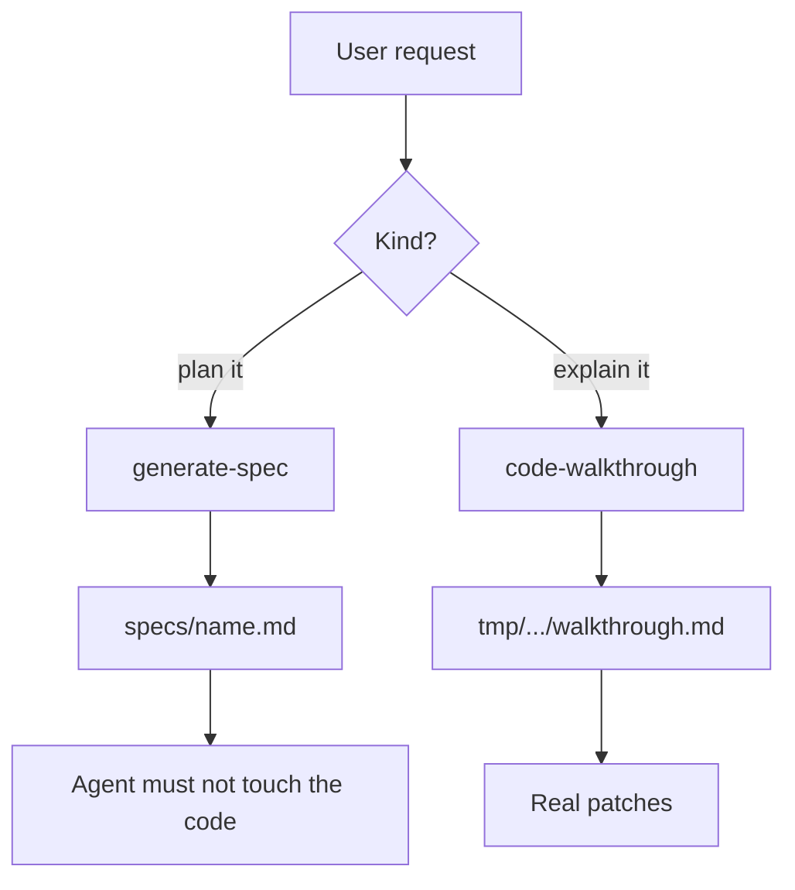
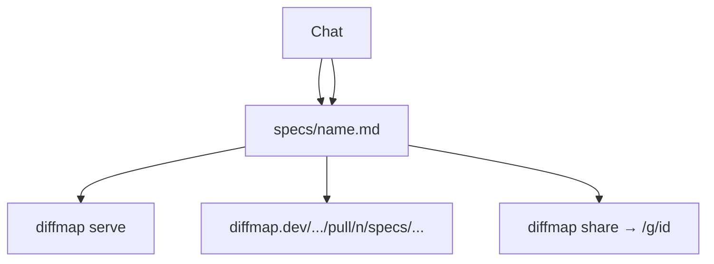
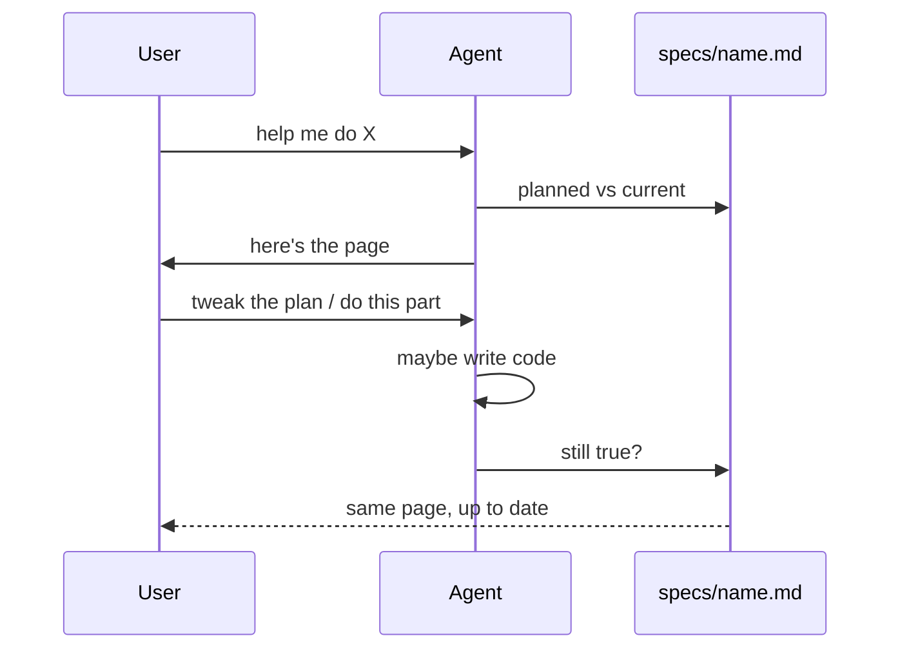

# Merge generate-spec and code-walkthrough

This records the earlier merge. The current skill is [generate-diffmap](../skills/generate-diffmap/SKILL.md), which covers both specs and code walkthroughs.

## Problem overview

The skills fought each other. One wrote a plan and then refused to update it. The other wrote a post-hoc walkthrough in a different folder. You couldn’t watch one page go from “here’s the idea” to “here’s what shipped.”

## Solution overview

Folded both into `generate-spec`. The skill is short: keep a spec that matches the work. Don’t interview forever before there’s a page. Don’t start a second markdown file for the same effort. `code-walkthrough` is the same body under a second install name. README: one `npx skills add tanishqkancharla/diffmap --skill generate-spec`.

Gist share and GitHub-hosted spec URLs already exist. The skill can mention them. Don’t rebuild hosting.

The spec is a picture of the work: **what’s already in the tree, and what’s still planned.** It lives at `specs/<name>.md` for the life of that work. The agent keeps it honest as the plan changes and as code lands. Other people read it from a GitHub PR or a gist — hosting for that is already on main.

Not two skills. Not a walkthrough file you start later. Same doc.

Product is **diffmap** (`tanishqkancharla/diffmap`, npm `@tanishqkancharla/diffmap`, `https://diffmap.dev`). Skill install name stays `generate-spec`. Do not `npm publish`.

### Before the merge



Two opposite skills, two files. The spec never learns what landed. The walkthrough never was the plan.

### After the merge





Call stacks and mermaid are how you _see_ planned vs current. Commit references are only for code that actually landed (a reference to a missing commit or file stops the page from serving). Share is `diffmap share` or push the spec on a PR; `https://diffmap.dev/.../pull/n/path` pins to one SHA.

## Goals

- One spec file the reader can use to see done vs planned.
- It stays current while you plan and while you implement.
- It’s shareable: PR on GitHub (`diffmap.dev/<owner>/<repo>/pull/<n>/<path>`) or `diffmap share` (gist).
- First draft doesn’t invent git patches or inline `diff:path` sketches.
- One install line in the README.

## Non-goals

- A mode picker or a second “walkthrough” product.
- Publishing npm, renaming the skill, or rebuilding gist/PR hosting.
- Viewer reading git for you.

## Implementation

All four phases landed in one squash commit:

```changes
d40b881
```

### ✅ Phase 1: One skill, one living spec

**Today**

`generate-spec` writes a plan and then refuses to update it. `code-walkthrough` writes a separate post-hoc file under `tmp/`.

**Proposed**

Rewrite `generate-spec` around one living spec and drop the counter-equivalent, do-not-implement, and do-not-plan rules. `code-walkthrough` gets the same text under its own `name:`. Both `openai.yaml` prompts and the README install blurb change to match.

Before this phase, an agent picked one of two skills based on whether the user wanted a plan or an explanation. Each skill produced its own file, and neither came back to the other's. After it, the agent always uses `generate-spec`, and that one skill writes the spec, serves it, and keeps it true as work lands:

```callstack
 agent
-├── generate-spec  # plan, then freeze
-└── code-walkthrough  # new tmp file
+└── generate-spec [[skills/generate-diffmap/SKILL.md]]
     ├── write specs/<name>.md
     ├── diffmap serve [[src/cli.ts]]
     └── keep that file true [[d40b881:skills/generate-spec/agents/openai.yaml#L4]]
```

`code-walkthrough` keeps the same body under its own `name:` so existing installs still work, and the README collapses to one install line. The skill file changes are in the commit's Diff panel. The prompt change shows the new promise most directly: the agent keeps the spec up to date instead of writing a phased plan once.

### ✅ Phase 2: Don’t lie in the markdown

**Today**

The skill interviews until the plan is settled, sketches changes as `diff:path` fences, and stops.

**Proposed**

Show planned work with call stacks and Mermaid, and link real commits only after the code lands. Drop the `diff:path` example from the skill.

The old template asked questions until the plan was settled, then wrote the spec with `diff:path` sketches of code that did not exist yet, and stopped. Those sketches looked like real patches, so readers could not tell planned work from landed work. The new template writes planned work as call stacks and returns to the same file once code lands:

```callstack
 generate-spec [[skills/generate-diffmap/SKILL.md]]
-├── Q&A until settled
-├── spec with diff:path sketches
-└── stop
+├── spec with proposed call stacks
+└── later: same file, real commits for what landed
```

Two smaller rules come with it. The agent runs `diffmap list` before `serve` so it reuses a running viewer, and it explains a change in prose instead of linking one that would fail to load.

### ✅ Phase 3: Viewer polish

**Today**

A spec that fails to parse crashes Vite, the title never refreshes after an edit, and Diff stays closed even when the spec has real patches.

**Proposed**

Show a parse error page, re-read the title on each `/__diffmap/meta` request, and open Diff when the spec embeds patches.

A living spec is edited while its viewer is open, so the viewer has to survive a half-written file and keep up with changes.

Parsing happens in the content plugin. Instead of throwing, it now exports the error message alongside a null document, so Vite keeps serving. The entry point reads that export and renders an error page in place of the viewer:

```callstack
 diffmapContentPlugin [[src/contentPlugin.ts#diffmapContentPlugin]]
 └── parseViewerDocument [[src/parseViewer.ts#parseViewerDocument]] [[d40b881:src/contentPlugin.ts#L18]]
-    └── throw
+    └── export parseError [[d40b881:src/contentPlugin.ts#L19-L21]] [[d40b881:src/viewer/main.tsx#L15-L21]]
```

Once a phase lands, its spec carries real patches. `ViewerApp` now opens the Diff panel on load when it finds any, so the reader sees the changed code first:

```callstack
 ViewerApp [[src/viewer/ViewerApp.tsx#ViewerApp]]
-└── leave Diff closed
+└── open Diff when sourceDiffs show up [[d40b881:src/viewer/ViewerApp.tsx#L35-L37]]
```

Last, the title. The server used to report the H1 it read at startup. `/__diffmap/meta` now re-reads the file on each request, so renaming the spec updates the header:

```callstack
 handleDiffmapRequest [[src/serve.ts]]
 └── GET /__diffmap/meta # re-read the H1 from disk [[d40b881:src/serve.ts#L261-L264]] [[d40b881:src/serve.ts#L269]]
```

### ✅ Phase 4: Check it

**Today**

No fixture covers a spec with both landed and planned phases.

**Proposed**

Add a mixed fixture and run the full checks.

The new fixture, [`fixtures/spec-then-implement.md`](../fixtures/spec-then-implement.md), holds one landed phase with real changes and one planned phase with only a call stack, the two states a living spec mixes.

With the fixture in place, `npm run format`, `lint`, `typecheck`, and `test` all passed, and the README no longer describes two opposite skills.

## References

- [`skills/generate-diffmap/SKILL.md`](../skills/generate-diffmap/SKILL.md) — Living spec. Same file for plan and what landed.
- `skills/code-walkthrough/SKILL.md` — Same body, `name: code-walkthrough`.
- [`README.md`](../README.md) — One install line; `serve` / `share` / list.
- [`src/cli.ts`](../src/cli.ts) — `diffmap serve`, `share`, `list`.
- [`src/contentPlugin.ts`](../src/contentPlugin.ts) — Parse errors export `parseError` instead of throwing.
- [`fixtures/spec-then-implement.md`](../fixtures/spec-then-implement.md) — Mixed planned/done fixture.
- [Hosted example of this spec](https://diffmap.dev/tanishqkancharla/diffmap/pull/5/specs/merge-generate-spec-walkthrough.md)
