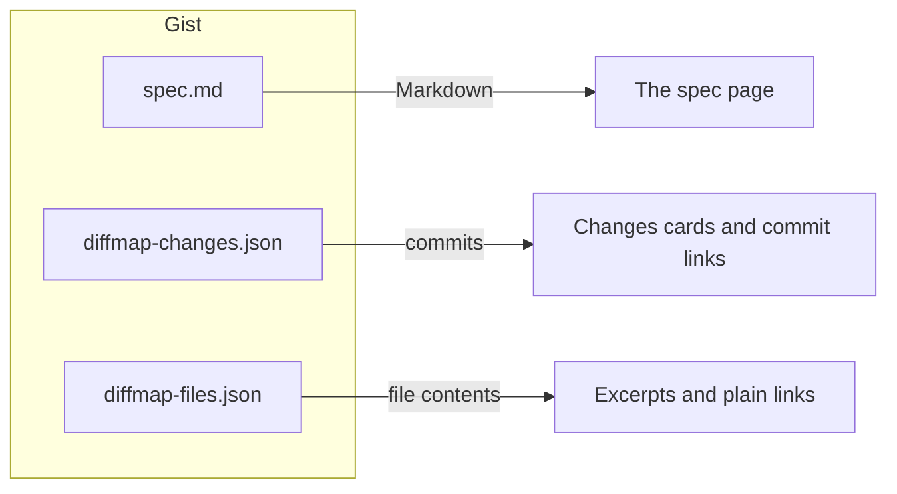

# diffmap

**Your coding agent writes more code than you can review.**

**You should be spending time reviewing design decisions and risky changes, not boilerplate.**

`diffmap` is an agent skill that lets your agent visually explain their changes to you. Agents can create interactive diagrams that link back to the source code.

You can try `diffmap` before you install it. In a repository that has changes, paste this prompt into your agent:

```text
Write a diffmap spec for the changes on this branch. Use github.com/tanishqkancharla/diffmap
```

If you like the result, install the skill:

```sh
npx skills add tanishqkancharla/diffmap --skill generate-diffmap
```

`diffmap` is [open source](https://github.com/tanishqkancharla/diffmap) and MIT licensed. Diffmaps are hosted locally by default, but you can choose to [upload a diffmap as an unlisted gist](#share-a-spec-with-a-link-experimental) and open it on diffmap.dev.

## See the main ideas

Your agent selects the best diagram for each idea. Each part of the diagram has a link to its code.

The examples below explain one made-up pull request. It moves login sessions out of server memory and into Postgres, so a deploy no longer signs everyone out. Click a linked part of a diagram to open its diff.

### Service diagrams

A service diagram shows each service and its state. Each step shows one event and the state that the event changes. Thus, you do not have to remember the state.

A service diagram can also show a change. Red parts exist only today, and green parts are new. As you step, each value shows today's state crossed out next to the new state.

Press **Play** to step through a login before and after the pull request:

```services diff
 service Browser "login page"
   state cookie = none
 service API "HTTP server" [[src/routes/login.ts#login]]
-  service Cache "in-memory sessions"
-    state sessions = 0
+  service Sessions [[src/sessions/store.ts#SessionStore]]
 service Postgres [[migrations/0004_sessions.sql]]
-  state sessions = not used
+  state sessions = 0 rows

 start "Sessions move from memory to Postgres"
   > Alice logs in, and the API stores her session. Today it keeps the session in memory, so a server restart signs her out. After the change, Sessions writes it to Postgres, where it survives a restart.

 step "Alice logs in"
   Browser -> API: POST /login
-step "The API keeps the session in memory"
   API -> Cache: create(alice)
   Cache.sessions = 1
     > The server loses this when it restarts.
+step "Sessions writes the session to Postgres"
   API -> Sessions: create(alice) [[src/sessions/store.ts#SessionStore.create]]
   Sessions -> Postgres: INSERT s_81f [[5e5510a:src/sessions/store.ts#L18-L21]]
   Postgres.sessions = 1 row
     > The row survives a restart.
 step "The API sets the session cookie"
   API -> Browser: 200 Set-Cookie [[5e5510a:src/routes/login.ts#L12]]
   Browser.cookie = sid=s_81f
```

### Mermaid diagrams

A Mermaid diagram can show a change in one picture: green parts are new, and red parts are removed. Each node and each arrow can have a link to its code.

In this pull request, the login route and the sign-in check stop sharing a `Map` inside the server, and both go through `SessionStore`:

```mermaid diff [Sessions move out of server memory]
 flowchart LR
   Login[POST /login] --> LoginRoute[login]
   Orders[GET /orders] --> Guard[requireSession]
-  LoginRoute --> Memory[(Map in server memory)]
-  Guard --> Memory
+  LoginRoute -->|create| Store[SessionStore]
+  Guard -->|find| Store
+  Store -->|SQL| Postgres[(sessions table)]
   %% ref node:LoginRoute [[src/routes/login.ts#login]]
   %% ref node:Guard [[src/middleware/requireSession.ts#requireSession]]
   %% ref node:Store [[src/sessions/store.ts#SessionStore]]
   %% ref node:Postgres [[migrations/0004_sessions.sql]]
   %% ref edge:2 [[5e5510a:src/routes/login.ts#L11]]
   %% ref edge:3 [[5e5510a:src/middleware/requireSession.ts#L9]]
```

### Call stacks

Each row has the form `result = call(inputs)`. Thus, you can follow the data from one call to the next call. A `+` row is new code, and a `−` row is old code that the change removes. Each row has a link to its code.

This call stack shows how a signed-in request finds its session:

```callstack
 response = handle(GET /orders)
 ├── requireSession(req, res, next) [[src/middleware/requireSession.ts#requireSession]]
-│   ├── session = findSession(req.cookies.sid) # a Map lookup in this process
-│   │   └── return sessions.get(id) # empty after every restart
+│   ├── session = await sessions.find(req.cookies.sid) [[src/sessions/store.ts#SessionStore.find]]
+│   │   └── return SELECT … WHERE id = $1 AND expires_at > now() # survives restarts
 │   └── res.locals.session = session
 └── return listOrders(res.locals.session.userId)
```

## Open the code

A function name in a sentence can also be a link, for example [[src/sessions/store.ts#SessionStore.find]].

When the work is complete, the spec shows a card for the commit. The links in the spec then refer to that commit. These links always show the code from that commit, also when the file changes later.

```changes
5e5510a
src/sessions/store.ts
src/middleware/requireSession.ts
src/routes/login.ts
migrations/0004_sessions.sql
```

```callstack
 response = login(req, res) [[5e5510a:src/routes/login.ts#L5-L14]]
-├── session = createSession(user.id) # kept in a Map in the server
+├── session = await sessions.create(user.id) [[5e5510a:src/routes/login.ts#L11]]
+│   └── INSERT INTO sessions (id, user_id, expires_at) [[5e5510a:src/sessions/store.ts#L18-L21]]
 └── res.cookie("sid", session.id) [[5e5510a:src/routes/login.ts#L12]]
```

## Share a spec with a link :badge[Experimental]

A teammate can read your spec without a copy of your branch. One command uploads the spec as an unlisted GitHub gist and prints the link:

```sh
npx @tanishqkancharla/diffmap share specs/search.md
# prints https://diffmap.dev/g/<gistId>
```

::details{summary="How sharing works"}
The shared page cannot use git or a copy of your repository. Thus, the gist also contains the data that the spec uses:

- A snapshot of each commit that the spec refers to
- The current contents of each file that the spec quotes.

Because of this data, this page can show code:



```changes
2f96051
```

`share` makes the two snapshots before it calls `gh`. Thus, `diffmap` does not keep a GitHub token:

```callstack
 result = shareMarkdownFile({ filePath, workspaceRoot }) [[2f96051:src/share.ts#L26-L103]]
 ├── parsed = parseViewerDocument(source)
 ├── if parsed is an error: return parsed # a broken diagram stops here
 ├── changes = readDocumentChanges(workspaceRoot, parsed) # each linked commit
+├── files = readDocumentFiles(workspaceRoot, parsed) # each quoted file [[2f96051:src/share.ts#L105-L125]]
 ├── await gh("auth", "status")
-├── created = await gh("gist", "create", spec, changes)
+├── created = await gh("gist", "create", spec, changes, files)
 └── return { gistId, viewerUrl: gistViewerUrl(gistId) }
```

This excerpt is from one of the quoted files. Thus, a shared copy of this page also shows it:

```54:63:src/share.ts
  // It has no files either, so excerpts and references without a commit read these.
  const files = readDocumentFiles(input.workspaceRoot, parsed);
  if (files instanceof Error) return files;

  const auth = await runGh(["auth", "status"]);
  if (auth instanceof DiffmapShareError) return auth;

  const args = ["gist", "create"];
  if (input.isPublic) args.push("--public");
  args.push("--desc", extractTitle(source), filePath);
```

::
