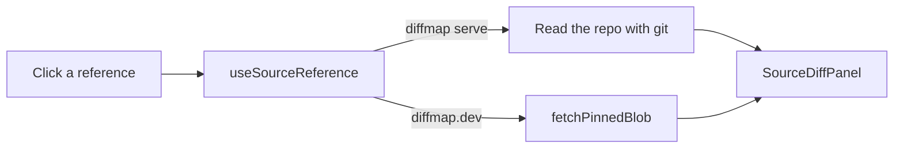
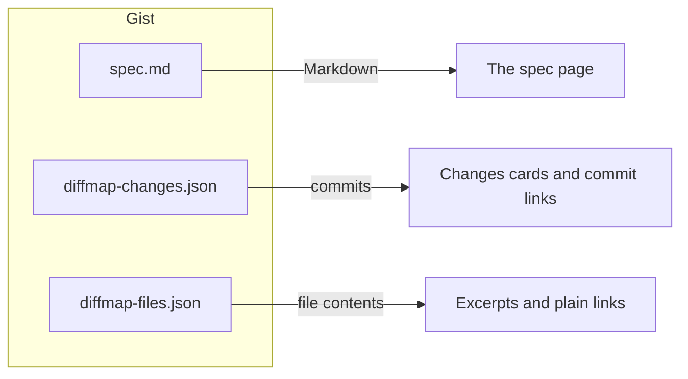

# diffmap

diffmap turns a Markdown file into a page like this one. Your coding agent writes it to show you a change, before and after building it: diagrams you can play, call stacks of what changes, and links that open the code.

Install the skill, then ask your agent to write a diffmap for a change you are planning or for a branch it just built:

```sh
npx skills add tanishqkancharla/diffmap --skill generate-diffmap
```

The agent keeps the spec in `specs/<name>.md`, serves it on your machine, and can share it as a link like this page.

Everything below is an example spec: diffmap's own features, one per phase. Each phase uses the feature it describes. Click a call stack row, a diagram node, or anything marked ↗ to open its code.

## Show a change, not a wall of text

A coding agent explains a change in a long message. You read it, then open each file it names to check that the code says the same thing.

A diffmap puts the explanation next to the code. Each phase says what changes for you, then shows the change as call stacks and diagrams whose parts open the code they name.

### ✅ Phase 1: Call stacks that open the code

**Today**

The agent describes the call path in a paragraph. You search for each function it names and guess how they connect.

**Proposed**

The agent draws the path as data flowing through calls: each row reads `result = call(inputs)`, `+` rows are new, `−` rows go away, and each row opens its code. This is how diffmap draws the tree below:

```callstack
 fence = parseFence(lang, source) [[src/parseFence.ts#parseFence]]
+└── lines = parseCallStack(source) # one row per line, with its links [[src/annotations.ts#parseCallStack]]
 view = Fence({ fence }) [[src/viewer/Fence.tsx#Fence]]
-└── return CodeBlock(fence.source) # the tree as plain text
+├── if fence.kind === "callstack":
+│   └── return CallStackDiff(fence.lines) # rows with + and − marks [[src/viewer/CallStackDiff.tsx#CallStackDiff]]
+└── return CodeBlock(fence.source) # other languages stay pseudocode
```

### ✅ Phase 2: Diagrams you can click

**Today**

The agent draws a flow in ASCII boxes. The boxes do not link to anything, and they break when a label gets long.

**Proposed**

Mermaid diagrams render in the page, and each node or arrow can open its code. Here is what happens when you click a reference:



### ✅ Phase 3: Services you can play

**Today**

A sequence diagram shows the messages between services, but not what each message changes. You keep the state of every service in your head.

**Proposed**

A service diagram shows each service with its state, then steps through the events. Press **Play** to watch `diffmap serve` open a spec, or hover a dotted name to read what it is:

```services
service Laptop
  > Your machine. serve reads files here and uploads nothing.
  service Agent "coding agent"
    > Writes the spec and runs diffmap for you.
  service CLI "diffmap serve" [[src/serve.ts#startServer]]
    > A small server that reads your repo with git.
    state url = none
  service Repo "your repo"
    > Holds the spec and the commits it links to.
service Browser
  service Page "the spec" [[src/viewer/ViewerApp.tsx#ViewerApp]]
    state page = empty
  service Panel "Diff panel" [[src/viewer/SourceDiffPanel.tsx#SourceDiffPanel]]
    > Opens beside the spec and shows the code a reference names.
    state shows = none

step "The agent serves the spec"
  Agent -> CLI: serve specs/search.md
step "serve checks every commit the spec links to"
  CLI -> Repo: readDocumentChanges [[src/git.ts#readDocumentChanges]]
    > A wrong SHA or line range fails here, so you never meet a broken link.
step "serve prints a URL for you"
  CLI -> Agent: localhost URL
  CLI.url = localhost:4321
step "You open the page"
  Page -> CLI: GET /
  CLI -> Page: spec
  Page.page = rendered
step "You click a call stack row"
  Panel -> CLI: /__diffmap/source
  CLI -> Repo: git show
    > Reads the file at the commit the row names, not the working tree.
step "The Diff panel shows the code"
  CLI -> Panel: lines
  Panel.shows = code
```

### ✅ Phase 4: Open code from prose

**Today**

A paragraph names a function as plain code, like `shareMarkdownFile`. You search the repo to find it.

**Proposed**

A function named in a paragraph opens its code too: [[src/share.ts#shareMarkdownFile]].

This phase is done, so it ends the way a finished phase does: with a card for the commit that built it, and references pinned to that commit. Pinned links show the code as the commit left it, even after the file moves on.

```changes
6e4b5d3
```

```callstack
 nodes = fromNode(text) [[6e4b5d3:src/parseViewer.ts#L318-L326]]
-└── return [{ type: "text", value: text }] # prose stays plain text
+└── return proseText(text) [[6e4b5d3:src/parseViewer.ts#L329-L353]]
+    ├── reference = parseReference(match) # each link in double brackets
+    └── return [...textBefore, { type: "reference", annotation }]
 element = renderNode(node) [[6e4b5d3:src/viewer/ComarkView.tsx#L64-L68]]
+└── if node.type === "reference":
+    └── return InlineReference(node.annotation) # a code button that opens the Diff panel [[6e4b5d3:src/viewer/ComarkView.tsx#L173-L189]]
```

### ✅ Phase 5: Share a spec as a link

**Today**

To read a spec, a teammate needs diffmap and a checkout of your repo.

**Proposed**

One command uploads the spec as a secret GitHub gist and prints a link anyone can open:

```sh
npx @tanishqkancharla/diffmap share specs/search.md
# prints https://diffmap.dev/g/<gistId>
```

The page that opens has no git and no checkout, so the gist carries what the spec reads: a snapshot of each commit it links, and the current contents of each file it quotes. That is why this page can show code at all:



```changes
2f96051
```

`share` builds both snapshots before it calls `gh`, so diffmap never stores a GitHub token:

```callstack
 result = shareMarkdownFile({ filePath, workspaceRoot }) [[2f96051:src/share.ts#L26-L103]]
 ├── parsed = parseViewerDocument(source)
 ├── if parsed is an error: return parsed # a broken diagram stops here
 ├── changes = readDocumentChanges(workspaceRoot, parsed) # each linked commit
+├── files = readDocumentFiles(workspaceRoot, parsed) # each quoted file [[2f96051:src/share.ts#L105-L125]]
 ├── await gh("auth", "status")
-├── created = await gh("gist", "create", spec, changes)
+├── created = await gh("gist", "create", spec, changes, files)
 └── return { gistId, viewerUrl: gistViewerUrl(gistId) }
```

This excerpt is one of the quoted files, so a shared copy of this page shows it too:

```54:63:src/share.ts
  // It has no files either, so excerpts and references without a commit read these.
  const files = readDocumentFiles(input.workspaceRoot, parsed);
  if (files instanceof Error) return files;

  const auth = await runGh(["auth", "status"]);
  if (auth instanceof DiffmapShareError) return auth;

  const args = ["gist", "create"];
  if (input.isPublic) args.push("--public");
  args.push("--desc", extractTitle(source), filePath);
```
