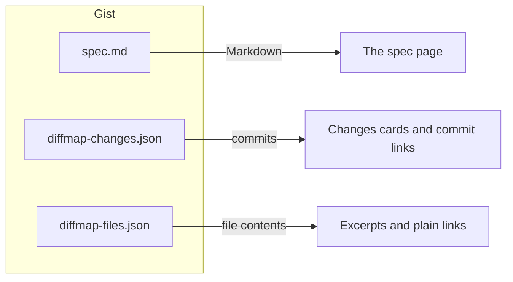

# diffmap

**Your coding agent writes more code than you can review.**

**You should be spending time reviewing design decisions and risky changes, not boilerplate.**

`diffmap` is an agent skill that lets your agent visually explain their changes to you. Agents can create interactive diagrams that link back to the source code.

You can try `diffmap` before you install it. In a repository that has changes, paste this prompt into your agent:

```text
Write a diffmap spec for the changes on this branch. Use the instructions at
https://raw.githubusercontent.com/tanishqkancharla/diffmap/main/skills/generate-diffmap/SKILL.md
Then serve the spec with npx @tanishqkancharla/diffmap and send me the link.
```

If you like the result, install the skill:

```sh
npx skills add tanishqkancharla/diffmap --skill generate-diffmap
```

`diffmap` is [open source](https://github.com/tanishqkancharla/diffmap) and MIT licensed. Diffmaps are hosted locally by default, but you can choose to [upload a diffmap as a secret gist](#share-a-spec-with-a-link) and open it on diffmap.dev.

## See the main ideas

Your agent selects the best diagram for each idea. Each part of the diagram has a link to its code.

### Service diagrams

A service diagram shows each service and its state. Each step shows one event and the state that the event changes. Thus, you do not have to remember the state.

A service diagram can also show a change. Red parts exist only today, and green parts are new. As you step, each value shows today's state crossed out next to the new state.

This change moves login sessions from memory to a database. Press **Play** to step through it:

```services diff
 service Browser "login page"
   state cookie = none
 service API "HTTP server"
-  service Cache "in-memory sessions"
-    state sessions = 0
+  service Sessions
 service Postgres
-  state sessions = not used
+  state sessions = 0 rows

 start "Sessions move from memory to Postgres"
   > Alice logs in, and the API stores her session. Today it keeps the session in memory, so a server restart signs her out. After the change, Sessions writes it to Postgres, where it survives a restart.

 step "Alice logs in"
   Browser -> API: POST /login
-step "The API keeps the session in memory"
   API -> Cache: create(alice)
   Cache.sessions = 1
     > The server loses this when it restarts.
+step "Sessions writes the session to Postgres"
   API -> Sessions: create(alice)
   Sessions -> Postgres: INSERT s_81f
   Postgres.sessions = 1 row
     > The row survives a restart.
 step "The API sets the session cookie"
   API -> Browser: 200 Set-Cookie
   Browser.cookie = sid=s_81f
```

### Mermaid diagrams

The page shows Mermaid diagrams. Each node and each arrow can have a link to its code. A diagram can show a change in one picture: green parts are new, and red parts are removed.

This diagram shows what occurs when you click a link, and what changed when diffmap.dev began to read code from GitHub:

```mermaid diff [diffmap.dev reads linked code from GitHub]
 flowchart LR
   Click[Click a link] --> Find[useSourceReference]
   Find -->|diffmap serve| Local[Read the repo with git]
+  Find -->|diffmap.dev| GitHub[fetchPinnedBlob]
   Local --> Panel[SourceDiffPanel]
+  GitHub --> Panel
   %% ref node:Find [[src/viewer/sourceNavigation.ts#useSourceReference]]
   %% ref node:GitHub [[src/github/fetchRepo.ts#fetchPinnedBlob]]
   %% ref node:Panel [[src/viewer/SourceDiffPanel.tsx#SourceDiffPanel]]
   %% ref edge:1 [[src/viewer/sourceNavigation.ts#requestSource]]
```

### Call stacks

Each row has the form `result = call(inputs)`. Thus, you can follow the data from one call to the next call. A `+` row is new code, and a `−` row is old code that the change removes. Each row has a link to its code.

This call stack shows how `diffmap` draws call stacks:

```callstack
 fence = parseFence(lang, source) [[src/parseFence.ts#parseFence]]
+└── lines = parseCallStack(source) # one row per line, with its links [[src/annotations.ts#parseCallStack]]
 view = Fence({ fence }) [[src/viewer/Fence.tsx#Fence]]
-└── return CodeBlock(fence.source) # the tree as plain text
+├── if fence.kind === "callstack":
+│   └── return CallStackDiff(fence.lines) # rows with + and − marks [[src/viewer/CallStackDiff.tsx#CallStackDiff]]
+└── return CodeBlock(fence.source) # other languages stay pseudocode
```

## Open the code

A function name in a sentence can also be a link, for example [[src/share.ts#shareMarkdownFile]].

When the work is complete, the spec shows a card for the commit. The links in the spec then refer to that commit. These links always show the code from that commit, also when the file changes later.

```changes
6e4b5d3
```

```callstack
 nodes = fromNode(text) [[6e4b5d3:src/parseViewer.ts#L318-L326]]
-└── return [{ type: "text", value: text }] # prose stays plain text
+└── return proseText(text) [[6e4b5d3:src/parseViewer.ts#L329-L353]]
+    ├── reference = parseReference(match) # each link in double brackets
+    └── return [...textBefore, { type: "reference", annotation }]
 element = renderNode(node) [[6e4b5d3:src/viewer/ComarkView.tsx#L64-L68]]
+└── if node.type === "reference":
+    └── return InlineReference(node.annotation) # a code button that opens the Diff panel [[6e4b5d3:src/viewer/ComarkView.tsx#L173-L189]]
```

## Share a spec with a link

A teammate can read your spec without a copy of your branch. One command uploads the spec as a secret GitHub gist and prints the link:

```sh
npx @tanishqkancharla/diffmap share specs/search.md
# prints https://diffmap.dev/g/<gistId>
```

::details{summary="How sharing works"}
The shared page cannot use git or a copy of your repository. Thus, the gist also contains the data that the spec uses:

- A snapshot of each commit that the spec refers to
- The current contents of each file that the spec quotes.

Because of this data, this page can show code:



```changes
2f96051
```

`share` makes the two snapshots before it calls `gh`. Thus, `diffmap` does not keep a GitHub token:

```callstack
 result = shareMarkdownFile({ filePath, workspaceRoot }) [[2f96051:src/share.ts#L26-L103]]
 ├── parsed = parseViewerDocument(source)
 ├── if parsed is an error: return parsed # a broken diagram stops here
 ├── changes = readDocumentChanges(workspaceRoot, parsed) # each linked commit
+├── files = readDocumentFiles(workspaceRoot, parsed) # each quoted file [[2f96051:src/share.ts#L105-L125]]
 ├── await gh("auth", "status")
-├── created = await gh("gist", "create", spec, changes)
+├── created = await gh("gist", "create", spec, changes, files)
 └── return { gistId, viewerUrl: gistViewerUrl(gistId) }
```

This excerpt is from one of the quoted files. Thus, a shared copy of this page also shows it:

```54:63:src/share.ts
  // It has no files either, so excerpts and references without a commit read these.
  const files = readDocumentFiles(input.workspaceRoot, parsed);
  if (files instanceof Error) return files;

  const auth = await runGh(["auth", "status"]);
  if (auth instanceof DiffmapShareError) return auth;

  const args = ["gist", "create"];
  if (input.isPublic) args.push("--public");
  args.push("--desc", extractTitle(source), filePath);
```

::
